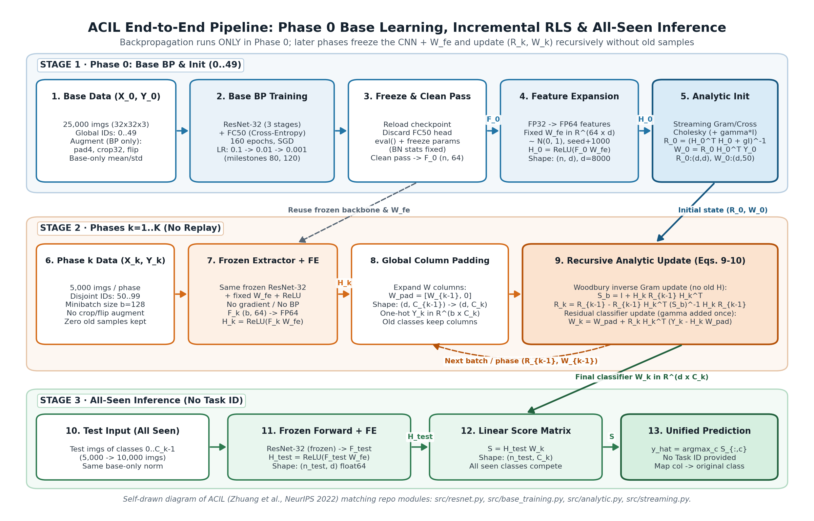
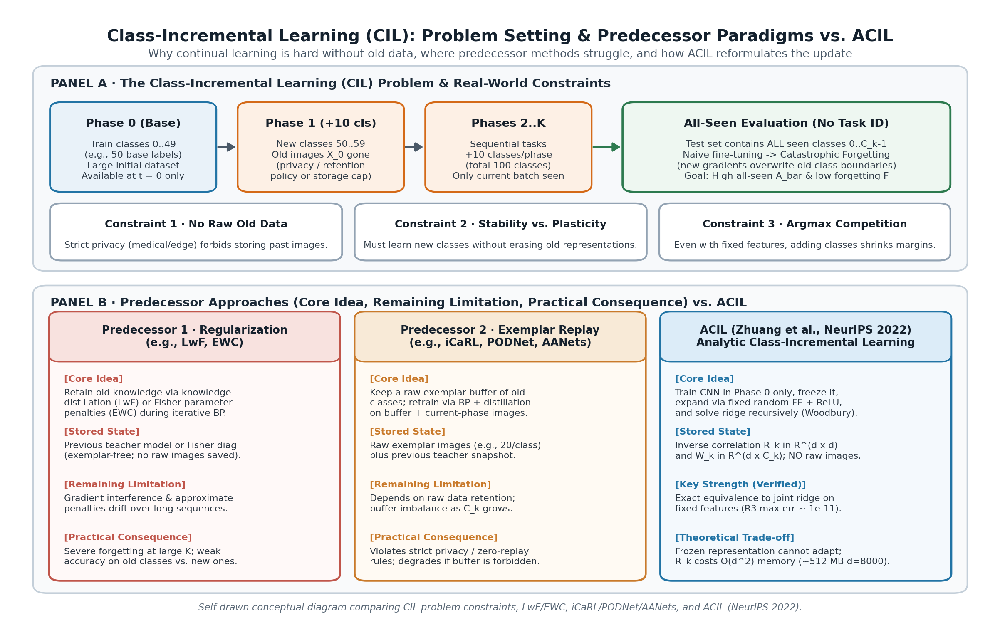

# ACIL — Reproduction and Analysis

Đồ án Nhập môn Máy học: đọc, tự triển khai, tái lập và phản biện **ACIL**, NeurIPS 2022.

| Thành viên | Phụ trách chính                                                       |
| ------------ | ------------------------------------------------------------------------ |
| Sang         | Phương pháp, analytic head, kiểm chứng joint/phase/minibatch và R3 |
| Vĩ          | Dataset, protocol, backbone, Kaggle và R1                               |
| Phát        | Metrics, W&B, ablation R2, bằng chứng và tổng hợp kết quả         |

## Hiện trạng

- [Tài liệu Reading the Paper — ACIL (NeurIPS 2022), 11/11/2026](docs/READING_THE_PAPER_ACIL.md): đầy đủ ví dụ thực tế tự đặt, phân tích 3 nhóm phương pháp tiền nhiệm (LwF, iCaRL, PODNet/AANets), phân loại đóng góp & tính mới, phân tích phương pháp 5 lớp (ký hiệu, pipeline, What/Why/How, chứng minh & điều kiện giới hạn Định lý 3.1 / Absolute Memorization / Privacy, độ phức tạp thời gian–không gian đối chiếu tiền nhiệm) và danh mục trích dẫn chuẩn IEEE cho Slide Deck giữa kỳ.
- [Kịch bản 36 Slides Giữa kỳ (Main 32 + Appendix 4), 12/11/2026](docs/KICH_BAN_36_SLIDE_GIUA_KY.md): kịch bản chi tiết từng slide kèm bố cục trực quan, bảng số liệu, link W&B public, footer trích dẫn IEEE từng slide và Speaker Notes chuẩn hóa ($\le 500$ từ/slide).
- [Báo cáo tổng hợp thực nghiệm giữa kỳ, 07/11/2026](reports/BAO_CAO_THUC_NGHIEM_GIUA_KY_20261107.md): R1/R2/R3 đã đủ kết quả; đã có [đối chiếu tác giả](reports/AUTHOR_CODE_COMPARISON_20261107.md); còn hoàn thiện PPTX. Gồm protocol, số liệu, giải thích thay đổi, giới hạn và bảng notebook–version–W&B.
- [Báo cáo cập nhật chuẩn repo và sơ đồ tự vẽ, 11/11/2026](reports/CAP_NHAT_REPO_VA_SO_DO_20261111.md): đồng bộ PR #22, bổ sung 2 sơ đồ tự vẽ trong `reports/figures/`, bảng ánh xạ thực nghiệm thống nhất, giải thích thư viện ngoài standard stack và docstring 3 phần cho toàn bộ `src/`.
- Đã có module analytic hỗ trợ nhãn toàn cục và minibatch; notebook/CLI dùng cùng source.
- Đã có test độc lập cho phương pháp và thứ tự log W&B/xuất JSON.
- VERIFY-01 là mốc lịch sử trên dữ liệu tổng hợp. VERIFY-02 kiểm tra thêm minibatch.
- Pipeline CIFAR smoke đã có lượt CUDA đủ 100 lớp: [JSON](reports/cifar100_kaggle_full5_results.json), [Kaggle scriptVersionId 365084714](https://www.kaggle.com/code/hsangg206/03-cifar100-safe-attempts/output?scriptVersionId=365084714), [W&B blhw74ff](https://wandb.ai/hsangg-2006/acil-reproduction/runs/blhw74ff) finished. W cuối 256×100, test 10.000 ảnh, accuracy 22,05%, mọi check đạt; source/config hashes đã đối chiếu. Đây là smoke 2 epochs/d256.
- Đã có resume CPU/CUDA, streaming analytic, profile d8000 và BP5; các bằng chứng lịch sử giữ riêng trong [danh mục](reports/README.md). **R1 hoàn tất 3 seeds 42/43/44**, mỗi seed 160 epochs/d8000/gamma0.1/K5. Ā **65,1196 ± 0,6104%**, final **56,1300 ± 0,5575%**, F_base **8,3067 ± 0,6201pp** (mean ± sample SD, n=3, ddof=1). Cả 3 W&B Finished/công khai; [báo cáo](reports/R1_CIFAR100_K5_3SEEDS_20261106.md), [summary JSON](reports/r1_cifar100_k5_summary.json), [manifest](reports/R1-C100-K5-3SEEDS-provenance.json). R2 và R3 cũng đã hoàn tất theo kế hoạch; đã có [đối chiếu tác giả](reports/AUTHOR_CODE_COMPARISON_20261107.md); đã soạn xong nội dung `Reading the Paper` & kịch bản 36 slides, còn xuất file `.pptx` nộp giữa kỳ. [Trạng thái ngắn cho Sang](docs/BUOC_TIEP_THEO_SANG.md).
- **R2 hoàn tất ngày 07/11/2026:** 9 lượt analytic mới trên seeds 42/43/44 và 3 baseline R1 tái dùng, đủ 4 hàng/3 seeds. [Báo cáo R2](reports/R2_CIFAR100_K5_20261107.md), [summary](reports/r2_cifar100_k5_summary.json), [manifest](reports/R2-C100-K5-provenance.json). Cả 9 W&B mới Finished/công khai; không train thêm backbone. Phạm vi 4/5 hàng Table 2, không có gamma 0.
- **R3 hoàn tất 07/11/2026:** batch 32/128/512 × 3 timing repeats trên một seed 42/d1024; 9 tiến trình CPU riêng, 54 so sánh phase khớp joint và 0 argmax khác. 9 W&B Finished/công khai. [Báo cáo](reports/R3_CIFAR100_K5_BATCH_20261107.md), [summary](reports/r3_cifar100_k5_summary.json), [manifest](reports/R3-C100-K5-provenance.json). Đây là 3 lần đo thời gian, không phải 3 seed benchmark.
- **Đã chạy code tác giả ngày 07/11/2026:** 2 lượt chính full CIFAR100/K5 trên cùng checkpoint 160 seed 42/d1024 và 1 diagnostic state base. [Báo cáo](reports/AUTHOR_CODE_COMPARISON_20261107.md), [raw JSON](reports/author_comparison_results.json), [manifest](reports/AUTHOR-COMPARE-01-provenance.json). C1 dự đoán khớp 6/6 mốc nhưng 2 phần tử score ngoài tolerance; C2 đạt 6/6; matched-base diagnostic đạt 5/5. Ba W&B Finished/public vẫn giữ flag C1=false. Chưa chạy recipe native 300 epochs/d8192.
- Project W&B: [hsangg-2006/acil-reproduction](https://wandb.ai/hsangg-2006/acil-reproduction), đã xác nhận Public ngày 02/11/2026.

## Cấu trúc và cách chạy

Mở thư mục gốc **`20-ML-Paper`** làm thư mục dự án trong VS Code. Cấu trúc đang dùng:

```text
20-ML-Paper/
├── src/                          # Code nhóm tự viết
│   ├── analytic.py               # Analytic head: phương trình (4), (9), (10) và joint ridge tham chiếu
│   ├── verification.py           # Dữ liệu tổng hợp, so joint/phase/minibatch
│   ├── verify_analytic.py        # CLI chạy VERIFY-02
│   ├── cifar_data.py             # Tải CIFAR-100, chia lớp theo seed, normalization từ base train
│   ├── resnet.py                 # ResNet-32 cho CIFAR
│   ├── base_training.py          # Base training bằng BP, checkpoint và resume theo epoch
│   ├── cifar_smoke.py            # Pipeline smoke có joint oracle
│   ├── streaming.py              # Pipeline benchmark không giữ dữ liệu phase cũ
│   ├── metrics.py                # Ā, final accuracy, F_base
│   ├── profile_analytic.py       # Đo thời gian/RAM cho analytic d=8000
│   ├── verify_resume.py          # Kiểm chạy liên tục so với resume
│   ├── run_attempt.py            # Thư mục và trạng thái riêng cho từng lượt chạy
│   ├── reporting.py              # Xuất JSON, source hashes, W&B
│   └── notebook_bundle.py        # Đóng gói source vào notebook Kaggle
├── tests/                        # Unit test cho các module trong src/
├── notebooks/
│   ├── 01_verify_analytic_update.ipynb      # VERIFY-01/02
│   ├── 02_cifar100_smoke.ipynb              # Smoke 50+10 lớp
│   ├── 03_cifar100_safe_attempts.ipynb      # Smoke đủ 100 lớp
│   ├── 04_resume_benchmark_profile.ipynb    # Profile d=8000 và BP5
│   ├── 05_profile_base_ready.ipynb          # Bản dựng lại của profile BP5
│   ├── 06_benchmark_seed42_ready.ipynb      # R1 seed 42
│   ├── 07_benchmark_seed43_ready.ipynb      # R1 seed 43
│   ├── 08_benchmark_seed44_ready.ipynb      # R1 seed 44
│   ├── 09_r2_ablation_seed42.ipynb          # R2 seed 42
│   ├── 10_r2_ablation_seed43.ipynb          # R2 seed 43
│   ├── 11_r2_ablation_seed44.ipynb          # R2 seed 44
│   ├── 12_r3_batch_analysis.ipynb           # R3
│   └── archive/
├── scripts/
│   ├── build_*.py                # Tạo notebook từ source hiện tại
│   ├── r2_runner.py, r3_runner.py, r3_worker.py   # Chạy R2/R3
│   ├── aggregate_r1.py, aggregate_r2.py, aggregate_r3.py   # Tổng hợp mean ± SD từ JSON
│   ├── plot_r1.py, plot_r2.py, plot_r3.py   # Vẽ hình trong reports/figures/
│   ├── plot_acil_diagrams.py             # Tự vẽ sơ đồ pipeline ACIL và bài toán/tiền nhiệm
│   ├── compare_author_acil.py, diagnose_author_base_precision.py   # Chạy đối chiếu code tác giả
│   ├── aggregate_author_comparison.py, plot_author_comparison.py, track_author_comparison.py
│   ├── reconcile_r3_tracking.py
│   └── tests/                    # Test cho scripts R3 và đối chiếu tác giả
├── configs/
│   ├── verify_analytic_update.json
│   ├── cifar100_smoke.json
│   └── cifar100_benchmark_k5.json          # Cấu hình R1
├── docs/
│   ├── READING_THE_PAPER_ACIL.md     # Nội dung đọc hiểu học thuật đầy đủ (Reading the Paper)
│   ├── KICH_BAN_36_SLIDE_GIUA_KY.md  # Kịch bản 36 slides giữa kỳ kèm Speaker Notes & IEEE footers
│   ├── protocol_chot.md          # Protocol benchmark v1.0
│   ├── metrics.md                # Định nghĩa metric v1.0
│   ├── Dac_ta_ACIL.md            # Đặc tả module analytic
│   ├── PHAN_CONG_NHOM.md
│   ├── R3_KE_HOACH_DO.md, DOI_CHIEU_CODE_TAC_GIA_KE_HOACH.md   # Kế hoạch đăng ký trước khi chạy
│   ├── HUONG_DAN_*.md, CHAY_KAGGLE_BANG_API.md, RESUME_BENCHMARK_PROFILE.md   # Hướng dẫn chạy
│   └── SUA_LOI_*.md, THAY_DOI_*.md, BUOC_TIEP_THEO_SANG.md   # Nhật ký thay đổi
├── reports/
│   ├── BAO_CAO_THUC_NGHIEM_GIUA_KY_20261107.md   # Báo cáo tổng hợp R1/R2/R3 và đối chiếu tác giả
│   ├── CAP_NHAT_REPO_VA_SO_DO_20261111.md        # Báo cáo cập nhật sơ đồ tự vẽ, mapping README và docstring src/
│   ├── R1_*.md, R2_*.md, R3_*.md, AUTHOR_CODE_COMPARISON_*.md, REVIEW_*.md   # Báo cáo từng bộ
│   ├── r1_*_summary.json, r2_*_summary.json, r3_*_summary.json   # Số liệu tổng hợp
│   ├── *_results.json, *_ready.json, *_progress.json   # JSON gốc từng lượt chạy
│   ├── *-provenance.json         # Manifest: source, version Kaggle, W&B, SHA-256
│   ├── figures/                  # Hình R1/R2/R3, đối chiếu tác giả và sơ đồ tự vẽ (pipeline, bài toán/tiền nhiệm)
│   ├── archive/                  # JSON gốc trước khi đồng bộ tracking và các lượt lỗi được giữ lại
│   └── README.md                 # Danh mục bằng chứng
├── requirements-verification.txt # Chỉ NumPy, cho module analytic
├── requirements-tracking.txt     # + wandb
├── requirements-cifar.txt        # + PyTorch, dữ liệu, SciPy
├── requirements-dev.txt          # + chạy notebook local
├── requirements-plots.txt        # matplotlib cho hình báo cáo
├── requirements-author-comparison.txt   # Môi trường riêng cho code tác giả
├── .gitattributes
├── .gitignore
└── README.md
```

`.git/`, `.venv/` và `reports/local/` là thư mục dùng trên máy; không đưa lên GitHub. `configs/`, các module reporting/verification và test tracking được giữ vì notebook VERIFY-02 đang dùng chúng.

| Đường dẫn | Nội dung |
|---|---|
| `src/` | Code nhóm tự viết: analytic head, dữ liệu, backbone, training, pipeline, metric |
| `tests/`, `scripts/tests/` | Unit test cho phương pháp, pipeline, resume, metric, tracking và các script phân tích |
| `notebooks/` | Notebook chạy trên Kaggle; từ notebook 02 trở đi, source được đóng gói sẵn trong notebook |
| `scripts/` | Tạo notebook, chạy R2/R3, tổng hợp số liệu, vẽ hình, đối chiếu code tác giả |
| `configs/` | Cấu hình VERIFY-02, smoke và benchmark R1 |
| `docs/` | Protocol, định nghĩa metric, đặc tả, hướng dẫn chạy và phân công |
| `reports/` | Kết quả đã công bố, manifest và hình; `reports/local/` bị Git bỏ qua |

Từ thư mục gốc, Python 3.10 trở lên; môi trường local được kiểm tra bằng Python 3.12:

```bash
python -m pip install -r requirements-verification.txt
python -m unittest discover -s tests -v
python -m src.verify_analytic
```

NumPy được khóa 2.1.3. W&B là tùy chọn; khi cần tracking:

```bash
python -m pip install -r requirements-tracking.txt
python -m src.verify_analytic --wandb --entity hsangg-2006 --project acil-reproduction
```

`requirements-dev.txt` dành cho chạy/kiểm tra notebook cục bộ bằng nbclient và ipykernel; không bắt buộc để chạy core hoặc bộ unit test.

Local dùng thông tin đăng nhập/env đã cấu hình, không ghi credential vào source. JSON mặc định ở `reports/local/verify_02_results.json`; tracking tắt ghi `not_logged`, URL null. Khi init/log/finish lỗi, file ghi `failed` và lệnh trả lỗi. `logged` chỉ được ghi sau khi run context kết thúc thành công.

## Chạy notebook trên Kaggle

1. Import notebook 01, chọn Python, Accelerator **None**, bật Internet.
2. Notebook tự lấy source từ GitHub khi không chạy trong checkout của repo. `SOURCE_REF` mặc định main; có thể đặt commit cụ thể để tái lập. Commit và source hashes thật được lưu vào JSON.
3. Bật secret `WANDB_API_KEY` cho notebook nếu dùng tracking. Mặc định log vào project nhóm; SDK khóa 0.28.1. Có thể tắt `LOG_WANDB` ở cell đầu để chỉ kiểm chứng.
4. Run All hoặc Save & Run All; kiểm tra VERIFY-02 COMPLETE và test đạt.
5. Lấy `verify_analytic_update_v2_results.json` từ Output. URL trong file phải là URL từ chính run vừa hoàn thành.
6. Cập nhật bảng bằng chứng bằng đúng version, commit nguồn và JSON của cùng lượt chạy. Không điền run ID cố định vào source.

[Hướng dẫn Kaggle chi tiết](docs/HUONG_DAN_KAGGLE.md). Notebook tự chọn đường dẫn output cho Kaggle/local; không bắt máy cá nhân phải có `/kaggle/working`. Trên máy cá nhân muốn tắt tracking, đặt `ACIL_LOG_WANDB=0` trước khi mở kernel hoặc đổi `LOG_WANDB` trong cell thiết lập.

Bộ test phương pháp kiểm tra ba seed, joint/phase/minibatch, lớp xuất hiện lại, state đầu vào không bị sửa, feature thiếu hạng với gamma dương và input không hợp lệ. Test reporting giả lập SDK, không cần đăng nhập W&B. Config dùng chung giữ seed 42, gamma 1, input 16, feature 24, 3 phase × 2 lớp, minibatch 7, float64 cùng các ngưỡng `rtol`/`atol`.

## Chạy CIFAR một mình

Sang hiện thực hiện một mình; không cần chờ bàn giao từ Vĩ để chạy smoke. [Hướng dẫn CIFAR 50+10](docs/HUONG_DAN_CIFAR_SMOKE.md) có bước chạy local/Kaggle và cách đọc kết quả.

```bash
python -m pip install -r requirements-cifar.txt
python -B -m src.cifar_smoke
```

Lệnh mặc định tải dữ liệu, train base 2 epochs, freeze ResNet-32/BatchNorm, expansion 256, chạy một phase mới và kiểm joint trên đủ 60 lớp. API dùng chính `src/analytic.py`; metadata mapping thuộc pipeline. Root output là `reports/local/cifar100_smoke/`; artifact đầy đủ nằm trong `attempts/<attempt_id>/`. Các test ảnh/attempt được skip rõ ràng nếu thiếu dependency CIFAR; 15 test core/tracking/metrics vẫn chạy với NumPy.

Analytic d8000 và BP5/CUDA resume đã đạt. BP5 chạy qua API trong [Version 3 /365703432](https://www.kaggle.com/code/hsangg206/04-resume-benchmark-profile/output?scriptVersionId=365703432); không cần chạy 05 lại. **[Notebook 06](notebooks/06_benchmark_seed42_ready.ipynb)** đã đặt R1 seed 42/160 epochs/d8000/K5, checkpoint đầu vào=None, offline W&B để sync sau. [Hướng dẫn API](docs/CHAY_KAGGLE_BANG_API.md) và [budget](reports/benchmark_seed42_budget.json) giải thích timeout 2 giờ. R1 seed 42 đã chạy xong 160 epochs/đủ 5 phase: [JSON](reports/benchmark_seed42_kaggle_results.json), [W&B zt1014ei](https://wandb.ai/hsangg-2006/acil-reproduction/runs/zt1014ei); không cần chạy 06 lại để lấy bằng chứng. Script `python scripts/build_profile_base_notebook.py` tạo 05 từ cùng bundle 04; giữ 04 làm snapshot của bằng chứng mới. Generator cũ `python -m src.notebook_bundle` vẫn mặc định tạo 04: không dùng để ghi đè snapshot đã công bố. `benchmark` dùng preset 160 epochs khi đã qua gate. `--resume-checkpoint` tiếp tục BP đang dở; `--reuse-checkpoint` dùng base đã hoàn tất.

Mỗi lần gọi pipeline tạo một attempt riêng. Root `latest.json`, `progress.json`, `results.json` có cùng attempt ID và trạng thái mới nhất: `running`, `complete` hoặc `failed`. Chỉ nhận kết quả khi `status=complete` và `verification_passed=true`; lấy checkpoint/state từ `output_dir` trong report. Nếu lượt mới lỗi, root ghi failed/false; dữ liệu lượt trước vẫn ở thư mục riêng. [Giải thích và test hồi quy](docs/SUA_LOI_TRANG_THAI_RUN.md).

`filelock` bảo vệ metadata root khi nhiều lượt cùng ghi; JSON trạng thái được ghi qua file tạm rồi replace. Đây là hạ tầng lưu kết quả, không tham gia công thức analytic. [Tài liệu filelock](https://py-filelock.readthedocs.io/en/latest/).

## Sơ đồ phương pháp và bài toán (tự vẽ)

Hai sơ đồ minh họa phục vụ slide đọc hiểu giữa kỳ được tự dựng bằng Matplotlib qua [`scripts/plot_acil_diagrams.py`](scripts/plot_acil_diagrams.py) (cài môi trường vẽ `requirements-plots.txt` rồi chạy `python scripts/plot_acil_diagrams.py`; không cắt dán hình từ PDF bài báo):

- **Sơ đồ pipeline end-to-end của ACIL:** [`reports/figures/acil_pipeline_end_to_end.png`](reports/figures/acil_pipeline_end_to_end.png) — trình bày đầy đủ 3 giai đoạn từ Base BP Training (`ResNet-32` + `FC50`, 160 epochs) $\rightarrow$ Freeze backbone & Random Feature Expansion $W_{\mathrm{fe}}$ $\rightarrow$ Analytic Ridge Initialization (`R_0`, `W_0`) $\rightarrow$ Incremental Woodbury/Residual Updates (`R_k`, `W_k`, không giữ mẫu cũ) $\rightarrow$ Suy luận hợp nhất (`argmax` trên toàn bộ lớp đã thấy).
- **Minh họa bài toán CIL và đối chiếu tiền nhiệm:** [`reports/figures/acil_problem_and_predecessors.png`](reports/figures/acil_problem_and_predecessors.png) — tóm tắt bối cảnh học tăng dần lớp, 3 ràng buộc cốt lõi (*no raw old data*, *stability–plasticity*, *argmax competition*) và đối chiếu cấu trúc (*core idea*, *stored state*, *remaining limitation*, *practical consequence*) giữa hướng Regularization (LwF/EWC), Exemplar Replay (iCaRL/PODNet/AANets) và ACIL.





## Bằng chứng thí nghiệm

### Bảng ánh xạ toàn bộ thực nghiệm (Experiment Mapping)

Bảng tổng hợp dưới đây ánh xạ từng lượt thí nghiệm tới notebook/script tạo ra kết quả, link W&B công khai và 1 dòng tóm tắt kết quả/ý nghĩa của lượt chạy:

| Thí nghiệm | Notebook / Script tạo kết quả | W&B run | Kết quả chính (1 dòng) |
|---|---|---|---|
| `VERIFY-01` | [`notebooks/01_verify_analytic_update.ipynb`](notebooks/01_verify_analytic_update.ipynb) | [7aeaupq7](https://wandb.ai/hsangg-2006/acil-reproduction/runs/7aeaupq7) Finished | Khớp nghiệm joint ridge trên dữ liệu tổng hợp theo phase (max abs W error `~1.84e-14`). |
| `VERIFY-02` | [`notebooks/01_verify_analytic_update.ipynb`](notebooks/01_verify_analytic_update.ipynb) / [`src/verify_analytic.py`](src/verify_analytic.py) | [wi4wau2d](https://wandb.ai/hsangg-2006/acil-reproduction/runs/wi4wau2d) Finished | Đạt 11/11 tests; cập nhật minibatch khớp joint trong `rtol=1e-8` (max rel W `~3.43e-13`), 0 argmax khác. |
| `CIFAR-SMOKE-01` | [`src/cifar_smoke.py`](src/cifar_smoke.py) (local CPU) | Tắt tracking (offline) | Kiểm tra end-to-end 2 epochs/d256 (50+10 lớp) trên CPU local trước khi chạy GPU Kaggle. |
| `CIFAR-KAGGLE-01` | [`notebooks/02_cifar100_smoke.ipynb`](notebooks/02_cifar100_smoke.ipynb) | [o2r63pj2](https://wandb.ai/hsangg-2006/acil-reproduction/runs/o2r63pj2) Finished | Smoke GPU 2 epochs/d256 (50→60 lớp): base 32,58%, 60 lớp 29,70%, khớp joint oracle. |
| `CIFAR-KAGGLE-02` | [`notebooks/03_cifar100_safe_attempts.ipynb`](notebooks/03_cifar100_safe_attempts.ipynb) | [blhw74ff](https://wandb.ai/hsangg-2006/acil-reproduction/runs/blhw74ff) Finished | Smoke GPU đủ 5 phase (50→100 lớp, W 256×100, 10.000 ảnh test), final 22,05%, khớp joint 6/6 mốc. |
| `PROFILE-KAGGLE-01` | [`notebooks/04_resume_benchmark_profile.ipynb`](notebooks/04_resume_benchmark_profile.ipynb) (V1) | [gey0yop4](https://wandb.ai/hsangg-2006/acil-reproduction/runs/gey0yop4) Finished | Đo tài nguyên d8000 trên subset Kaggle T4 (cửa sổ profile 34,07s; peak RSS ~3,20 GB) trước benchmark dài. |
| `BP5-KAGGLE-01` | [`notebooks/04_resume_benchmark_profile.ipynb`](notebooks/04_resume_benchmark_profile.ipynb) (V3) / [`notebooks/05_profile_base_ready.ipynb`](notebooks/05_profile_base_ready.ipynb) | [pv82dy1f](https://wandb.ai/hsangg-2006/acil-reproduction/runs/pv82dy1f) Finished | Xác nhận 5 epochs BP thật (76,11s), checkpoint v2 và CUDA resume proof đạt (53/54 tests, 1 snapshot skip). |
| `R1 / seed 42` | [`notebooks/06_benchmark_seed42_ready.ipynb`](notebooks/06_benchmark_seed42_ready.ipynb) | [zt1014ei](https://wandb.ai/hsangg-2006/acil-reproduction/runs/zt1014ei) Finished | Benchmark chính seed 42 (160 epochs, d8000, K5): Ā `65,1646%`, final `55,87%`, F_base `8,32 pp`. |
| `R1 / seed 43` | [`notebooks/07_benchmark_seed43_ready.ipynb`](notebooks/07_benchmark_seed43_ready.ipynb) | [v51m2dan](https://wandb.ai/hsangg-2006/acil-reproduction/runs/v51m2dan) Finished | Benchmark chính seed 43 (160 epochs, d8000, K5): Ā `65,7062%`, final `56,77%`, F_base `8,92 pp`. |
| `R1 / seed 44` | [`notebooks/08_benchmark_seed44_ready.ipynb`](notebooks/08_benchmark_seed44_ready.ipynb) | [vqcs1ql4](https://wandb.ai/hsangg-2006/acil-reproduction/runs/vqcs1ql4) Finished | Benchmark chính seed 44 (160 epochs, d8000, K5): Ā `64,4880%`, final `55,75%`, F_base `7,68 pp`. |
| `R2 / seed 42 (3 ca mới)` | [`notebooks/09_r2_ablation_seed42.ipynb`](notebooks/09_r2_ablation_seed42.ipynb) | [xdrm0d27](https://wandb.ai/hsangg-2006/acil-reproduction/runs/xdrm0d27) · [qcgdklxh](https://wandb.ai/hsangg-2006/acil-reproduction/runs/qcgdklxh) · [3yp99ewh](https://wandb.ai/hsangg-2006/acil-reproduction/runs/3yp99ewh) | Ablation seed 42: No-FE/γ=0.1 (`53,3970%`), FE8000/γ=0.01 (`65,1606%`), FE8000/γ=0.001 (`65,1576%`). |
| `R2 / seed 43 (3 ca mới)` | [`notebooks/10_r2_ablation_seed43.ipynb`](notebooks/10_r2_ablation_seed43.ipynb) | [7wgme4so](https://wandb.ai/hsangg-2006/acil-reproduction/runs/7wgme4so) · [xfleip26](https://wandb.ai/hsangg-2006/acil-reproduction/runs/xfleip26) · [aler6nj2](https://wandb.ai/hsangg-2006/acil-reproduction/runs/aler6nj2) | Ablation seed 43: No-FE/γ=0.1 (`53,4313%`), FE8000/γ=0.01 (`65,7034%`), FE8000/γ=0.001 (`65,7034%`). |
| `R2 / seed 44 (3 ca mới)` | [`notebooks/11_r2_ablation_seed44.ipynb`](notebooks/11_r2_ablation_seed44.ipynb) | [81aci8h1](https://wandb.ai/hsangg-2006/acil-reproduction/runs/81aci8h1) · [dub202jk](https://wandb.ai/hsangg-2006/acil-reproduction/runs/dub202jk) · [l9c50ezb](https://wandb.ai/hsangg-2006/acil-reproduction/runs/l9c50ezb) | Ablation seed 44: No-FE/γ=0.1 (`52,9357%`), FE8000/γ=0.01 (`64,4880%`), FE8000/γ=0.001 (`64,4880%`). |
| `R3 / batch 32 (3 repeats)` | [`notebooks/12_r3_batch_analysis.ipynb`](notebooks/12_r3_batch_analysis.ipynb) / [`scripts/r3_runner.py`](scripts/r3_runner.py) | [luf7uv40](https://wandb.ai/hsangg-2006/acil-reproduction/runs/luf7uv40) · [yqxph1bb](https://wandb.ai/hsangg-2006/acil-reproduction/runs/yqxph1bb) · [59vlfxzv](https://wandb.ai/hsangg-2006/acil-reproduction/runs/59vlfxzv) | Batch 32 (d1024, seed 42): tổng analytic `17,3334 ± 0,0784 s`, peak RSS `151,35 MiB`, 18/18 mốc khớp joint. |
| `R3 / batch 128 (3 repeats)` | [`notebooks/12_r3_batch_analysis.ipynb`](notebooks/12_r3_batch_analysis.ipynb) / [`scripts/r3_runner.py`](scripts/r3_runner.py) | [o54hbdfp](https://wandb.ai/hsangg-2006/acil-reproduction/runs/o54hbdfp) · [4481bnn1](https://wandb.ai/hsangg-2006/acil-reproduction/runs/4481bnn1) · [3gv0moj7](https://wandb.ai/hsangg-2006/acil-reproduction/runs/3gv0moj7) | Batch 128 (d1024, seed 42): tổng analytic `6,9247 ± 0,1098 s`, peak RSS `146,10 MiB` (thấp nhất), 18/18 mốc khớp joint. |
| `R3 / batch 512 (3 repeats)` | [`notebooks/12_r3_batch_analysis.ipynb`](notebooks/12_r3_batch_analysis.ipynb) / [`scripts/r3_runner.py`](scripts/r3_runner.py) | [lnk0grbq](https://wandb.ai/hsangg-2006/acil-reproduction/runs/lnk0grbq) · [5ehmjvh3](https://wandb.ai/hsangg-2006/acil-reproduction/runs/5ehmjvh3) · [xesh2kjl](https://wandb.ai/hsangg-2006/acil-reproduction/runs/xesh2kjl) | Batch 512 (d1024, seed 42): tổng analytic `4,9975 ± 0,1123 s` (nhanh nhất), peak RSS `164,55 MiB`, 18/18 mốc khớp joint. |
| `Author C1 controlled` | [`scripts/compare_author_acil.py`](scripts/compare_author_acil.py) | [0tlcy6id](https://wandb.ai/hsangg-2006/acil-reproduction/runs/0tlcy6id) Finished (`equivalence=false`) | Đối chiếu code tác giả cùng FE/order R3: prediction khớp 6/6, 2 phần tử score ở phase 3–4 vượt `allclose`. |
| `Author C2 native FE/main` | [`scripts/compare_author_acil.py`](scripts/compare_author_acil.py) | [8muywodv](https://wandb.ai/hsangg-2006/acil-reproduction/runs/8muywodv) Finished | Chạy `main.main` tác giả với native FE/shuffle trên cache cố định: R/W/score/prediction khớp 6/6. |
| `Author C1R posthoc` | [`scripts/diagnose_author_base_precision.py`](scripts/diagnose_author_base_precision.py) | [yeb0jqfb](https://wandb.ai/hsangg-2006/acil-reproduction/runs/yeb0jqfb) Finished | Nạp base state nhóm rồi cập nhật tác giả 5 phase: khớp 5/5 (max score error `6,65e-13`), định vị drift về bước base. |

### Chi tiết các lượt đối chiếu và provenance lịch sử

| ID              | Source snapshot                                                                                    | Kết quả                                                                 | Kaggle version                                                                                                           | W&B                                                                     |
| --------------- | -------------------------------------------------------------------------------------------------- | ------------------------------------------------------------------------- | ------------------------------------------------------------------------------------------------------------------------ | ----------------------------------------------------------------------- |
| VERIFY-01       | [23af76f](https://github.com/24122050S/20-ML-Paper/commit/23af76f9615a0b7e81ff5d8cc373acab45ec4398) | [JSON đã đối chiếu log](reports/verify_analytic_update_results.json)  | [Version 8](https://www.kaggle.com/code/hsangg206/01-verify-analytic-update6bf7e5ced7/notebook?scriptVersionId=364773332) | [7aeaupq7](https://wandb.ai/hsangg-2006/acil-reproduction/runs/7aeaupq7) |
| VERIFY-02       | [217684f](https://github.com/24122050S/20-ML-Paper/commit/217684f02566c9d0a34cea0071a26dbfda7b5582) | [JSON nguyên bản Kaggle](reports/verify_analytic_update_v2_results.json) | [Version 9](https://www.kaggle.com/code/hsangg206/01-verify-analytic-update6bf7e5ced7/output?scriptVersionId=364788888)   | [wi4wau2d](https://wandb.ai/hsangg-2006/acil-reproduction/runs/wi4wau2d) |
| CIFAR-SMOKE-01  | Local working tree có source hashes; chưa commit tại thời điểm chạy                         | [JSON local đã kiểm tra](reports/cifar100_smoke_results.json)           | Run local CPU                                                                                                            | Tắt tracking, ID/URL null                                              |
| CIFAR-KAGGLE-01 | Source bundle; hashes trong JSON đã đối chiếu                                                 | [JSON Kaggle](reports/cifar100_kaggle_results.json)                        | [Version 2](https://www.kaggle.com/code/hsangg206/notebook7e7946d4ee?scriptVersionId=364942764)                           | [o2r63pj2](https://wandb.ai/hsangg-2006/acil-reproduction/runs/o2r63pj2) |
| CIFAR-KAGGLE-02 | [Bundle notebook 03 tại 9972be9](https://github.com/24122050S/20-ML-Paper/blob/9972be9db06b60ff1abbf0c7483325543cda8b1a/notebooks/03_cifar100_safe_attempts.ipynb) | [JSON 100 lớp](reports/cifar100_kaggle_full5_results.json) | [scriptVersionId 365084714](https://www.kaggle.com/code/hsangg206/03-cifar100-safe-attempts/output?scriptVersionId=365084714) | [blhw74ff](https://wandb.ai/hsangg-2006/acil-reproduction/runs/blhw74ff) |
| BP5-KAGGLE-01 | [Source API Version 3](notebooks/archive/05_profile_base_api_v3.ipynb), core 16 hashes trong manifest | [JSON BP5 sau sync](reports/profile_base_kaggle_ready.json) | [Version 3 /365703432](https://www.kaggle.com/code/hsangg206/04-resume-benchmark-profile/output?scriptVersionId=365703432) | [pv82dy1f](https://wandb.ai/hsangg-2006/acil-reproduction/runs/pv82dy1f) Finished |
| R1-SEED42-KAGGLE-01 | [Notebook 06 tại cb9c0f0](https://github.com/24122050S/20-ML-Paper/blob/cb9c0f03571768af41fde4f8835aac41ac3421e3/notebooks/06_benchmark_seed42_ready.ipynb), 16 source hashes đã kiểm | [JSON R1 seed 42](reports/benchmark_seed42_kaggle_results.json) | [Version 1 /365844618](https://www.kaggle.com/code/hsangg206/06-benchmark-seed42/output?scriptVersionId=365844618) | [zt1014ei](https://wandb.ai/hsangg-2006/acil-reproduction/runs/zt1014ei) Finished |
| R1-SEED43-KAGGLE-01 | [Notebook 07](notebooks/07_benchmark_seed43_ready.ipynb), core 16 hashes khớp | [JSON seed 43](reports/benchmark_seed43_kaggle_results.json) | [Version 1 /366266785](https://www.kaggle.com/code/hsangg206/07-benchmark-seed43/output?scriptVersionId=366266785) | [v51m2dan](https://wandb.ai/hsangg-2006/acil-reproduction/runs/v51m2dan) Finished |
| R1-SEED44-KAGGLE-01 | [Notebook 08](notebooks/08_benchmark_seed44_ready.ipynb), core 16 hashes khớp | [JSON seed 44](reports/benchmark_seed44_kaggle_results.json) | [Version 1 /366266800](https://www.kaggle.com/code/hsangg206/08-benchmark-seed44/output?scriptVersionId=366266800) | [vqcs1ql4](https://wandb.ai/hsangg-2006/acil-reproduction/runs/vqcs1ql4) Finished |

CIFAR-KAGGLE-01: Python 3.13.15, NumPy 2.1.3, PyTorch 2.11.0+cu128, CUDA, train mới 2 epochs, expansion 256, seed 42. Base 50 lớp đạt 32,58%; sau phase mới 60 lớp đạt 29,70% trên đủ 6.000 ảnh test. W là 256×50 rồi 256×60, dự đoán khớp joint, mọi check đạt. Đã đối chiếu output và JSON của Version 2 với run W&B Finished. JSON ghi `logged`; git_commit null do source được giải nén từ bundle. [Manifest](reports/CIFAR-KAGGLE-01-provenance.json) liên kết version, source bundle và checksum JSON. Kaggle hiển thị môi trường GPU T4 x2, runtime notebook 1m42s; notebook được ghi nhận Private lúc đối chiếu. Đây là smoke test.

CIFAR-KAGGLE-02: train mới 2 epochs, seed 42, d256, gamma 0.1 trên CUDA; Python 3.13.16, NumPy 2.1.3, PyTorch 2.11.0+cu130. Sáu mốc 50→60→70→80→90→100 lớp có accuracy 33,46%→29,9167%→27,50%→25,2250%→23,3111%→22,05%; dự đoán khớp joint ở mọi phase. W&B API công khai xác nhận finished/config/summary khớp; [manifest](reports/CIFAR-KAGGLE-02-provenance.json) giữ checksum JSON và source bundle. Link Kaggle do Sang cung cấp; giao diện/số version hiển thị và loại GPU chưa xác minh độc lập. [Review lượt chạy](reports/REVIEW_CIFAR_KAGGLE_FULL5_20261104.md).

VERIFY-01: Python 3.13.15, NumPy 2.1.3, float64, seed 42, gamma 1, 3 phase, 2 lớp/phase, feature 24. Kết quả ở hàng này được đối chiếu từ output lưu của Version 8, sửa metadata URL cũ mà không đổi numeric rows. Sai lệch W tuyệt đối lớn nhất khoảng 1.84e-14; đây không phải sai lệch tương đối. [Version 5 gốc](reports/archive/VERIFY-01-version5.json) được giữ riêng.

VERIFY-02 giữ bài toán tổng hợp tương ứng, so sánh thêm cập nhật minibatch với joint sau từng phase; đánh giá W/R/score/argmax, lớp lặp, state không bị sửa và lỗi tracking. Các con số nhỏ có thể khác bitwise giữa môi trường; áp dụng ngưỡng đã ghi trong config.

VERIFY-02 Version 9 đã Save & Run All thành công trên Kaggle CPU ngày 02/11/2026: 11 tests đạt; W qua ba phase là `(24,2)`, `(24,4)`, `(24,6)`; sai lệch tương đối W lớn nhất của minibatch so với joint là khoảng `3.43e-13`, không có nhãn dự đoán khác nhau. W&B xác nhận Finished. Notebook có output được Kaggle push ở [eddd50d](https://github.com/24122050S/20-ML-Paper/commit/eddd50d20a3d7f11bf6b24efd7d15916a1581bd2); commit này khác source commit `217684f` mà notebook đã fetch để tính toán. [Manifest đối chiếu](reports/VERIFY-02-provenance.json) ghi cả hai và SHA-256 của JSON.

Notebook Kaggle được ghi nhận **Private** trong các lần đối chiếu version; cần kiểm quyền truy cập trước khi nộp. Source, notebook và JSON đã lưu trên GitHub; notebook 01 có output, còn bản 02 mang source bundle của Version 2. W&B project đã được ghi nhận Public.

Trạng thái cập nhật **07/11/2026**: smoke 100 lớp đã có JSON và W&B finished; source/config của lượt mới khớp bundle 03. Suite hiện tại: **54 tests, 53 đạt và 1 skip CUDA** trên local CPU; bootstrap 04 từ bundle trong kernel mới đạt 52/54, skip CUDA và test snapshot 02/03 không phân phối trong bundle. [Protocol benchmark v1.0](docs/protocol_chot.md) và [metrics v1.0](docs/metrics.md) đã chốt: CIFAR-100/K5, base 160 epochs, d8000, gamma 0.1; R1/R2/R3 theo core scope. Resume CPU đã so model/optimizer/scheduler/RNG/history chính xác; streaming đủ 100 lớp khớp accuracy oracle CPU ở cả 6 mốc. [Bằng chứng mới](reports/RESUME-PROFILE-01-provenance.json) và [báo cáo thay đổi](reports/REVIEW_RESUME_PROFILE_20261104.md) ghi phạm vi từng phép kiểm. Analytic d8000 trên Kaggle T4 đã đạt qua [gey0yop4](https://wandb.ai/hsangg-2006/acil-reproduction/runs/gey0yop4); BP5/CUDA cũng đã đạt: GPU bundle 54 tests, 53 passed / 1 historical-snapshot skip. [Review BP5](reports/REVIEW_BP5_KAGGLE_20261105.md) ghi checkpoint v2, RAM/GPU và ngân sách ~59 phút; chuẩn bị 2 giờ để còn hơn 30% dự phòng. [Notebook 06](notebooks/06_benchmark_seed42_ready.ipynb) đã chạy R1 seed 42 trên T4: 160 epochs, 6 đánh giá, Ā 65,1646%, final 55,87%, W 8000×100; [báo cáo](reports/R1_SEED42_KAGGLE_20261106.md). R1 hiện đã đủ 42/43/44: Ā 65,1196 ± 0,6104% (n=3, ddof=1), [summary](reports/r1_cifar100_k5_summary.json) / [báo cáo tổng hợp](reports/R1_CIFAR100_K5_3SEEDS_20261106.md); R2/R3 và [đối chiếu tác giả](reports/AUTHOR_CODE_COMPARISON_20261107.md) đã hoàn tất; hiện còn xuất file `.pptx` nộp giữa kỳ và làm phần cuối kỳ. [Checksum CPU](docs/SUA_LOI_CHECKSUM_JSON.md) đã khớp Git blob; số liệu lịch sử giữ nguyên. [Review tổng quan](reports/REVIEW_TONG_QUAN_20261102.md) · [Danh mục bằng chứng](reports/README.md).

Analytic của notebook 04 là Public Version 1 với source bundle khớp và W&B finished; cùng kernel này hiện có BP5 ở Version 3. Version-pinned output API đã đối chiếu raw bytes của analytic V1 /365647614 và BP5 V3 /365703432. BP5 cung cấp executed CUDA test proof trong JSON. [Review analytic Kaggle](reports/REVIEW_PROFILE_KAGGLE_20261104.md) và [review BP5](reports/REVIEW_BP5_KAGGLE_20261105.md) ghi phạm vi từng lượt.

BP5: [Kaggle Version 3](https://www.kaggle.com/code/hsangg206/04-resume-benchmark-profile/output?scriptVersionId=365703432), [JSON tổng hợp sau sync](reports/profile_base_kaggle_ready.json), [manifest/source archive](reports/BP5-KAGGLE-01-provenance.json), [W&B pv82dy1f](https://wandb.ai/hsangg-2006/acil-reproduction/runs/pv82dy1f) Finished. Đồng bộ đúng payload offline, không train lại; API không đăng nhập xác nhận config, 16 source hashes, summary và CUDA proof khớp. [JSON gốc trước sync](reports/archive/BP5-KAGGLE-01-original-ready.json) giữ nguyên `not_logged/offline_pending_sync`; bản tổng hợp chỉ bổ sung metadata đồng bộ thực tế. Run gey0yop4 thuộc analytic Version 1.

## Kiểm resume và profile bằng CLI

```bash
python -m src.verify_resume --data-dir ../data
python -m src.profile_analytic --checkpoint reports/local/cifar100_smoke/base_checkpoint.pt --data-dir ../data --dimension 8000 --threads 4 --device cpu
```

Các lệnh trên kiểm subset CPU và tài nguyên; JSON giữ trạng thái tracking `not_logged`. Notebook 04 hỗ trợ logging trên Kaggle. D8000 vẫn dùng NumPy/SciPy CPU cho analytic; GPU dùng cho CNN.

## Quy ước phương pháp

- Nhãn đầu vào là ID toàn cục. Một lớp gặp lại ở batch sau vẫn dùng cột cũ.
- Cùng backbone/feature expansion và gamma trong một chuỗi cập nhật. Module hiện chỉ hỗ trợ gamma > 0; không gọi một gamma rất nhỏ là ablation gamma=0.
- Joint giữ lịch sử chỉ để tạo nghiệm tham chiếu trong bộ kiểm tra. Hàm incremental không nhận dữ liệu train cũ.
- Accuracy tổng hợp không dùng so với accuracy benchmark của paper; tương đương joint analytic không có nghĩa tương đương joint CNN training hoặc accuracy lớp cũ luôn bất biến.

## Nguồn và hỗ trợ

**Bài báo tái lập**

- H. Zhuang, Z. Weng, H. Wei, R. Xie, K.-A. Toh và Z. Lin, [ACIL: Analytic Class-Incremental Learning with Absolute Memorization and Privacy Protection](https://proceedings.neurips.cc/paper_files/paper/2022/hash/4b74a42fc81fc7ee252f6bcb6e26c8be-Abstract-Conference.html), NeurIPS 2022. Analytic head trong `src/analytic.py` tự cài từ mục 3.1–3.2, phương trình (4), (9), (10).

**Thành phần dùng lại, không phải đóng góp của nhóm**

| Thành phần | Nguồn | Cách dùng trong repo |
|---|---|---|
| Kiến trúc ResNet-32, shortcut option A | K. He, X. Zhang, S. Ren và J. Sun, "Deep Residual Learning for Image Recognition", CVPR 2016, mục 4.2 | `src/resnet.py` viết lại theo mô tả kiến trúc; không chép code có sẵn |
| Dataset CIFAR-100 | A. Krizhevsky, "Learning Multiple Layers of Features from Tiny Images", Tech. Rep., University of Toronto, 2009 | Dữ liệu cho mọi thí nghiệm CIFAR |
| Bản phân phối CIFAR-100 | Hugging Face [`uoft-cs/cifar100`](https://huggingface.co/datasets/uoft-cs/cifar100), revision `aadb3af77e9048adbea6b47c21a81e47dd092ae5` | `src/cifar_data.py` tải tự động và ghi SHA-256 từng file vào JSON kết quả |
| Protocol CIL: 50 lớp base + K phase | A. Douillard và cộng sự, PODNet, ECCV 2020; Y. Liu, B. Schiele và Q. Sun, AANets, CVPR 2021; theo ACIL mục 4.1 | Định nghĩa chia lớp trong `docs/protocol_chot.md`; sai khác về thứ tự lớp ghi ở mục 6 |
| Code tác giả ACIL | [ZHUANGHP/Analytic-continual-learning](https://github.com/ZHUANGHP/Analytic-continual-learning/tree/0afd6bf87622e808ce7f730f8556e78229b9e758), commit `0afd6bf` | Chỉ chạy trong môi trường riêng để đối chiếu; không chép vào `src/` |

**Thư viện và nền tảng**

- Tính toán chuẩn (`standard stack`): NumPy 2.1.3, SciPy 1.17.0, PyTorch 2.11.0 (và scikit-learn 1.5.2 trong môi trường đối chiếu code tác giả). Phiên bản khóa trong các file `requirements-*.txt`.
- Nền tảng: Weights & Biases (`wandb` 0.28.1), Kaggle Notebooks (GPU T4), Hugging Face Datasets và GitHub.

**Giải thích các thư viện ngoài standard stack (`numpy`, `scipy`, `scikit-learn`, `torch`)**

| Thư viện | File cấu hình | Lý do sử dụng ngoài standard scientific stack |
|---|---|---|
| `wandb` (0.28.1) | `requirements-tracking.txt` | Bắt buộc theo quy định môn học để theo dõi công khai toàn bộ run, cấu hình, metric và đồ thị. |
| `huggingface_hub` (1.10.1), `pyarrow` (23.0.1), `Pillow` (11.1.0) | `requirements-cifar.txt` | Phục vụ tải tự động CIFAR-100 từ Hugging Face (`uoft-cs/cifar100`), đọc file Parquet theo revision pin và giải mã byte ảnh PNG sang mảng RGB uint8. |
| `filelock` (4.2.6) | `requirements-cifar.txt` | Khóa tệp an toàn khi cập nhật `latest.json`/`results.json` ở thư mục root giữa các attempt, tránh race condition. |
| `psutil` (7.2.2) | `requirements-cifar.txt`, `requirements-author-comparison.txt` | Lấy mẫu bộ nhớ RSS của tiến trình CPU trong [`MemoryMonitor`](src/profile_analytic.py) cho profile d8000 và thí nghiệm R3. |
| `threadpoolctl` (3.6.0) | `requirements-cifar.txt`, `requirements-author-comparison.txt` | Giới hạn nhất quán số luồng BLAS/OpenMP khi trích xuất đặc trưng và đo thời gian analytic R3 trên CPU. |
| `matplotlib` (3.9.2) | `requirements-plots.txt` | Chỉ dùng để tự vẽ các biểu đồ kết quả R1/R2/R3, đối chiếu tác giả và 2 sơ đồ phương pháp/bài toán trong `reports/figures/`, tách khỏi môi trường train. |
| `nbformat` (5.10.4), `nbclient` (0.11.0), `ipykernel` (7.2.0) | `requirements-dev.txt` | Chỉ dùng cục bộ để đóng gói, xác thực schema notebook (`tests/test_notebook_distribution.py`) và chạy kiểm thử notebook. |
| `tqdm` (4.67.1), `PyYAML` (6.0.2) | `requirements-author-comparison.txt` | Thư viện tiện ích tiến trình và đọc config YAML cho repo đối chiếu của tác giả (`ZHUANGHP/Analytic-continual-learning`). |
| `torchvision` (0.20.1+cpu) | Hướng dẫn ở dòng đầu `requirements-author-comparison.txt` (pin tại [`reports/author_comparison_environment_freeze.txt`](reports/author_comparison_environment_freeze.txt)) | Cài riêng từ PyTorch CPU index trong `.venv-author` để chạy `main.py`/`DatasetWrapper` gốc của tác giả mà không ảnh hưởng môi trường `src/`. |

**Công cụ AI**

- Notebook/code khởi đầu và các sửa đổi được hỗ trợ bởi ChatGPT. Nhóm chịu trách nhiệm đọc, kiểm chứng và giải thích toàn bộ sản phẩm.

[Phân công Sang/Vĩ/Phát](docs/PHAN_CONG_NHOM.md) · [Đặc tả analytic](docs/Dac_ta_ACIL.md) · [Báo cáo thay đổi](docs/THAY_DOI_VERIFY02.md)

[Báo cáo thay đổi CIFAR smoke](docs/THAY_DOI_CIFAR_SMOKE.md) · [Hướng dẫn tự chạy](docs/HUONG_DAN_CIFAR_SMOKE.md)

## Tổng hợp R1

Đã đủ 3 seed độc lập 42/43/44. Xem [bảng theo seed/phase và hình](reports/R1_CIFAR100_K5_3SEEDS_20261106.md). Tái tạo bằng `python scripts/aggregate_r1.py`; vẽ bằng môi trường riêng với `requirements-plots.txt` và `python scripts/plot_r1.py`. Các script này không gửi GPU job. Summary chỉ complete khi đủ 3 input/provenance hợp lệ; SD dùng ddof=1. R2/R3 đã hoàn tất theo [protocol](docs/protocol_chot.md); các báo cáo riêng ghi đúng phạm vi từng bộ.

## R2: bỏ expansion và thay gamma — hoàn tất 07/11/2026

| Cấu hình | Ā: mean ± sample SD (%) |
|---|---:|
| Bỏ expansion, gamma 0.1 (H64) | 53,2547 ± 0,2768 |
| FE8000, gamma 0.1 (baseline R1) | 65,1196 ± 0,6104 |
| FE8000, gamma 0.01 | 65,1173 ± 0,6089 |
| FE8000, gamma 0.001 | 65,1163 ± 0,6088 |

n=3 seeds 42/43/44, sample SD với ddof=1. [Báo cáo và hình](reports/R2_CIFAR100_K5_20261107.md) giải thích kết quả, sai lệch với paper và paired differences. Baseline FE8000/gamma0.1 dùng 3 run R1 ở bảng trên; 9 dòng sau là 9 run analytic mới.

| Experiment | Source snapshot | Cấu hình | Kết quả | Kaggle version | W&B |
|---|---|---|---|---|---|
| R2/42/no_fe_g0p1 | [Notebook 09 @ c30ec15](https://github.com/24122050S/20-ML-Paper/blob/c30ec15a7cdd1ac49ad87bbd3cff2bba6d835e5a/notebooks/09_r2_ablation_seed42.ipynb) | Bỏ expansion, gamma 0.1 (H64) | [Raw JSON](reports/r2_seed42_kaggle_results.json) | [v1 /366341660](https://www.kaggle.com/code/hsangg206/09-r2-ablation-seed42/output?scriptVersionId=366341660) | [xdrm0d27](https://wandb.ai/hsangg-2006/acil-reproduction/runs/xdrm0d27) Finished |
| R2/42/fe8000_g0p01 | [Notebook 09 @ c30ec15](https://github.com/24122050S/20-ML-Paper/blob/c30ec15a7cdd1ac49ad87bbd3cff2bba6d835e5a/notebooks/09_r2_ablation_seed42.ipynb) | FE8000, gamma 0.01 | [Raw JSON](reports/r2_seed42_kaggle_results.json) | [v1 /366341660](https://www.kaggle.com/code/hsangg206/09-r2-ablation-seed42/output?scriptVersionId=366341660) | [qcgdklxh](https://wandb.ai/hsangg-2006/acil-reproduction/runs/qcgdklxh) Finished |
| R2/42/fe8000_g0p001 | [Notebook 09 @ c30ec15](https://github.com/24122050S/20-ML-Paper/blob/c30ec15a7cdd1ac49ad87bbd3cff2bba6d835e5a/notebooks/09_r2_ablation_seed42.ipynb) | FE8000, gamma 0.001 | [Raw JSON](reports/r2_seed42_kaggle_results.json) | [v1 /366341660](https://www.kaggle.com/code/hsangg206/09-r2-ablation-seed42/output?scriptVersionId=366341660) | [3yp99ewh](https://wandb.ai/hsangg-2006/acil-reproduction/runs/3yp99ewh) Finished |
| R2/43/no_fe_g0p1 | [Notebook 10 @ c30ec15](https://github.com/24122050S/20-ML-Paper/blob/c30ec15a7cdd1ac49ad87bbd3cff2bba6d835e5a/notebooks/10_r2_ablation_seed43.ipynb) | Bỏ expansion, gamma 0.1 (H64) | [Raw JSON](reports/r2_seed43_kaggle_results.json) | [v1 /366341726](https://www.kaggle.com/code/hsangg206/10-r2-ablation-seed43/output?scriptVersionId=366341726) | [7wgme4so](https://wandb.ai/hsangg-2006/acil-reproduction/runs/7wgme4so) Finished |
| R2/43/fe8000_g0p01 | [Notebook 10 @ c30ec15](https://github.com/24122050S/20-ML-Paper/blob/c30ec15a7cdd1ac49ad87bbd3cff2bba6d835e5a/notebooks/10_r2_ablation_seed43.ipynb) | FE8000, gamma 0.01 | [Raw JSON](reports/r2_seed43_kaggle_results.json) | [v1 /366341726](https://www.kaggle.com/code/hsangg206/10-r2-ablation-seed43/output?scriptVersionId=366341726) | [xfleip26](https://wandb.ai/hsangg-2006/acil-reproduction/runs/xfleip26) Finished |
| R2/43/fe8000_g0p001 | [Notebook 10 @ c30ec15](https://github.com/24122050S/20-ML-Paper/blob/c30ec15a7cdd1ac49ad87bbd3cff2bba6d835e5a/notebooks/10_r2_ablation_seed43.ipynb) | FE8000, gamma 0.001 | [Raw JSON](reports/r2_seed43_kaggle_results.json) | [v1 /366341726](https://www.kaggle.com/code/hsangg206/10-r2-ablation-seed43/output?scriptVersionId=366341726) | [aler6nj2](https://wandb.ai/hsangg-2006/acil-reproduction/runs/aler6nj2) Finished |
| R2/44/no_fe_g0p1 | [Notebook 11 @ 16a0fa0](https://github.com/24122050S/20-ML-Paper/blob/16a0fa0fff53c33fda34dab7a9fe7f6915587466/notebooks/11_r2_ablation_seed44.ipynb) | Bỏ expansion, gamma 0.1 (H64) | [Raw JSON](reports/r2_seed44_kaggle_results.json) | [v1 /366348428](https://www.kaggle.com/code/hsangg206/11-r2-ablation-seed44/output?scriptVersionId=366348428) | [81aci8h1](https://wandb.ai/hsangg-2006/acil-reproduction/runs/81aci8h1) Finished |
| R2/44/fe8000_g0p01 | [Notebook 11 @ 16a0fa0](https://github.com/24122050S/20-ML-Paper/blob/16a0fa0fff53c33fda34dab7a9fe7f6915587466/notebooks/11_r2_ablation_seed44.ipynb) | FE8000, gamma 0.01 | [Raw JSON](reports/r2_seed44_kaggle_results.json) | [v1 /366348428](https://www.kaggle.com/code/hsangg206/11-r2-ablation-seed44/output?scriptVersionId=366348428) | [dub202jk](https://wandb.ai/hsangg-2006/acil-reproduction/runs/dub202jk) Finished |
| R2/44/fe8000_g0p001 | [Notebook 11 @ 16a0fa0](https://github.com/24122050S/20-ML-Paper/blob/16a0fa0fff53c33fda34dab7a9fe7f6915587466/notebooks/11_r2_ablation_seed44.ipynb) | FE8000, gamma 0.001 | [Raw JSON](reports/r2_seed44_kaggle_results.json) | [v1 /366348428](https://www.kaggle.com/code/hsangg206/11-r2-ablation-seed44/output?scriptVersionId=366348428) | [l9c50ezb](https://wandb.ai/hsangg-2006/acil-reproduction/runs/l9c50ezb) Finished |

Các cấu hình dùng đúng checkpoint 160 cùng seed, cùng class order/normalization/HF revision; hai gamma mới giữ FE hash giống R1. Không train lại backbone. No-FE dùng trực tiếp F64. JSON numeric giữ nguyên trạng thái lúc capture offline; ready/manifest bổ sung actual run ID/URL sau khi sync và kiểm công khai. NPZ mới được load/kiểm đầy đủ trên Kaggle CPU, lưu tại Output đúng version; local chỉ tải JSON/proof/log, không tải NPZ lớn.

Tái tạo bảng: `python scripts/aggregate_r2.py`. Tái tạo hình: cài `requirements-plots.txt` trong môi trường riêng rồi `python scripts/plot_r2.py`. Để chạy lại thực nghiệm, import notebook 09/10/11, bật Internet/GPU và gắn đúng R1 Input version 1 theo cell cấu hình; `CHECKPOINT=None` tìm checkpoint theo SHA đã pin và sẽ lỗi nếu không có, không tự train. W&B tạo offline trước, cần đồng bộ bằng `wandb sync` trên payload đúng lượt và xác minh xong mới công bố tracking. Giới hạn hai phiên batch GPU của tài khoản tại lúc chạy khiến seed 44 được gửi sau 42/43. R2 tái lập 4/5 hàng Table 2; gamma 0 ngoài scope v1.0. R3 và đối chiếu tác giả cũng đã có báo cáo hoàn tất; hiện còn xuất `.pptx` giữa kỳ và làm phần phản biện/poster cuối kỳ.

## R3: phân tích batch size — hoàn tất 07/11/2026

| Batch | Analytic mean ± SD (s) | Peak RSS mean ± SD (MiB) | Argmax khác joint |
|---:|---:|---:|---:|
| 32 | 17,3334 ± 0,0784 | 151,3503 ± 0,9749 | 0 |
| 128 | 6,9247 ± 0,1098 | 146,1029 ± 0,9158 | 0 |
| 512 | 4,9975 ± 0,1123 | 164,5521 ± 4,3843 | 0 |

n=3 timing repeats trên **một seed 42**, sample SD với ddof=1. Thời gian chỉ gồm 6 cửa sổ học analytic (có FE); CNN/cache/evaluation/oracle/IO/log nằm ngoài. RSS là toàn process CPU lấy mẫu 5ms, gồm runtime/input/allocator; R/W/FE luôn 9.28125 MiB. [Báo cáo/hình](reports/R3_CIFAR100_K5_BATCH_20261107.md) có bảng base/incremental, sai số, 6 mốc accuracy, giới hạn phép đo và nguồn run. Cả 54 so sánh R/W/score đạt `rtol=1e-6`/`atol=1e-8`, không có argmax khác joint.

| Experiment | Source snapshot | Cấu hình | Kết quả | Kaggle version | W&B |
|---|---|---|---|---|---|
| R3/b32_r1 | [Notebook 12 @ eaf2566](https://github.com/24122050S/20-ML-Paper/blob/eaf256660fa896ca16ebe3a908868244f07f07d6/notebooks/12_r3_batch_analysis.ipynb) | batch 32, repeat1, seed 42/d1024 | [Raw JSON](reports/r3_cifar100_k5_results.json) | [v1 /366444048](https://www.kaggle.com/code/hsangg206/12-r3-batch-analysis/output?scriptVersionId=366444048) | [luf7uv40](https://wandb.ai/hsangg-2006/acil-reproduction/runs/luf7uv40) Finished |
| R3/b128_r1 | [Notebook 12 @ eaf2566](https://github.com/24122050S/20-ML-Paper/blob/eaf256660fa896ca16ebe3a908868244f07f07d6/notebooks/12_r3_batch_analysis.ipynb) | batch 128, repeat1, seed 42/d1024 | [Raw JSON](reports/r3_cifar100_k5_results.json) | [v1 /366444048](https://www.kaggle.com/code/hsangg206/12-r3-batch-analysis/output?scriptVersionId=366444048) | [o54hbdfp](https://wandb.ai/hsangg-2006/acil-reproduction/runs/o54hbdfp) Finished |
| R3/b512_r1 | [Notebook 12 @ eaf2566](https://github.com/24122050S/20-ML-Paper/blob/eaf256660fa896ca16ebe3a908868244f07f07d6/notebooks/12_r3_batch_analysis.ipynb) | batch 512, repeat1, seed 42/d1024 | [Raw JSON](reports/r3_cifar100_k5_results.json) | [v1 /366444048](https://www.kaggle.com/code/hsangg206/12-r3-batch-analysis/output?scriptVersionId=366444048) | [lnk0grbq](https://wandb.ai/hsangg-2006/acil-reproduction/runs/lnk0grbq) Finished |
| R3/b128_r2 | [Notebook 12 @ eaf2566](https://github.com/24122050S/20-ML-Paper/blob/eaf256660fa896ca16ebe3a908868244f07f07d6/notebooks/12_r3_batch_analysis.ipynb) | batch 128, repeat2, seed 42/d1024 | [Raw JSON](reports/r3_cifar100_k5_results.json) | [v1 /366444048](https://www.kaggle.com/code/hsangg206/12-r3-batch-analysis/output?scriptVersionId=366444048) | [4481bnn1](https://wandb.ai/hsangg-2006/acil-reproduction/runs/4481bnn1) Finished |
| R3/b512_r2 | [Notebook 12 @ eaf2566](https://github.com/24122050S/20-ML-Paper/blob/eaf256660fa896ca16ebe3a908868244f07f07d6/notebooks/12_r3_batch_analysis.ipynb) | batch 512, repeat2, seed 42/d1024 | [Raw JSON](reports/r3_cifar100_k5_results.json) | [v1 /366444048](https://www.kaggle.com/code/hsangg206/12-r3-batch-analysis/output?scriptVersionId=366444048) | [5ehmjvh3](https://wandb.ai/hsangg-2006/acil-reproduction/runs/5ehmjvh3) Finished |
| R3/b32_r2 | [Notebook 12 @ eaf2566](https://github.com/24122050S/20-ML-Paper/blob/eaf256660fa896ca16ebe3a908868244f07f07d6/notebooks/12_r3_batch_analysis.ipynb) | batch 32, repeat2, seed 42/d1024 | [Raw JSON](reports/r3_cifar100_k5_results.json) | [v1 /366444048](https://www.kaggle.com/code/hsangg206/12-r3-batch-analysis/output?scriptVersionId=366444048) | [yqxph1bb](https://wandb.ai/hsangg-2006/acil-reproduction/runs/yqxph1bb) Finished |
| R3/b512_r3 | [Notebook 12 @ eaf2566](https://github.com/24122050S/20-ML-Paper/blob/eaf256660fa896ca16ebe3a908868244f07f07d6/notebooks/12_r3_batch_analysis.ipynb) | batch 512, repeat3, seed 42/d1024 | [Raw JSON](reports/r3_cifar100_k5_results.json) | [v1 /366444048](https://www.kaggle.com/code/hsangg206/12-r3-batch-analysis/output?scriptVersionId=366444048) | [xesh2kjl](https://wandb.ai/hsangg-2006/acil-reproduction/runs/xesh2kjl) Finished |
| R3/b32_r3 | [Notebook 12 @ eaf2566](https://github.com/24122050S/20-ML-Paper/blob/eaf256660fa896ca16ebe3a908868244f07f07d6/notebooks/12_r3_batch_analysis.ipynb) | batch 32, repeat3, seed 42/d1024 | [Raw JSON](reports/r3_cifar100_k5_results.json) | [v1 /366444048](https://www.kaggle.com/code/hsangg206/12-r3-batch-analysis/output?scriptVersionId=366444048) | [59vlfxzv](https://wandb.ai/hsangg-2006/acil-reproduction/runs/59vlfxzv) Finished |
| R3/b128_r3 | [Notebook 12 @ eaf2566](https://github.com/24122050S/20-ML-Paper/blob/eaf256660fa896ca16ebe3a908868244f07f07d6/notebooks/12_r3_batch_analysis.ipynb) | batch 128, repeat3, seed 42/d1024 | [Raw JSON](reports/r3_cifar100_k5_results.json) | [v1 /366444048](https://www.kaggle.com/code/hsangg206/12-r3-batch-analysis/output?scriptVersionId=366444048) | [3gv0moj7](https://wandb.ai/hsangg-2006/acil-reproduction/runs/3gv0moj7) Finished |

[Kế hoạch chốt trước run](docs/R3_KE_HOACH_DO.md) · [Summary](reports/r3_cifar100_k5_summary.json) · [Manifest](reports/R3-C100-K5-provenance.json). Đã tải/kiểm đủ fixture và 60 NPZ ở local, giải lại joint từ full fixed features để so 54 trạng thái. Raw JSON giữ trạng thái capture offline; ready/manifest ghi actual tracking sau sync. Tái tạo bảng bằng `python scripts/aggregate_r3.py`, vẽ với môi trường riêng có `requirements-plots.txt` rồi `python scripts/plot_r3.py`. Để chạy lại, import notebook 12 và gắn Input R1 seed 42/version 1, bật GPU/Internet; cache F64 chỉ phục vụ nghiên cứu/oracle, không phải replay storage của learner. Các notebook/script R1/R2 và bằng chứng lịch sử được giữ nguyên.

Sau `wandb sync`, dùng `python scripts/reconcile_r3_tracking.py --suite <raw-r3_ready.json>` để chốt summary từ raw report và thêm alias `r3/learning_seconds_total`, `r3/max_abs_score_error_all_phases`, tránh nhầm giá trị phase cuối với tổng/max cả chuỗi. Helper chỉ nhận run đã Finished và ghi hash raw suite; các run công bố đã qua bước này và được kiểm API công khai. History/numeric JSON giữ nguyên.

**Đã có đủ ba bộ thực nghiệm R1/R2/R3, đối chiếu code tác giả (C1/C2/C1R), nội dung đọc hiểu (`docs/READING_THE_PAPER_ACIL.md`) và kịch bản 36 slides (`docs/KICH_BAN_36_SLIDE_GIUA_KY.md`).** Công việc còn lại cho mốc giữa kỳ là xuất và kiểm định file `.pptx` nộp Moodle; phần phân tích phản biện & thực nghiệm bổ sung thuộc mốc poster cuối kỳ. Không đồng nhất hoàn tất thí nghiệm với hoàn tất toàn bộ yêu cầu môn.

## Đối chiếu source tác giả — thực thi 07/11/2026

[Kế hoạch có phiên bản](docs/DOI_CHIEU_CODE_TAC_GIA_KE_HOACH.md) · [Cách chạy riêng môi trường/input](docs/HUONG_DAN_CHAY_CODE_TAC_GIA.md) · [Báo cáo phân tích](reports/AUTHOR_CODE_COMPARISON_20261107.md).

| Case | Script thực thi | Điều kiểm tra / kết quả | Bằng chứng | W&B |
|---|---|---|---|---|
| C1 controlled | [Runner @2d74c46](https://github.com/24122050S/20-ML-Paper/blob/2d74c46/scripts/compare_author_acil.py) | Author source cùng FE/order như R3; prediction giống 6/6, score fail 2 phase (2 elements), không nới tolerance | [Raw](reports/author_comparison_results.json) | [0tlcy6id](https://wandb.ai/hsangg-2006/acil-reproduction/runs/0tlcy6id) Finished; equivalence=false |
| C2 native FE/main | [Runner @2d74c46](https://github.com/24122050S/20-ML-Paper/blob/2d74c46/scripts/compare_author_acil.py) | Gọi main.main thật; cùng cache/checkpoint, native FE/shuffle; R/W/score/prediction đạt 6/6 | [Raw](reports/author_comparison_results.json), [IL.csv](reports/author_comparison_native_IL.csv) | [8muywodv](https://wandb.ai/hsangg-2006/acil-reproduction/runs/8muywodv) Finished |
| C1R posthoc | [Diagnostic @5429ad9](https://github.com/24122050S/20-ML-Paper/blob/5429ad9/scripts/diagnose_author_base_precision.py) | Nạp base state nhóm rồi cập nhật tác giả 5 phase; đạt 5/5, không thay thế C1 cold-start | [Raw diagnostic](reports/author_comparison_base_diagnostic.json) | [yeb0jqfb](https://wandb.ai/hsangg-2006/acil-reproduction/runs/yeb0jqfb) Finished |

Source tác giả pin `0afd6bf`, checkout riêng và không sửa core. Một seed 42/d1024, không có 3 seed SD; không dùng accuracy này thay R1 d8000. `status=failed` trong raw suite giữ gate C1 không đạt; 3 run Finished chỉ là tracking hoàn tất. Đã tái hiện lỗi nhãn khi bật class shuffle và định vị sai khác FP32 tại pooling; phần lớn score drift của cold-start được định vị vào state base qua diagnostic riêng. R1/R2/R3 và các JSON/manifests lịch sử giữ nguyên.
