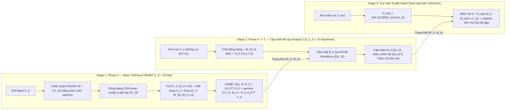

# Reading the Paper — Analytic Class-Incremental Learning (ACIL, NeurIPS 2022)

- **Bài báo mục tiêu:** Huiping Zhuang, Zhenyu Weng, Hongxin Wei, Renchunzi Xie, Kar-Ann Toh, Zhiping Lin, *"ACIL: Analytic Class-Incremental Learning with Absolute Memorization and Privacy Protection"*, Advances in Neural Information Processing Systems (NeurIPS), vol. 35, pp. 11602–11614, 2022 [1].
- **Mục đích tài liệu:** Cung cấp đầy đủ nội dung học thuật theo chuẩn yêu cầu mục **Reading the Paper** của môn Nhập môn Học máy (HCMUS) để nhóm trực tiếp chuyển hóa vào Slide Deck giữa kỳ (`.pptx`, 20–40 slides kèm speaker notes) và làm nền tảng lý thuyết cho repository.
- **Sơ đồ minh họa tự vẽ đi kèm:**
  - Hình bài toán & đối chiếu tiền nhiệm: [`reports/figures/acil_problem_and_predecessors.png`](../reports/figures/acil_problem_and_predecessors.png)
  - Sơ đồ kiến trúc & pipeline end-to-end: [`reports/figures/acil_pipeline_end_to_end.png`](../reports/figures/acil_pipeline_end_to_end.png)

---

## 1. Context & Motivation (Bối cảnh, Động lực & Phương pháp tiền nhiệm)

### 1.1. Phát biểu bài toán Class-Incremental Learning (CIL) và thách thức cốt lõi

Trong học sâu truyền thống, mô hình phân loại được huấn luyện một lần trên tập dữ liệu tĩnh chứa toàn bộ các lớp. Tuy nhiên, trong thế giới thực, các lớp đối tượng mới xuất hiện tuần tự theo thời gian qua các giai đoạn (phases/tasks) $k = 0, 1, \dots, K$:

- Ở **phase $k$**, hệ thống chỉ nhận tập dữ liệu mới $\mathcal{D}_k^{\text{train}} = \{(X_k^{(i)}, y_k^{(i)})\}_{i=1}^{N_k}$ thuộc tập gồm $c_k$ lớp mới. Các tập lớp giữa các phase rời nhau từng đôi một ($\mathcal{C}_i \cap \mathcal{C}_j = \emptyset$ với $i \neq j$).
- Sau khi hoàn tất cập nhật tại phase $k$, mô hình phải phân loại được **tất cả các lớp đã từng xuất hiện** từ đầu đến hiện tại, tức $C_k = \sum_{j=0}^{k} c_j$ lớp, **mà không được biết chỉ số phase/task của mẫu kiểm tra lúc suy luận** (*task-agnostic / single-head evaluation*) [1], [2].
- Ràng buộc khắt khe của **Exemplar-Free / Privacy-Preserving CIL**: Khi đã chuyển sang phase $k$, dữ liệu gốc của các phase trước ($\mathcal{D}_0^{\text{train}}, \dots, \mathcal{D}_{k-1}^{\text{train}}$) không còn được lưu trữ hoặc không được phép truy cập lại vì giới hạn bộ nhớ thiết bị và quy định bảo mật dữ liệu [1].

Khi huấn luyện tiếp mạng nơ-ron bằng hạ gradient ngẫu nhiên (SGD / Backpropagation) chỉ trên dữ liệu lớp mới $\mathcal{D}_k^{\text{train}}$, trọng số mạng bị kéo lệch mạnh về phía các lớp mới và xóa sạch tri thức phân biệt các lớp cũ — hiện tượng **Quên thảm khốc (*Catastrophic Forgetting*)** [1], [2], [3]. Ngược lại, nếu đóng băng quá cứng mạng để giữ lớp cũ, mô hình lại không đủ khả năng học biểu diễn cho lớp mới — tạo nên thế tiến thoái lưỡng nan **Độ dẻo – Độ ổn định (*Stability–Plasticity Dilemma*)** [1].

---

### 1.2. Ví dụ thực tế tự đặt (Concrete Real-World Scenario)

> **Bối cảnh tự thiết kế: Hệ thống hỗ trợ sàng lọc tổn thương da liễu liên viện tại các bệnh viện tuyến tỉnh Việt Nam (Multi-Hospital Dermatology Screening System)**

1. **Thiết lập ban đầu (Phase 0 — Base Phase):**
   - Một mô hình thị giác máy tính được Bộ Y tế cấp phép sau khi huấn luyện trên **50 nhóm bệnh lý da liễu phổ biến** (viêm da cơ địa, vảy nến, nấm da, dày sừng ánh sáng, u hắc tố điển hình...) từ kho ảnh chuẩn hóa ban đầu.
2. **Luồng phát sinh lớp mới theo thời gian (Incremental Phases $k = 1, \dots, K$):**
   - Mỗi quý (mỗi phase $k$), các bệnh viện chuyên khoa ghi nhận thêm **10 biến thể bệnh lý hoặc hội chứng da hiếm gặp / mới nổi** (ví dụ: biến chứng da hậu nhiễm virus mới, phản ứng thuốc đặc hiệu mới, tổn thương ký sinh trùng vùng dịch tễ mới). Hệ thống cần cập nhật để nhận diện được cả **50 nhóm bệnh cũ lẫn $10 \times k$ nhóm bệnh mới** trên cùng một đầu ra chẩn đoán duy nhất.
3. **Vì sao các cách làm truyền thống thất bại trong kịch bản này?**
   - **Không thể lưu ảnh bệnh nhân cũ để phát lại (Ràng buộc Pháp lý & Quyền riêng tư):** Ảnh tổn thương da của bệnh nhân là dữ liệu y tế nhạy cảm định danh (Protected Health Information — theo chuẩn bảo mật hồ sơ bệnh án điện tử / HIPAA / Nghị định 13/2023/NĐ-CP về Bảo vệ dữ liệu cá nhân). Sau khi kết thúc đợt huấn luyện tại từng bệnh viện hoặc hết thời hạn lưu trữ tạm, hệ thống **bắt buộc phải xóa ảnh gốc của bệnh nhân cũ**, không được phép đóng gói kho ảnh bệnh nhân cũ (exemplar buffer) gửi đi các viện khác để chạy replay.
   - **Không thể fine-tune chỉ trên 10 bệnh mới:** Nếu chỉ chạy SGD trên ảnh của 10 bệnh mới trong quý hiện tại, mô hình sẽ dự đoán hầu hết bệnh nhân mắc 50 bệnh phổ biến ban đầu thành 10 bệnh mới (*Catastrophic Forgetting*), gây báo động giả nghiêm trọng trong sàng lọc lâm sàng.
   - **Không thể huấn luyện lại từ đầu (Joint Training) mỗi quý:** Việc gom lại toàn bộ ảnh lịch sử của mọi quý vừa vi phạm quy định lưu trữ dữ liệu bệnh nhân, vừa tốn hàng chục giờ huấn luyện GPU mỗi lần cập nhật nhỏ tại bệnh viện tuyến dưới.
4. **Nhu cầu đặt ra cho thuật toán:**
   - Cần một cơ chế cập nhật **không lưu bất kỳ ảnh bệnh nhân cũ nào**, chỉ giữ lại trạng thái toán học gọn nhẹ từ các quý trước, cập nhật tức thì trên CPU/máy trạm bệnh viện khi có dữ liệu quý mới, nhưng cho ra bộ phân loại có chất lượng tương đương như thể được học gộp trên toàn bộ lịch sử. Đây chính là bài toán mà **ACIL** giải quyết [1].

---

### 1.3. Phân tích các phương pháp tiền nhiệm (Predecessor Approaches)

Để thấy rõ vị trí của ACIL, ta phân tích **3 nhóm phương pháp tiền nhiệm tiêu biểu** (vượt mức tối thiểu 2 phương pháp theo yêu cầu), đi qua đủ 3 tầng: **Ý tưởng cốt lõi $\rightarrow$ Hạn chế còn tồn tại $\rightarrow$ Hệ quả thực tế** (minh họa trực quan tại [`reports/figures/acil_problem_and_predecessors.png`](../reports/figures/acil_problem_and_predecessors.png)):

#### Tiền nhiệm 1: Learning without Forgetting — LwF (Li & Hoiem, 2017) [3] *(Nhóm Regularization / Knowledge Distillation không lưu mẫu)*
- **Ý tưởng cốt lõi (Core Idea):**
  - Không lưu trữ ảnh của các phase cũ. Trước khi huấn luyện phase mới $k$, mô hình đóng băng một bản sao mạng từ phase $k-1$ làm "giáo viên" (*teacher*).
  - Khi đưa ảnh của lớp mới $X_k$ vào mạng, hàm mất mát kết hợp hai thành phần: (1) Cross-Entropy trên các đầu ra lớp mới với nhãn thật $Y_k$, và (2) **Knowledge Distillation loss** ép các logit đầu ra lớp cũ của mạng hiện tại phải bám sát logit do mạng giáo viên sinh ra trên chính các ảnh mới $X_k$ [3].
- **Hạn chế còn tồn tại (Remaining Limitation):**
  - Mạng giáo viên chỉ được truy vấn bằng **dữ liệu của các lớp mới $X_k$**, vốn có phân phối đặc trưng rất khác với dữ liệu thực sự của các lớp cũ $X_{0:k-1}$ (*out-of-distribution distillation query*).
  - Khi chuỗi cập nhật kéo dài qua nhiều phase ($K$ lớn), sai số chưng cất bị cộng dồn liên tiếp từ giáo viên phase $k-1$ sang học sinh phase $k$ (*error compounding*), đồng thời ranh giới quyết định giữa lớp cũ và lớp mới không được hiệu chỉnh trực tiếp vì thiếu mẫu lớp cũ [1], [2].
- **Hệ quả thực tế (Practical Consequence):**
  - Độ chính xác trung bình suy giảm rất nhanh khi số phase tăng trong bài toán single-head CIL (chẳng hạn trên CIFAR-100 nhiều phase, LwF bị thiên lệch nặng về các lớp vừa học ở phase cuối và quên phần lớn các lớp ở phase 0) [2]. Trong ứng dụng thực tế như sàng lọc y tế hay kiểm soát chất lượng công nghiệp nhiều đợt, hệ thống nhanh chóng mất khả năng nhận diện các nhóm đối tượng nền tảng ban đầu.

#### Tiền nhiệm 2: iCaRL — Incremental Classifier and Representation Learning (Rebuffi et al., 2017) [2] *(Nhóm Exemplar Replay + Nearest-Mean-of-Exemplars)*
- **Ý tưởng cốt lõi (Core Idea):**
  - Nới lỏng ràng buộc không lưu mẫu bằng cách duy trì một bộ nhớ đệm giới hạn $\mathcal{M}$ (*exemplar memory*, ví dụ cố định $|\mathcal{M}| = 2000$ ảnh trên CIFAR-100) được chọn lọc theo chiến lược *herding* để xấp xỉ tâm lớp của các lớp cũ [2].
  - Ở mỗi phase $k$, iCaRL gộp dữ liệu mới $\mathcal{D}_k^{\text{train}}$ với bộ nhớ $\mathcal{M}$ để huấn luyện lại mạng bằng SGD kết hợp distillation loss, sau đó phân loại bằng bộ phân loại nguyên mẫu gần nhất (*Nearest-Mean-of-Exemplars — NME*) trong không gian đặc trưng chuẩn hóa $L_2$ [2].
- **Hạn chế còn tồn tại (Remaining Limitation):**
  - **Thứ nhất:** Bắt buộc phải lưu trữ và phát lại dữ liệu thô (ảnh gốc) của các lớp cũ trong suốt vòng đời hệ thống [1], [2].
  - **Thứ hai:** Khi tổng số lớp đã gặp $C_k$ tăng lên nhưng ngân sách bộ nhớ $|\mathcal{M}|$ cố định, số mẫu đại diện cho mỗi lớp cũ $m = |\mathcal{M}| / C_k$ bị cắt giảm liên tục, gây **mất cân bằng lớp nghiêm trọng** (*severe class imbalance*) giữa hàng trăm mẫu/lớp mới và chỉ vài mẫu/lớp cũ trong mỗi vòng huấn luyện SGD [1], [4].
- **Hệ quả thực tế (Practical Consequence):**
  - **Không thể triển khai** trong các lĩnh vực bị cấm lưu trữ dữ liệu gốc của người dùng/bệnh nhân vì lý do pháp lý và quyền riêng tư (y tế, tài chính, sinh trắc học) [1].
  - Ngay cả khi được phép lưu mẫu, mỗi phase mới đều đòi hỏi chạy lại hàng trăm epoch SGD trên GPU tiêu tốn nhiều thời gian/điện năng, và chất lượng ước lượng tâm lớp suy thoái dần khi số lớp mở rộng lớn.

#### Tiền nhiệm 3: PODNet (Douillard et al., 2020) [4] & AANets (Liu et al., 2021) [5] *(Nhóm Multi-level Spatial Distillation & Kiến trúc Đa nhánh hiện đại)*
- **Ý tưởng cốt lõi (Core Idea):**
  - **PODNet [4]:** Kết hợp bộ nhớ exemplar với phép chưng cất định hướng không gian đa tầng (*Pooled Outputs Distillation — POD*) dọc theo chiều rộng và chiều cao của các feature map trung gian trong ResNet, kết hợp với bộ phân loại Local Similarity Classifier (LSC) để giữ cấu trúc biểu diễn qua nhiều phase nhỏ.
  - **AANets [5]:** Xây dựng hai nhánh khối dư song song ở mỗi mức độ sâu — một nhánh *플라스틱 (plastic)* học tự do đặc trưng lớp mới và một nhánh *ổn định (stable)* bảo tồn đặc trưng lớp cũ — rồi học các trọng số tổng hợp thích nghi (*Adaptive Aggregation*) cùng exemplar replay.
- **Hạn chế còn tồn tại (Remaining Limitation):**
  - Cả hai phương pháp vẫn **phụ thuộc cốt lõi vào exemplar replay** (ví dụ lưu 20 mẫu/lớp cũ) và quy trình tối ưu lặp SGD nhiều epoch với nhiều siêu tham số cân bằng loss (distillation weight, margin, cosine scaling, two-stage fine-tuning) [1], [4], [5].
  - Khi số phase $K$ tăng lớn ($K = 25, 50$), việc cập nhật lặp lại bằng backpropagation qua hàng chục đợt vẫn làm trượt dần không gian đặc trưng (*representation drift*) và suy giảm độ chính xác trung bình $\bar{A}$ (trên CIFAR-100 ở $K=25$, PODNet giảm từ $64.83\%$ ở $K=5$ xuống $60.72\%$; AANets giảm từ $66.31\%$ xuống $62.31\%$ theo Table 1 của bài báo [1]).
- **Hệ quả thực tế (Practical Consequence):**
  - Vẫn vi phạm ràng buộc bảo mật dữ liệu gốc (exemplar-free), chi phí huấn luyện tích lũy qua $K$ phase rất lớn (tăng tuyến tính với số phase × số epoch SGD), và hiệu năng kém ổn định khi hệ thống phải cập nhật liên tục thành nhiều đợt nhỏ (*large-phase regime*) [1].

---

## 2. Contributions & Novelty (Phân loại Đóng góp & Tính mới)

### 2.1. Phân loại các đóng góp của bài báo (Categorized Contributions)

Theo chuẩn phân loại học thuật của môn học, các đóng góp của ACIL [1] được tách bạch thành 3 nhóm:

| Phân loại | Nội dung đóng góp trong ACIL [1] |
|---|---|
| **1. Đóng góp Lý thuyết (Theoretical Contributions)** | - **Định lý 3.1 (Theorem 3.1 — Tương đương đại số với học gộp):** Chứng minh toán học chặt chẽ rằng nghiệm trọng số phân loại $W_k$ được cập nhật đệ quy ở từng phase $k$ của ACIL (không dùng dữ liệu cũ) **bằng chính xác tuyệt đối** nghiệm tối ưu đóng $\tilde{W}_k$ của bài toán hồi quy Ridge học gộp (*joint analytic learning*) trên toàn bộ đặc trưng lịch sử $X_{0:k}^{\text{train}}$ [1]. - **Đặt nền tảng lý thuyết về *Absolute Memorization* (Ghi nhớ tuyệt đối)** cho bài toán CIL: xóa bỏ hoàn toàn sự phụ thuộc vào thứ tự phase/minibatch và hiện tượng quên đại số ở tầng phân loại khi không gian đặc trưng cố định. |
| **2. Đóng góp Kỹ thuật / Thuật toán (Technical / Algorithmic Contributions)** | - **Thiết kế kiến trúc ACIL 3 bước:** (i) Đóng băng backbone CNN sau phase 0 và chiếu đặc trưng qua tầng **Feature Expansion (FE)** ngẫu nhiên cố định kèm hàm kích hoạt phi tuyến $\operatorname{ReLU}$ để tăng khả năng tách tuyến tính trong không gian chiều cao $d$; (ii) **Analytic Re-alignment on Base Training (ARaBT)** khởi tạo ma trận $R_0, W_0$ bằng nghiệm đóng Ridge thay thế hoàn toàn lớp FC của backpropagation; (iii) **Cập nhật đệ quy theo bổ đề Sherman–Morrison–Woodbury (Recursive Least Squares — RLS)** chỉ lưu ma trận $R_{k-1} \in \mathbb{R}^{d\times d}$ và $W_{k-1} \in \mathbb{R}^{d\times C_{k-1}}$ để cập nhật trực tiếp cả cột trọng số lớp cũ lẫn cột trọng số lớp mới [1]. |
| **3. Đóng góp Thực nghiệm (Empirical Contributions)** | - Chứng minh thực nghiệm trên CIFAR-100, ImageNet-Subset và ImageNet-Full qua các kịch bản $K = 5, 10, 25, 50$ phases rằng một phương pháp **không lưu mẫu cũ (exemplar-free)** và **không huấn luyện lại backbone** vẫn đạt kết quả ngang ngửa hoặc vượt các phương pháp có lưu mẫu mạnh nhất (PODNet, AANets, LUCIR, iCaRL) ở $K=25, 50$ [1]. - Chứng minh hiệu năng của ACIL **bất biến theo số phase $K$** (khi tập base 50% cố định) và tốc độ cập nhật incremental trên CPU/GPU nhanh hơn hàng chục lần so với các phương pháp huấn luyện lặp bằng SGD [1]. |

### 2.2. Phân tích Tính mới (Novelty) đối chiếu với các phương pháp tiền nhiệm

Điểm khác biệt căn bản tạo nên **tính mới (novelty)** của ACIL so với toàn bộ dòng nghiên cứu tiền nhiệm nằm ở việc **đổi mô hình hóa toán học của quá trình cập nhật liên tục**:

1. **Điều các tiền nhiệm chưa làm được (What predecessors could not do):**
   - Mọi phương pháp dựa trên SGD/Backpropagation (dù dùng regularization như LwF/EWC hay dùng replay như iCaRL/PODNet/AANets) đều tối ưu hàm mục tiêu bằng cập nhật gradient lặp cục bộ. Do không có toàn bộ dữ liệu cũ, quỹ đạo tối ưu SGD luôn bị lệch khỏi nghiệm học gộp (*joint training*), khiến chất lượng mô hình **tất yếu suy thoái khi số phase $K$ tăng lên** và không bao giờ đạt trạng thái khớp tuyệt đối với học gộp nếu không lưu toàn bộ dữ liệu [1].
2. **Điều ACIL làm mới hoàn toàn (What ACIL newly introduces):**
   - Thay vì tiếp tục dùng SGD để tinh chỉnh mạng qua các phase, ACIL tách bài toán thành: **(1) học biểu diễn phi tuyến ở phase 0** và **(2) giải bài toán tối ưu lồi bậc hai có nghiệm đóng (Ridge Regression) trong không gian đặc trưng mở rộng ngẫu nhiên $d$ chiều ở mọi phase $k \ge 0$** [1].
   - Nhờ tính chất cộng tính của tích ma trận đặc trưng $\sum_{j=0}^k H_j^T H_j$ và bổ đề nghịch đảo ma trận Woodbury, toàn bộ thông tin hình học bậc hai của mọi dữ liệu quá khứ được nén hoàn hảo vào duy nhất một ma trận nghịch đảo tương quan tự động $R_{k-1} \in \mathbb{R}^{d\times d}$ (*Regularized Feature Autocorrelation Matrix — RFAM*) [1].
   - Nhờ đó, ACIL là phương pháp CIL đầu tiên đạt đồng thời **3 tính chất tưởng chừng mâu thuẫn nhau**:
     1. **Không lưu bất kỳ mẫu dữ liệu cũ nào** (*Exemplar-free / Privacy protection*);
     2. **Nghiệm sau $K$ phase khớp chính xác 100% (tới cấp độ dấu phẩy động) với nghiệm học gộp** (*Absolute Memorization / Batch & Phase-order invariance*);
     3. **Cập nhật chỉ cần 1 lượt đi qua dữ liệu mới (single-pass / one-epoch analytic update)**, không cần tối ưu lặp nhiều epoch [1].

---

## 3. Method — Phân tích Phương pháp theo 5 Lớp (5-Layer Breakdown)

### Lớp 1: Hệ thống ký hiệu & Phát biểu toán học (Notation & Problem Formulation)

Để thống nhất giữa bài báo gốc [1] và mã nguồn tái lập trong [`src/analytic.py`](../src/analytic.py) (đặc tả tại [`docs/Dac_ta_ACIL.md`](Dac_ta_ACIL.md)), hệ thống ký hiệu được định nghĩa như sau:

| Ký hiệu | Kích thước (Shape) | Ý nghĩa toán học và vai trò trong thuật toán |
|---|---|---|
| $k \in \{0, 1, \dots, K\}$ | Vô hướng | Chỉ số phase: $k=0$ là phase khởi tạo (Base phase), $k \ge 1$ là các phase học tăng dần. |
| $X_k^{\text{train}}, Y_k^{\text{train}}$ | $N_k \times (\text{C,H,W})$, $N_k \times c_k$ | Tập gồm $N_k$ ảnh huấn luyện và ma trận nhãn one-hot của $c_k$ lớp mới xuất hiện tại phase $k$. |
| $C_k = \sum_{j=0}^{k} c_j$ | Vô hướng | Tổng số lớp tích lũy đã học từ phase $0$ đến hết phase $k$ (với CIFAR-100, $K=5$: $C_0=50, C_1=60, \dots, C_5=100$). |
| $f_{\text{cnn}}(\cdot; \theta_0)$ | $\mathbb{R}^{N_k \times d_{\text{cnn}}}$ | Đặc trưng phẳng rút trích sau tầng Global Average Pooling của backbone CNN đã đóng băng trọng số $\theta_0$ (với ResNet-32 CIFAR: $d_{\text{cnn}} = 64$). |
| $W_{\text{fe}}$ | $\mathbb{R}^{d_{\text{cnn}} \times d}$ | Ma trận mở rộng đặc trưng ngẫu nhiên cố định, lấy mẫu độc lập từ phân phối chuẩn $\mathcal{N}(0, 1)$ một lần duy nhất và giữ nguyên qua mọi phase. |
| $H_k \text{ (hay } X_k^{(\text{fe})}\text{)}$ | $\mathbb{R}^{N_k \times d}$ | Ma trận đặc trưng mở rộng tại phase $k$: $H_k = \operatorname{ReLU}(f_{\text{cnn}}(X_k^{\text{train}}; \theta_0) W_{\text{fe}})$, với $d \gg d_{\text{cnn}}$ (benchmark dùng $d = 8000$). |
| $\tilde{H}_k \text{ (hay } X_{0:k}^{(\text{fe})}\text{)}$ | $\mathbb{R}^{(\sum_{j=0}^k N_j) \times d}$ | Ma trận ghép dọc đặc trưng mở rộng của toàn bộ các phase từ $0$ đến $k$: $\tilde{H}_k = [H_0^T, H_1^T, \dots, H_k^T]^T$. |
| $\tilde{Y}_k \text{ (hay } Y_{0:k}\text{)}$ | $\mathbb{R}^{(\sum_{j=0}^k N_j) \times C_k}$ | Ma trận nhãn one-hot đường chéo khối của toàn bộ dữ liệu từ phase $0$ đến $k$: $\tilde{Y}_k = \operatorname{diag}(Y_0, Y_1, \dots, Y_k)$. |
| $\gamma > 0$ | Vô hướng | Hệ số điều chuẩn $L_2$ (Ridge regularization), bảo đảm ma trận tương quan luôn xác định dương và khả nghịch. |
| $R_k$ | $\mathbb{R}^{d \times d}$ | Ma trận nghịch đảo tương quan đặc trưng có điều chuẩn (*Regularized Feature Autocorrelation Matrix — RFAM*) tại phase $k$: $R_k = (\tilde{H}_k^T \tilde{H}_k + \gamma I_d)^{-1}$. |
| $W_k$ | $\mathbb{R}^{d \times C_k}$ | Ma trận trọng số phân loại tuyến tính cho toàn bộ $C_k$ lớp đã học sau phase $k$. |

**Mục tiêu tối ưu tổng quát (Joint Analytic Objective tại phase $k$):**
Giả sử tại phase $k$, nếu ta có đầy đủ dữ liệu từ phase $0$ đến $k$, bài toán học phân loại tuyến tính được mô hình hóa thành bài toán tối ưu lồi bậc hai (Ridge Regression trên nhãn one-hot) [1]:

$$
\min_{W \in \mathbb{R}^{d \times C_k}} \mathcal{L}_{\text{joint}}(W) = \left\| \tilde{Y}_k - \tilde{H}_k W \right\|_F^2 + \gamma \| W \|_F^2
$$

trong đó $\|\cdot\|_F$ là chuẩn Frobenius. Do hàm mục tiêu lồi chặt với mọi $\gamma > 0$, đạo hàm bậc nhất bằng $0$ cho nghiệm đóng duy nhất:

$$
\tilde{W}_k = \left( \tilde{H}_k^T \tilde{H}_k + \gamma I_d \right)^{-1} \tilde{H}_k^T \tilde{Y}_k
$$

Mục tiêu của ACIL là **tính được đúng nghiệm $\tilde{W}_k$ này tại mỗi phase $k$ mà chỉ được dùng dữ liệu hiện tại $(H_k, Y_k)$ và trạng thái $(R_{k-1}, W_{k-1})$**, tuyệt đối không truy cập lại $(H_0, Y_0), \dots, (H_{k-1}, Y_{k-1})$ [1].

---

### Lớp 2: Kiến trúc & Sơ đồ Pipeline End-to-End

Toàn bộ luồng xử lý của ACIL được minh họa trong sơ đồ tự vẽ [`reports/figures/acil_pipeline_end_to_end.png`](../reports/figures/acil_pipeline_end_to_end.png) và gồm **3 giai đoạn nối tiếp nhau**:

---

### Lớp 3: Phân tích chi tiết từng thành phần (What / Why / How)

#### Thành phần 1: Đóng băng Backbone CNN sau Base Training ($\operatorname{CNN}_{\theta_0}$)
- **What (Đó là gì?):** Mạng trích xuất đặc trưng sâu (ResNet-32 trên CIFAR-100) được huấn luyện bằng SGD + Cross-Entropy trên $c_0 = 50$ lớp base trong 160 epochs, sau đó tháo bỏ lớp phân loại tuyến tính tạm thời (`FC_50`) và khóa cứng toàn bộ tham số lẫn thống kê BatchNorm (`model.eval()`, `requires_grad = False`) [1].
- **Why (Tại sao cần?):**
  1. Nếu cập nhật tiếp backbone bằng backpropagation trên các phase mới mà không có dữ liệu cũ, các tầng tích chập sẽ bị thay đổi làm phá vỡ không gian biểu diễn của các lớp cũ (*representation drift / catastrophic forgetting*).
  2. Công thức đệ quy tuyến tính ở tầng đầu ra chỉ tương đương với nghiệm học gộp khi hàm ánh xạ từ ảnh đầu vào sang vector đặc trưng $\phi(x) = \operatorname{ReLU}(f_{\text{cnn}}(x; \theta_0) W_{\text{fe}})$ là **một ánh xạ tĩnh bất biến qua mọi phase** [1].
- **How (Hoạt động thế nào?):**
  - Với mọi mẫu ảnh $x$ ở bất kỳ phase $k \ge 0$ (cả lúc khởi tạo ARaBT, lúc cập nhật tăng dần và lúc đánh giá test), ảnh đi qua cùng phép chuẩn hóa cố định (tính từ tập base train) và đi qua $\operatorname{CNN}_{\theta_0}$ ở chế độ `eval()` để sinh vector đặc trưng cơ sở $f \in \mathbb{R}^{64}$ (sau Global Average Pooling) ở độ chính xác `float32`, trước khi ép kiểu sang `float64` để đưa vào bước giải tích.

#### Thành phần 2: Tầng Mở rộng Đặc trưng Ngẫu nhiên (Feature Expansion — FE)
- **What (Đó là gì?):** Một tầng chiếu tuyến tính ngẫu nhiên cố định $W_{\text{fe}} \in \mathbb{R}^{d_{\text{cnn}} \times d}$ (với $d \gg d_{\text{cnn}}$, ví dụ $64 \to 8000$) theo sau bởi hàm kích hoạt phi tuyến $\operatorname{ReLU}$ [1]:
  $$
  H_k = \operatorname{ReLU}\!\left( f_{\text{cnn}}(X_k; \theta_0)\, W_{\text{fe}} \right) \in \mathbb{R}^{N_k \times d}
  $$
- **Why (Tại sao cần?):**
  - Đầu ra trực tiếp của ResNet-32 trên CIFAR chỉ có số chiều rất thấp ($d_{\text{cnn}} = 64$), nhỏ hơn cả tổng số lớp cần phân loại ($C_5 = 100$). Một bộ phân loại tuyến tính đặt trực tiếp trên không gian $64$ chiều bị giới hạn hạng (*rank-deficient / under-parameterized*) và không đủ siêu phẳng tách tuyến tính cho 100 lớp khi backbone đã bị đóng băng.
  - Theo định lý Cover (Cover's Theorem on separability of patterns), phép chiếu phi tuyến ngẫu nhiên ($\cdot \, W_{\text{fe}}$ tiếp nối bởi $\operatorname{ReLU}$) nhúng đặc trưng $64$ chiều lên không gian chiều cao $d = 8000$, giúp các cụm lớp vốn chồng lấn phi tuyến trong $\mathbb{R}^{64}$ trở nên **khả tách tuyến tính tốt hơn hẳn** trước khi giải hồi quy Ridge [1].
  - *Bằng chứng thực nghiệm từ R2 của nhóm:* Khi bỏ tầng FE (dùng trực tiếp $f_{\text{cnn}} \in \mathbb{R}^{64}$ với $\gamma = 0.1$), độ chính xác trung bình $\bar{A}$ chỉ đạt **$53.26\%$**; khi bật FE ($d = 8000, \gamma = 0.1$), $\bar{A}$ nhảy vọt lên **$65.12\%$** — tức tăng **+$11.86\text{ pp}$** trên cùng một checkpoint backbone ([`reports/R2_CIFAR100_K5_20261107.md`](../reports/R2_CIFAR100_K5_20261107.md)).
- **How (Hoạt động thế nào?):**
  - Ma trận $W_{\text{fe}} \sim \mathcal{N}(0, 1)^{64 \times 8000}$ được khởi tạo một lần duy nhất bằng bộ sinh số ngẫu nhiên tách biệt (`seed + 1000`), không có vector dịch (bias), không cập nhật gradient, và giữ cố định suốt từ phase 0 đến phase $K$.

#### Thành phần 3: Căn chỉnh Giải tích trên tập Base (Analytic Re-alignment on Base Training — ARaBT)
- **What (Đó là gì?):** Bước khởi tạo lại bộ phân loại của phase 0 bằng nghiệm đóng hồi quy Ridge (Phương trình (3)–(4) trong bài báo [1]) thay vì giữ lại trọng số lớp `FC_50` học bằng SGD.
- **Why (Tại sao cần?):**
  - Lớp `FC_50` huấn luyện bằng Cross-Entropy + SGD không nằm trong không gian nghiệm của bài toán bình phương tối thiểu có điều chuẩn trên đặc trưng mở rộng $H_0 \in \mathbb{R}^{N_0 \times d}$. Để chuỗi đệ quy ở các phase $k \ge 1$ nối tiếp hợp lệ, trạng thái gốc ở $k = 0$ bắt buộc phải là nghiệm cực tiểu của $\left\| Y_0 - H_0 W_0 \right\|_F^2 + \gamma \| W_0 \|_F^2$ kèm ma trận tương quan nghịch đảo $R_0$ [1].
- **How (Hoạt động thế nào?):**
  - Tính ma trận Gram có điều chuẩn và ma trận tương quan chéo trên toàn bộ $N_0 = 25{,}000$ mẫu base (trong code [`src/analytic.py`](../src/analytic.py) hàm `initialize_batches` tích lũy theo từng minibatch để không phải giữ ma trận $25{,}000 \times 8{,}000$ trong RAM):
    $$
    A_0 = \sum_{b} H_{0,b}^T H_{0,b} + \gamma I_d \in \mathbb{R}^{d \times d}, \qquad B_0 = \sum_{b} H_{0,b}^T Y_{0,b} \in \mathbb{R}^{d \times c_0}
    $$
  - Giải hệ xác định dương đối xứng bằng phân rã Cholesky ($A_0 = L L^T$) để thu được trạng thái khởi đầu (Phương trình (4) của bài báo [1]):
    $$
    R_0 = A_0^{-1} = \left( H_0^T H_0 + \gamma I_d \right)^{-1}, \qquad W_0 = R_0 H_0^T Y_0 = A_0^{-1} B_0
    $$
  - Lưu ý quan trọng: hệ số $\gamma I_d$ **chỉ được cộng đúng một lần duy nhất tại bước khởi tạo $R_0$**; không bao giờ cộng thêm $\gamma I_d$ ở các batch hay các phase tiếp theo.

#### Thành phần 4: Cập nhật Đệ quy Ma trận Nghịch đảo Tương quan Đặc trưng ($R_k$)
- **What (Đó là gì?):** Công thức cập nhật ma trận $R_{k-1} \to R_k \in \mathbb{R}^{d \times d}$ khi có lô dữ liệu đặc trưng mới $H_k \in \mathbb{R}^{N_k \times d}$ (Phương trình (10) trong bài báo [1]):
  $$
  R_k = R_{k-1} - R_{k-1} H_k^T \left( I_{N_k} + H_k R_{k-1} H_k^T \right)^{-1} H_k R_{k-1}
  $$
- **Why (Tại sao cần?):**
  - Theo định nghĩa học gộp, $R_k^{-1} = \tilde{H}_k^T \tilde{H}_k + \gamma I_d = (\tilde{H}_{k-1}^T \tilde{H}_{k-1} + \gamma I_d) + H_k^T H_k = R_{k-1}^{-1} + H_k^T H_k$.
  - Nếu tính trực tiếp nghịch đảo của ma trận $d \times d$ ($d = 8000$) hoặc lưu lại $\tilde{H}_{k-1}$, chi phí nghịch đảo trực tiếp là $\mathcal{O}(d^3)$ mỗi lần cập nhật. Nhờ áp dụng **bổ đề nghịch đảo ma trận Sherman–Morrison–Woodbury** cho phép cập nhật hạng $b$ (khi chia phase $k$ thành các minibatch kích thước $b = 128 \ll d = 8000$), ta chỉ cần nghịch đảo ma trận nhỏ kích thước $b \times b$:
    $$
    S_b = I_b + H_b R_{\text{old}} H_b^T \in \mathbb{R}^{b \times b}
    $$
    giảm bậc độ phức tạp nghịch đảo từ $\mathcal{O}(d^3)$ xuống $\mathcal{O}(b^3 + b d^2)$ [1].
- **How (Hoạt động thế nào?):**
  - Trong [`src/analytic.py`](../src/analytic.py) (`incremental_update`), với mỗi minibatch đặc trưng $H_b \in \mathbb{R}^{b \times d}$:
    1. Tính $P = R_{\text{old}} H_b^T \in \mathbb{R}^{d \times b}$.
    2. Lập ma trận đối xứng xác định dương $S_b = I_b + H_b P \in \mathbb{R}^{b \times b}$.
    3. Giải hệ tuyến tính $S_b K^T = P^T$ bằng Cholesky (thay vì gọi `inv` tường minh để tăng độ ổn định số học), rồi cập nhật $R_{\text{new}} = R_{\text{old}} - P S_b^{-1} P^T$ và đối xứng hóa $R_{\text{new}} \leftarrow \frac{1}{2}(R_{\text{new}} + R_{\text{new}}^T)$ nhằm triệt tiêu sai số làm tròn dấu phẩy động.

#### Thành phần 5: Cập nhật Đệ quy Trọng số Phân loại ($W_k$) cho cả lớp cũ và lớp mới
- **What (Đó là gì?):** Công thức cập nhật ma trận trọng số phân loại từ $W_{k-1} \in \mathbb{R}^{d \times C_{k-1}}$ sang $W_k \in \mathbb{R}^{d \times C_k}$ (Phương trình (9) trong bài báo [1]):
  $$
  W_k = \left[\, W_{k-1} - R_k H_k^T H_k W_{k-1} \;\;\;\; R_k H_k^T Y_k \,\right]
  $$
  Hoặc viết dưới **dạng sai số phần dư toàn cục (global residual form)** khi cập nhật theo từng minibatch (như trong [`src/analytic.py`](../src/analytic.py)):
  $$
  W_{\text{pad}} = \left[\, W_{\text{old}} \;\; \mathbf{0}_{d \times (C_k - C_{\text{old}})} \,\right], \qquad W_{\text{new}} = W_{\text{pad}} + R_{\text{new}} H_b^T \left( Y_{b,\text{global}} - H_b W_{\text{pad}} \right)
  $$
- **Why (Tại sao cần?):**
  - Khi thêm dữ liệu mới $H_k$, không chỉ các cột trọng số của lớp mới cần được tạo ra ($R_k H_k^T Y_k$), mà **các cột trọng số của các lớp cũ cũng phải được hiệu chỉnh** bằng lượng $-R_k H_k^T H_k W_{k-1}$ [1].
  - *Ý nghĩa trực quan của số hạng hiệu chỉnh $-R_k H_k^T H_k W_{k-1}$:* Trong bài toán học gộp, nhãn one-hot của các lớp cũ trên những mẫu dữ liệu thuộc lớp mới $H_k$ phải bằng $\mathbf{0}$ (vì mẫu lớp mới không thuộc lớp cũ). Nếu không có số hạng trừ $-R_k H_k^T (H_k W_{k-1})$, các cột trọng số lớp cũ $W_{k-1}$ có thể sinh ra điểm kích hoạt dương lớn ($H_k W_{k-1} \neq \mathbf{0}$) trên dữ liệu lớp mới, gây nhầm lẫn lớp mới thành lớp cũ. Số hạng $-R_k H_k^T H_k W_{k-1}$ chính là bước **kéo phản hồi của các cột lớp cũ về $0$ trên dữ liệu mới** mà không cần xem lại dữ liệu cũ!
- **How (Hoạt động thế nào?):**
  - Hai dạng công thức (ghép khối Phương trình (9) và dạng residual toàn cục) là **đồng nhất về mặt đại số**:
    - Với các cột lớp cũ (nơi $Y_{b,\text{global}}^{(\text{old})} = \mathbf{0}$): $W_{\text{old}} + R_k H_k^T(\mathbf{0} - H_k W_{\text{old}}) = W_{k-1} - R_k H_k^T H_k W_{k-1}$ (khớp chính xác khối trái của Phương trình (9)).
    - Với các cột lớp mới (nơi $W_{\text{pad}}^{(\text{new})} = \mathbf{0}$ ở lần xuất hiện đầu tiên): $\mathbf{0} + R_k H_k^T(Y_k - \mathbf{0}) = R_k H_k^T Y_k$ (khớp chính xác khối phải của Phương trình (9)), và nếu cập nhật tiếp ở minibatch thứ hai trong cùng phase $k$, công thức residual tự động cộng dồn chính xác mà không sinh thêm cột thừa.

---

### Lớp 4: Các tính chất lý thuyết, Giải thích trực quan & Giới hạn điều kiện

#### 4.1. Định lý 3.1 (Theorem 3.1 — Sự tương đương giữa ACIL đệ quy và Học gộp giải tích)

- **Phát biểu định lý (Restatement of Theorem 3.1 [1]):**
  > Cho chuỗi tập dữ liệu đặc trưng mở rộng và nhãn one-hot $\{(H_j, Y_j)\}_{j=0}^k$ với backbone CNN và ma trận mở rộng $W_{\text{fe}}$ cố định. Đặt nghiệm học gộp tại phase $k$ là:
  > $$
  > \tilde{W}_k = \left( \tilde{H}_k^T \tilde{H}_k + \gamma I_d \right)^{-1} \tilde{H}_k^T \tilde{Y}_k
  > $$
  > Khi đó, nếu khởi tạo $R_0 = (H_0^T H_0 + \gamma I_d)^{-1}$, $W_0 = R_0 H_0^T Y_0$ và cập nhật đệ quy tại mỗi phase $k \ge 1$ theo:
  > $$
  > R_k = R_{k-1} - R_{k-1} H_k^T \left( I + H_k R_{k-1} H_k^T \right)^{-1} H_k R_{k-1}, \qquad W_k = \left[\, W_{k-1} - R_k H_k^T H_k W_{k-1} \;\;\; R_k H_k^T Y_k \,\right]
  > $$
  > thì với mọi $k \ge 0$, ta luôn có **$W_k = \tilde{W}_k$**.

- **Phác thảo chứng minh toán học (Proof Sketch):**
  1. *Bước cơ sở ($k=0$):* Hiển nhiên $W_0 = (H_0^T H_0 + \gamma I_d)^{-1} H_0^T Y_0 = \tilde{W}_0$.
  2. *Bước quy nạp ($k-1 \to k$):* Giả sử $R_{k-1} = (\tilde{H}_{k-1}^T \tilde{H}_{k-1} + \gamma I_d)^{-1}$ và $W_{k-1} = \tilde{W}_{k-1} = R_{k-1} \tilde{H}_{k-1}^T \tilde{Y}_{k-1}$.
     - Theo cấu trúc ghép dọc $\tilde{H}_k = [\tilde{H}_{k-1}^T, H_k^T]^T$, ta có:
       $$
       \tilde{H}_k^T \tilde{H}_k + \gamma I_d = \left(\tilde{H}_{k-1}^T \tilde{H}_{k-1} + \gamma I_d\right) + H_k^T I_{N_k} H_k = R_{k-1}^{-1} + H_k^T H_k
       $$
     - Áp dụng đẳng thức nghịch đảo ma trận Sherman–Morrison–Woodbury $(A + U C V)^{-1} = A^{-1} - A^{-1} U (C^{-1} + V A^{-1} U)^{-1} V A^{-1}$ với $A = R_{k-1}^{-1}$, $U = H_k^T$, $C = I_{N_k}$, $V = H_k$, ta thu được ngay $R_k = (\tilde{H}_k^T \tilde{H}_k + \gamma I_d)^{-1}$.
     - Mặt khác, do $\tilde{Y}_k = \operatorname{diag}(\tilde{Y}_{k-1}, Y_k)$, tích tương quan chéo tách thành hai khối cột độc lập:
       $$
       \tilde{H}_k^T \tilde{Y}_k = \begin{bmatrix} \tilde{H}_{k-1}^T & H_k^T \end{bmatrix} \begin{bmatrix} \tilde{Y}_{k-1} & \mathbf{0} \\ \mathbf{0} & Y_k \end{bmatrix} = \left[\, \tilde{H}_{k-1}^T \tilde{Y}_{k-1} \;\;\; H_k^T Y_k \,\right]
       $$
     - Nhân $R_k$ vào bên trái:
       $$
       \tilde{W}_k = R_k \tilde{H}_k^T \tilde{Y}_k = \left[\, R_k \tilde{H}_{k-1}^T \tilde{Y}_{k-1} \;\;\; R_k H_k^T Y_k \,\right]
       $$
     - Dùng hệ thức $R_{k-1}^{-1} = R_k^{-1} - H_k^T H_k \implies I_d = R_k R_{k-1}^{-1} + R_k H_k^T H_k \implies R_k = R_{k-1} - R_k H_k^T H_k R_{k-1}$:
       $$
       R_k \tilde{H}_{k-1}^T \tilde{Y}_{k-1} = \left(R_{k-1} - R_k H_k^T H_k R_{k-1}\right) \tilde{H}_{k-1}^T \tilde{Y}_{k-1} = W_{k-1} - R_k H_k^T H_k W_{k-1}
       $$
     - Thay vào biểu thức của $\tilde{W}_k$, ta được đúng công thức của $W_k$. (ĐPCM) $\blacksquare$

- **Giải thích trực quan (Intuitive Meaning):**
  - Trong hồi quy tuyến tính bình phương tối thiểu, nghiệm tối ưu $\tilde{W}_k$ không cần biết từng điểm dữ liệu riêng lẻ nằm ở đâu, mà **chỉ phụ thuộc vào hai thống kê đủ bậc hai (sufficient statistics)**: tổng tự tương quan đặc trưng $\sum H_j^T H_j$ và tổng tương quan chéo đặc trưng–nhãn $\sum H_j^T Y_j$.
  - Vì phép cộng ma trận có tính kết hợp và giao hoán, việc cộng dồn từng phase (hay từng minibatch kích thước bất kỳ) cho ra **cùng một ma trận tổng** như khi gom toàn bộ dữ liệu lại một lúc. Ma trận $R_k$ đóng vai trò như một "bộ nhớ hình học bậc hai" ghi lại độ cong của không gian đặc trưng đã qua, cho phép xoay và co giãn trọng số cũ $W_{k-1}$ về đúng vị trí cân bằng mới mà không cần nhìn lại dữ liệu cũ.
  - *Bằng chứng thực nghiệm từ R3 của nhóm:* Khi chạy cập nhật đệ quy qua 5 phase trên CIFAR-100 với 3 kích thước minibatch khác nhau ($b \in \{32, 128, 512\}$), sai số tuyệt đối cực đại giữa $W_k$ đệ quy và nghiệm học gộp $\tilde{W}_k$ trên toàn bộ **54/54 mốc kiểm tra** đều $\le 1.16 \times 10^{-11}$ (`float64`), và số mẫu test bị lệch nhãn dự đoán argmax là **0/10,000 mẫu** ([`reports/R3_CIFAR100_K5_BATCH_20261107.md`](../reports/R3_CIFAR100_K5_BATCH_20261107.md)).

- **Các điều kiện biên & Giới hạn của Định lý 3.1 (Boundary Conditions & Limitations):**
  1. **Điều kiện cố định hàm đặc trưng ($\phi(x)$ bất biến):** Định lý 3.1 chỉ đúng khi phép trích xuất đặc trưng (backbone CNN, thống kê BatchNorm, phép chuẩn hóa ảnh, và ma trận $W_{\text{fe}}$) hoàn toàn không thay đổi từ phase 0 đến phase $K$. Nếu cập nhật dù chỉ một tầng của CNN hay cho phép BatchNorm cập nhật `running_mean`/`running_var` ở các phase sau, $H_0$ cũ không còn khớp với không gian của $H_k$ mới và định lý lập tức mất hiệu lực.
  2. **Điều kiện khả nghịch và hệ số điều chuẩn ($\gamma > 0$ cố định):** Ma trận $H_0^T H_0 + \gamma I_d$ phải xác định dương nghiêm ngặt ($\gamma > 0$), và $\gamma I_d$ chỉ được cộng đúng một lần ở phase 0. Nếu cộng lại $\gamma I_d$ ở mỗi phase $k$, nghiệm thu được sẽ tương ứng với hệ số điều chuẩn bị nhân lên $(k+1)\gamma$, làm lệch nghiệm so với học gộp.
  3. **Tương đương với *Joint Analytic Learning*, KHÔNG tương đương với *Joint End-to-End CNN Training*:** Định lý 3.1 chứng minh ACIL bằng với việc gom toàn bộ dữ liệu lại để giải **tầng phân loại Ridge trên backbone đã học từ 50 lớp base**, chứ **không** tương đương với việc huấn luyện lại toàn bộ mạng ResNet-32 từ đầu trên cả 100 lớp bằng SGD. Do đó, chất lượng trần của ACIL vẫn bị giới hạn bởi chất lượng biểu diễn học được ở phase 0.
  4. **Độ chính xác số học hữu hạn (Floating-Point Precision):** Đẳng thức $W_k = \tilde{W}_k$ là đẳng thức trên trường số thực $\mathbb{R}$. Trên máy tính, việc lặp công thức Woodbury qua hàng trăm minibatch trên `float32` có thể tích lũy sai số làm mất tính đối xứng xác định dương của $R_k$; do đó thực nghiệm chuẩn cần thực hiện bước analytic ở độ chính xác kép `float64` (như thiết kế trong [`src/analytic.py`](../src/analytic.py)).

---

#### 4.2. Tính chất Ghi nhớ Tuyệt đối (Absolute Memorization) & Bất biến theo số Phase $K$

- **Ý nghĩa trực quan:**
  - Vì $W_K = \tilde{W}_K$ chỉ phụ thuộc vào tập hợp toàn bộ dữ liệu $\bigcup_{k=0}^K \mathcal{D}_k^{\text{train}}$, nghiệm cuối cùng tại phase $K$ **hoàn toàn không phụ thuộc vào việc 50 lớp mới được chia thành $K=5$ đợt (mỗi đợt 10 lớp), $K=25$ đợt (mỗi đợt 2 lớp), hay $K=50$ đợt (mỗi đợt 1 lớp)**, miễn là tập base phase 0 giữ nguyên [1].
  - Đây là lý do trong Table 1 của bài báo [1], khi tăng $K$ từ $5 \to 10 \to 25 \to 50$, độ chính xác bước cuối $A_K$ của ACIL giữ nguyên không đổi, trong khi các phương pháp SGD/distillation suy giảm mạnh theo $K$.

- **Giới hạn & Phân biệt quan trọng (Tại sao "Absolute Memorization" vẫn có $F_{\text{base}} > 0$?):**
  - **"Ghi nhớ tuyệt đối" trong ACIL là ghi nhớ tuyệt đối nghiệm đại số của bộ phân loại học gộp ($\|W_k - \tilde{W}_k\|_F = 0$), KHÔNG có nghĩa là độ chính xác kiểm tra trên tập lớp cũ không giảm khi số lớp tăng ($F_{\text{base}} = 0$).**
  - Ở phase 0, bộ phân loại chỉ chọn $\operatorname{argmax}$ trên **50 lớp**; đến phase 5, bộ phân loại phải chọn $\operatorname{argmax}$ trên **100 lớp**. Khi không gian quyết định bị chia nhỏ từ 50 vùng thành 100 vùng trên một backbone cố định, xác suất một mẫu thuộc 50 lớp cũ có điểm logit rơi sang một trong 50 lớp mới tăng lên một cách tự nhiên (kể cả khi huấn luyện Joint Ridge trên cả 100 lớp từ đầu).
  - Trong thực nghiệm R1 của nhóm ([`reports/R1_CIFAR100_K5_3SEEDS_20261106.md`](../reports/R1_CIFAR100_K5_3SEEDS_20261106.md)), độ quên trên 50 lớp base sau 5 phase là $F_{\text{base}} = B_0 - B_5 = 8.31 \pm 0.62\text{ pp}$ (bài báo báo cáo $F = 9.00\%$ ở Table 1 [1]). Mức giảm này phản ánh **độ khó tăng thêm của bài toán phân loại 100 lớp so với 50 lớp trên đặc trưng cố định**, không phải do thuật toán cập nhật đệ quy làm rơi mất thông tin của phase 0.

---

#### 4.3. Tính chất Bảo vệ Quyền riêng tư (Privacy Protection) & Giới hạn Lý thuyết

- **Lập luận của bài báo & Ý nghĩa trực quan [1]:**
  1. ACIL **không lưu bất kỳ mẫu ảnh gốc $X_k$ hay ma trận đặc trưng từng mẫu $H_k \in \mathbb{R}^{N_k \times d}$** của các phase trước.
  2. Về mặt đại số, ngay cả khi kẻ tấn công truy cập được trạng thái lưu trữ $(R_k, W_k)$, việc khôi phục lại ma trận đặc trưng $H_k \in \mathbb{R}^{N_k \times d}$ từ $R_k^{-1} - R_{k-1}^{-1} = H_k^T H_k \in \mathbb{R}^{d \times d}$ là **bài toán bất định vô nghiệm duy nhất (ill-posed / non-unique)** vì với mọi ma trận trực giao $Q \in \mathbb{R}^{N_k \times N_k}$ ($Q^T Q = I_{N_k}$), ma trận $\hat{H}_k = Q H_k$ đều cho ra cùng một tích $(Q H_k)^T (Q H_k) = H_k^T H_k$ (hơn nữa thứ tự mẫu, giá trị từng hàng riêng lẻ và phần thông tin bị triệt tiêu qua hàm $\operatorname{ReLU}$ cũng như tầng Global Average Pooling của CNN không thể đảo ngược duy nhất) [1].

- **Giới hạn điều kiện (Boundary Conditions on Privacy Claim):**
  1. Khái niệm "Privacy Protection" trong bài báo [1] là **bảo mật theo nghĩa không lưu mẫu thô (exemplar-free) và bất khả nghịch đại số tuyến tính từ ma trận Gram**, **KHÔNG phải** là chứng minh bảo mật theo chuẩn **Differential Privacy ($(\varepsilon, \delta)$-DP)**.
  2. Ma trận $R_k = (\tilde{H}_k^T \tilde{H}_k + \gamma I_d)^{-1}$ và $W_k$ vẫn lưu giữ trọn vẹn thống kê tương quan bậc hai chính xác của toàn bộ tập dữ liệu huấn luyện (nếu xóa 1 mẫu $(h_i, y_i)$, có thể dùng công thức downdate hạng-1 để tính sự thay đổi của $R_k$). Do đó, ACIL đáp ứng yêu cầu "không lưu trữ hồ sơ/ảnh gốc của người dùng", nhưng chưa chống lại các tấn công suy luận thành viên (*membership inference*) dựa trên thống kê ma trận hiệp phương sai nếu kẻ tấn công có sẵn mẫu ứng viên $h_{\text{query}}$.

---

### Lớp 5: Phân tích Độ phức tạp Thời gian & Không gian (Time & Space Complexity) so sánh với Tiền nhiệm

#### 5.1. Độ phức tạp của ACIL theo từng giai đoạn

Ký hiệu:
- $N_k$: số mẫu huấn luyện của phase $k$; $b$: kích thước minibatch khi cập nhật giải tích ($b \ll d$);
- $d_{\text{cnn}}$: chiều đặc trưng đầu ra của backbone CNN ($64$ với ResNet-32);
- $d$: chiều không gian mở rộng đặc trưng FE ($d = 8000$ trong R1/R2);
- $C_k$: tổng số lớp đã thấy đến phase $k$ ($C_k \le C = 100$);
- $E$: số epoch huấn luyện SGD mỗi phase của các phương pháp dùng backpropagation (thường $E \in [70, 160]$);
- $M = |\mathcal{M}|$: tổng số mẫu ảnh cũ lưu trong exemplar buffer của các phương pháp replay (thường $M = 2000$ trên CIFAR-100);
- $C_{\text{fwd}}, C_{\text{bwd}}$: chi phí tính toán 1 lượt lan truyền tiến / ngược qua backbone CNN cho 1 mẫu ($C_{\text{bwd}} \approx 2\text{–}3 \times C_{\text{fwd}}$).

**1. Độ phức tạp Thời gian (Time Complexity) của ACIL tại một phase tăng dần $k \ge 1$:**
- **Trích xuất đặc trưng & Chiếu FE (chỉ 1 lượt đi qua dữ liệu mới, $E = 1$, không backprop):**
  $$
  T_{\text{extract}}^{(k)} = \mathcal{O}\!\left( N_k \cdot C_{\text{fwd}} + N_k \cdot d_{\text{cnn}} \cdot d \right)
  $$
- **Cập nhật đệ quy $R_k$ và $W_k$ theo $\lceil N_k / b \rceil$ minibatch kích thước $b$:**
  - Trong mỗi minibatch $b \times d$:
    - Tính $P = R_{\text{old}} H_b^T$: $\mathcal{O}(b d^2)$ phép nhân-cộng.
    - Tính $S_b = I_b + H_b P$ và nghịch đảo/Cholesky ma trận $b \times b$: $\mathcal{O}(b^2 d + b^3)$.
    - Cập nhật hạng-$b$ cho $R_{\text{new}} = R_{\text{old}} - P S_b^{-1} P^T$: $\mathcal{O}(b d^2)$.
    - Cập nhật $W_{\text{new}} \in \mathbb{R}^{d \times C_k}$: $\mathcal{O}(b d C_k)$.
  - Cộng trên toàn bộ $\frac{N_k}{b}$ minibatch của phase $k$ (do $C_k \ll d$ và $b \ll d$):
    $$
    T_{\text{analytic}}^{(k)} = \frac{N_k}{b} \cdot \mathcal{O}\!\left( b d^2 + b^2 d + b^3 + b d C_k \right) = \mathcal{O}\!\left( N_k d^2 + N_k b d + N_k b^2 + N_k d C_k \right) \approx \mathcal{O}\!\left( N_k d^2 \right)
    $$
  - *Lưu ý:* Nếu không chia minibatch hay không dùng bổ đề Woodbury mà nghịch đảo trực tiếp ma trận $d \times d$, chi phí sẽ là $\mathcal{O}(d^3 + N_k d^2)$. Nhờ Woodbury theo minibatch $b$, chi phí cập nhật **tuyến tính theo số mẫu mới $N_k$** và **không phụ thuộc vào số epoch $E$** (vì chỉ duyệt đúng 1 lần qua $N_k$ mẫu).

**2. Độ phức tạp Không gian / Bộ nhớ (Space Complexity) của ACIL giữa các phase:**
- Bộ nhớ lưu trữ mẫu dữ liệu cũ: **$\mathcal{O}(1) = 0$ bytes** (không lưu ảnh hay feature mẫu cũ).
- Bộ nhớ trạng thái mô hình phải giữ lại giữa các phase:
  $$
  S_{\text{state}}(\text{ACIL}) = \underbrace{|\theta_0|}_{\text{Backbone CNN}} + \underbrace{\mathcal{O}(d_{\text{cnn}} \cdot d)}_{W_{\text{fe}}} + \underbrace{\mathcal{O}(d^2)}_{R_k \in \mathbb{R}^{d\times d}} + \underbrace{\mathcal{O}(d \cdot C_k)}_{W_k \in \mathbb{R}^{d\times C_k}} = \mathcal{O}\!\left( |\theta_0| + d^2 + d C_k \right)
  $$
- Bộ nhớ đệm tạm thời trong RAM khi xử lý 1 minibatch kích thước $b$: $\mathcal{O}(b d + b^2)$.

---

#### 5.2. Bảng đối chiếu Độ phức tạp với các Phương pháp Tiền nhiệm

| Tiêu chí so sánh | **Joint Training (CNN End-to-End)** | **Regularization / Distillation (LwF [3], EWC)** | **Exemplar Replay + Distillation (iCaRL [2], PODNet [4], AANets [5])** | **ACIL (Bài báo này [1])** |
|---|---|---|---|---|
| **Lưu dữ liệu mẫu cũ (Exemplar Buffer)** | Lưu toàn bộ $\sum_{j=0}^{k-1} N_j$ mẫu ($\mathcal{O}(N_{\text{total}})$) | **Không lưu ($0$)** | Lưu $M$ mẫu ảnh gốc ($\mathcal{O}(M \cdot D_{\text{img}})$) | **Không lưu ($0$)** |
| **Bộ nhớ trạng thái giữ giữa các phase** | $\mathcal{O}(|\theta| + N_{\text{total}} D_{\text{img}})$ | $\mathcal{O}(2|\theta|)$ (lưu thêm mạng Teacher hoặc ma trận Fisher đường chéo) | $\mathcal{O}(2|\theta| + M \cdot D_{\text{img}})$ (mạng Teacher + kho mẫu $\mathcal{M}$) | $\mathcal{O}(|\theta_0| + d^2 + d C_k)$ (ma trận $R_k, W_k, W_{\text{fe}}$) |
| **Số lượt duyệt qua CNN ở phase $k$ ($k \ge 1$)** | $E$ epochs trên toàn bộ $\sum_{j=0}^k N_j$ mẫu (Forward + Backward) | $E$ epochs trên $N_k$ mẫu mới (Forward Teacher + Forward/Backward Student) | $E$ epochs trên $(N_k + M)$ mẫu (Forward Teacher + Forward/Backward Student) | **Đúng 1 lượt ($E=1$)** chỉ Forward trên $N_k$ mẫu mới (không Backward) |
| **Độ phức tạp thời gian cập nhật tại phase $k$** | $\mathcal{O}\!\left(E \cdot (\sum_{j=0}^k N_j) \cdot (C_{\text{fwd}} + C_{\text{bwd}})\right)$ | $\mathcal{O}\!\left(E \cdot N_k \cdot (2C_{\text{fwd}} + C_{\text{bwd}})\right)$ | $\mathcal{O}\!\left(E \cdot (N_k + M) \cdot (2C_{\text{fwd}} + C_{\text{bwd}})\right)$ | $\mathcal{O}\!\left(N_k C_{\text{fwd}} + N_k d^2\right)$ |
| **Độ phức tạp suy luận (Inference) cho 1 mẫu test** | $\mathcal{O}(C_{\text{fwd}} + d_{\text{cnn}} C_k)$ | $\mathcal{O}(C_{\text{fwd}} + d_{\text{cnn}} C_k)$ | $\mathcal{O}(C_{\text{fwd}} + d_{\text{cnn}} C_k)$ (hoặc tính khoảng cách tới $C_k$ tâm lớp) | $\mathcal{O}(C_{\text{fwd}} + d_{\text{cnn}} d + d C_k)$ |
| **Khớp nghiệm học gộp (Exact Joint Equivalence)** | Có (chuẩn tham chiếu CNN) | **Không** (trôi dạt mạnh khi $K$ tăng) | **Không** (suy giảm khi $K$ tăng do $M/C_k$ nhỏ dần) | **Có (Định lý 3.1: khớp chính xác Joint Analytic)** |

---

#### 5.3. Phân tích đánh đổi thực tế về Thời gian & Bộ nhớ (Concrete Quantitative Trade-off Analysis)

1. **Ưu thế vượt trội về Thời gian cập nhật Incremental ($k \ge 1$):**
   - Các phương pháp tiền nhiệm như iCaRL, PODNet hay AANets phải chạy $E = 70\text{–}160$ epochs SGD (cả lan truyền tiến lẫn ngược qua ResNet) ở **mỗi phase mới**, tiêu tốn hàng chục phút đến hàng giờ GPU cho một chuỗi $K=5\text{–}50$ phases.
   - Ngược lại, trong ACIL, sau khi đã có backbone ở phase 0, toàn bộ 5 phase tăng dần ($25{,}000$ ảnh mới của 50 lớp) chỉ đi qua ResNet đúng **1 lần ở chế độ `eval()`** và cập nhật ma trận đại số tuyến tính.
   - *Số liệu đo thực tế từ R1 & R3 của nhóm:*
     - Ở cấu hình đầy đủ $d = 8000$ (R1, [`reports/R1_CIFAR100_K5_3SEEDS_20261106.md`](../reports/R1_CIFAR100_K5_3SEEDS_20261106.md)), thời gian cập nhật giải tích cho **1 phase mới (5,000 ảnh, 40 minibatch)** chỉ mất trung bình **$\approx 32.1\text{ giây}$ trên CPU 4 luồng**, và toàn bộ 5 phase tăng dần hoàn tất trong **$\approx 2.7\text{ phút}$** (trong khi huấn luyện 160 epochs SGD ở phase 0 mất $\approx 42\text{ phút}$ trên GPU).
     - Ở cấu hình $d = 1024$ (R3, [`reports/R3_CIFAR100_K5_BATCH_20261107.md`](../reports/R3_CIFAR100_K5_BATCH_20261107.md)), toàn bộ chuỗi analytic (base + 5 phase) chỉ mất **$5.40\text{ giây}$** với batch size $b=512$ (nhanh hơn $2.34\times$ so với $b=32$ là $12.64\text{ giây}$ nhờ tận dụng tối ưu nhân ma trận BLAS cấp 3, trong khi vẫn cho ra nghiệm giống hệt nhau tới $10^{-11}$).

2. **Đánh đổi bộ nhớ $\mathcal{O}(d^2)$ của ma trận $R_k$ (Góc nhìn phản biện định lượng):**
   - Độ phức tạp bộ nhớ trạng thái của ACIL **không phụ thuộc vào tổng số mẫu $N_{\text{total}}$**, nhưng lại **tăng bậc hai theo chiều mở rộng đặc trưng $d$** ($\mathcal{O}(d^2)$):
     - Với $d = 8000$ và kiểu dữ liệu `float64` ($8\text{ bytes/phần tử}$):
       - Ma trận $R_k \in \mathbb{R}^{8000 \times 8000}$ chiếm đúng $8000 \times 8000 \times 8 = \mathbf{512{,}000{,}000\text{ bytes}} \approx \mathbf{488.28\text{ MiB}}$ ($\mathbf{512\text{ MB}}$).
       - Ma trận $W_5 \in \mathbb{R}^{8000 \times 100}$ chiếm $6.40\text{ MB}$; ma trận $W_{\text{fe}} \in \mathbb{R}^{64 \times 8000}$ chiếm $4.10\text{ MB}$; tổng ba ma trận là **$522.50\text{ MB}$** (hoặc $\approx 261.25\text{ MB}$ nếu lưu ở `float32`).
     - So sánh với bộ nhớ lưu $M = 2000$ ảnh gốc trên CIFAR-100 ($32 \times 32 \times 3\text{ bytes/ảnh}$): kho ảnh thô của iCaRL/PODNet trên CIFAR-100 chỉ tốn $2000 \times 3072 \approx \mathbf{6.14\text{ MB}}$.
     - Ngược lại, trên **ImageNet** ($224 \times 224 \times 3\text{ uint8} \approx 150.5\text{ KB/ảnh}$) hoặc khi số lượng mẫu lịch sử lên tới hàng triệu ảnh ($N_{\text{total}} = 1.28 \times 10^6$), kích thước cố định của $R_k$ (không phình to theo số mẫu hay số lớp) mới phát huy lợi thế nén không gian so với việc lưu kho ảnh lớn.
   - **Kết luận về độ phức tạp:** ACIL đổi việc *lưu mẫu dữ liệu thô $\mathcal{O}(M \cdot D_{\text{img}})$ và chi phí huấn luyện lặp $\mathcal{O}(K \cdot E)$* lấy một **chi phí bộ nhớ ma trận tĩnh $\mathcal{O}(d^2)$ cố định theo chiều đặc trưng $d$** và **chi phí cập nhật một lượt tuyến tính theo số mẫu $\mathcal{O}(N_k d^2)$**.

---

## 4. Danh mục Trích dẫn Chuẩn IEEE (Dùng để đặt ở chân từng Slide trong Deck `.pptx`)

> **Lưu ý quy định định dạng Slide Deck của môn học:**
> - **KHÔNG tạo một slide `References` riêng ở cuối bài thuyết trình.**
> - Mọi nguồn tham khảo phải được trích dẫn bằng số trong ngoặc vuông `[1]`, `[2]`, ... ngay trong nội dung slide/notes và **đặt dòng trích dẫn chuẩn IEEE tương ứng ở phần chân (footer) của chính slide có sử dụng nguồn đó**.

Dưới đây là các chuỗi trích dẫn chuẩn IEEE đã biên tập sẵn để nhóm copy trực tiếp vào footer của từng slide:

- **[1]** H. Zhuang, Z. Weng, H. Wei, R. Xie, K.-A. Toh, and Z. Lin, "ACIL: Analytic class-incremental learning with absolute memorization and privacy protection," in *Advances in Neural Information Processing Systems (NeurIPS)*, vol. 35, pp. 11602–11614, 2022.
- **[2]** S.-A. Rebuffi, A. Kolesnikov, G. Sperl, and C. H. Lampert, "iCaRL: Incremental classifier and representation learning," in *Proc. IEEE Conf. Comput. Vis. Pattern Recognit. (CVPR)*, 2017, pp. 2001–2010.
- **[3]** Z. Li and D. Hoiem, "Learning without forgetting," *IEEE Trans. Pattern Anal. Mach. Intell.*, vol. 40, no. 12, pp. 2935–2947, Dec. 2018.
- **[4]** A. Douillard, M. Cord, C. Ollion, T. Robert, and E. Valle, "PODNet: Pooled outputs distillation for small-tasks incremental learning," in *Proc. Eur. Conf. Comput. Vis. (ECCV)*, 2020, pp. 86–102.
- **[5]** Y. Liu, B. Schiele, and Q. Sun, "Adaptive aggregation networks for class-incremental learning," in *Proc. IEEE/CVF Conf. Comput. Vis. Pattern Recognit. (CVPR)*, 2021, pp. 2544–2553.
- **[6]** K. He, X. Zhang, S. Ren, and J. Sun, "Deep residual learning for image recognition," in *Proc. IEEE Conf. Comput. Vis. Pattern Recognit. (CVPR)*, 2016, pp. 770–778.
- **[7]** A. Krizhevsky, "Learning multiple layers of features from tiny images," Univ. Toronto, Toronto, ON, Canada, Tech. Rep., 2009.
- **[8]** S. Hou, X. Pan, C. C. Loy, Z. Wang, and D. Lin, "Learning a unified classifier incrementally via rebalancing," in *Proc. IEEE/CVF Conf. Comput. Vis. Pattern Recognit. (CVPR)*, 2019, pp. 831–839.

