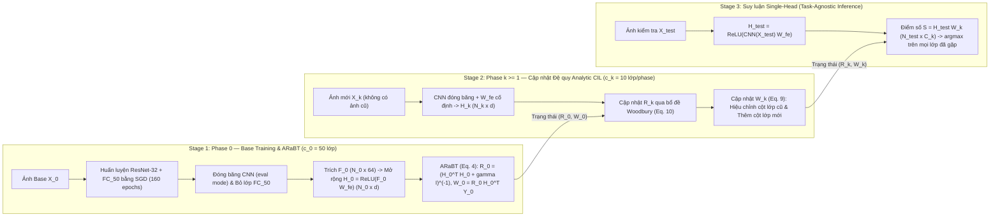

# Reading the Paper — Analytic Class-Incremental Learning (ACIL, NeurIPS 2022)

- **Bài báo mục tiêu:** Huiping Zhuang, Zhenyu Weng, Hongxin Wei, Renchunzi Xie, Kar-Ann Toh, Zhiping Lin, *"ACIL: Analytic Class-Incremental Learning with Absolute Memorization and Privacy Protection"*, Advances in Neural Information Processing Systems (NeurIPS), vol. 35, pp. 11602–11614, 2022 [1].
- **Mục đích tài liệu:** Tổng hợp nội dung đọc hiểu lý thuyết của bài báo **ACIL** phục vụ báo cáo giữa kỳ môn Nhập môn Máy học (HCMUS) và làm tài liệu tham chiếu phương pháp cho repository.
- **Sơ đồ minh họa tự vẽ đi kèm:**
  - Hình bài toán & đối chiếu tiền nhiệm: [`reports/figures/acil_problem_and_predecessors.png`](../reports/figures/acil_problem_and_predecessors.png)
  - Sơ đồ kiến trúc & pipeline end-to-end: [`reports/figures/acil_pipeline_end_to_end.png`](../reports/figures/acil_pipeline_end_to_end.png)

---

## 1. Context & Motivation (Bối cảnh, Động lực & Phương pháp tiền nhiệm)

### 1.1. Phát biểu bài toán Class-Incremental Learning (CIL) và thách thức chính

Trong học sâu thông thường, mô hình phân loại được huấn luyện một lần trên tập dữ liệu tĩnh chứa sẵn tất cả các lớp. Tuy nhiên, trong nhiều bài toán thực tế, các lớp đối tượng mới xuất hiện tuần tự theo từng giai đoạn (phases/tasks) $k = 0, 1, \dots, K$:

- Ở **phase $k$**, hệ thống chỉ nhận tập dữ liệu mới $\mathcal{D}_k^{\text{train}} = \{(X_k^{(i)}, y_k^{(i)})\}_{i=1}^{N_k}$ thuộc $c_k$ lớp mới. Các tập lớp giữa các phase rời nhau từng đôi một ($\mathcal{C}_i \cap \mathcal{C}_j = \emptyset$ với $i \neq j$).
- Sau khi hoàn tất cập nhật tại phase $k$, mô hình phải phân loại được **tất cả các lớp đã từng xuất hiện** từ đầu đến hiện tại, tức $C_k = \sum_{j=0}^{k} c_j$ lớp, **mà không được cung cấp chỉ số phase/task của mẫu kiểm tra khi suy luận** (*task-agnostic / single-head evaluation*) [1], [2].
- Ràng buộc của thiết lập **Exemplar-Free / Privacy-Preserving CIL**: Khi đã chuyển sang phase $k$, dữ liệu gốc của các phase trước ($\mathcal{D}_0^{\text{train}}, \dots, \mathcal{D}_{k-1}^{\text{train}}$) không còn được lưu trữ hoặc không được phép truy cập lại do giới hạn bộ nhớ và yêu cầu bảo mật dữ liệu [1].

Khi huấn luyện tiếp mạng nơ-ron bằng hạ gradient ngẫu nhiên (SGD / Backpropagation) chỉ trên dữ liệu lớp mới $\mathcal{D}_k^{\text{train}}$, trọng số mạng bị kéo lệch về phía các lớp mới và làm mất khả năng phân biệt các lớp cũ — hiện tượng **Quên thảm khốc (*Catastrophic Forgetting*)** [1], [2], [3]. Ngược lại, nếu giữ cố định mạng quá mức để bảo vệ lớp cũ, mô hình lại khó thích nghi với lớp mới — dẫn đến bài toán đánh đổi giữa **Độ ổn định và Độ dẻo (*Stability–Plasticity Dilemma*)** [1].

---

### 1.2. Ví dụ thực tế tự đặt

> **Bối cảnh nhóm xây dựng: Hệ thống hỗ trợ sàng lọc tổn thương da liễu liên viện tại các bệnh viện tuyến tỉnh**

1. **Thiết lập ban đầu (Phase 0 — Base Phase):**
   - Một mô hình thị giác máy tính được huấn luyện ban đầu trên **50 nhóm bệnh lý da liễu phổ biến** (viêm da cơ địa, vảy nến, nấm da, dày sừng ánh sáng, u hắc tố điển hình...) từ kho ảnh chuẩn hóa.
2. **Luồng phát sinh lớp mới theo thời gian (Incremental Phases $k = 1, \dots, K$):**
   - Mỗi quý (mỗi phase $k$), các bệnh viện chuyên khoa ghi nhận thêm **10 biến thể bệnh lý hoặc hội chứng da mới nổi / ít gặp** (ví dụ: tổn thương da hậu nhiễm virus mới, phản ứng thuốc đặc hiệu, ký sinh trùng theo vùng dịch tễ). Hệ thống cần cập nhật để nhận diện đồng thời cả **50 nhóm bệnh cũ lẫn $10 \times k$ nhóm bệnh mới** trên một đầu ra chẩn đoán chung.
3. **Vì sao các cách làm thông thường gặp khó khăn trong kịch bản này?**
   - **Không thể lưu ảnh bệnh nhân cũ để phát lại (Ràng buộc pháp lý & quyền riêng tư):** Ảnh tổn thương da là dữ liệu y tế nhạy cảm có khả năng định danh bệnh nhân (theo quy định bảo mật bệnh án điện tử / Nghị định 13/2023/NĐ-CP về Bảo vệ dữ liệu cá nhân). Sau khi kết thúc đợt huấn luyện hoặc hết thời hạn lưu trữ tạm, hệ thống **phải xóa ảnh gốc của bệnh nhân cũ**, không được đóng gói kho ảnh cũ (exemplar buffer) chuyển giữa các viện để chạy replay.
   - **Không thể fine-tune chỉ trên 10 bệnh mới:** Nếu chỉ chạy SGD trên ảnh của 10 bệnh mới trong quý hiện tại, mô hình sẽ dự đoán nhầm phần lớn ca mắc 50 bệnh phổ biến ban đầu sang 10 bệnh mới (*Catastrophic Forgetting*), gây sai lệch trong sàng lọc lâm sàng.
   - **Không thể huấn luyện lại từ đầu (Joint Training) mỗi quý:** Việc gom lại toàn bộ ảnh lịch sử vừa vướng quy định lưu trữ dữ liệu bệnh nhân, vừa tốn nhiều giờ huấn luyện GPU cho mỗi đợt cập nhật tại bệnh viện tuyến dưới.
4. **Yêu cầu đặt ra cho thuật toán:**
   - Cần một cơ chế cập nhật **không lưu ảnh bệnh nhân cũ**, chỉ giữ lại trạng thái ma trận từ các quý trước, cập nhật nhanh ngay trên máy trạm CPU/GPU khi có dữ liệu quý mới, nhưng vẫn đạt nghiệm phân loại tương đương với khi giải gộp trên toàn bộ lịch sử đặc trưng. Đây là bài toán mà **ACIL** hướng tới [1].

---

### 1.3. Phân tích các phương pháp tiền nhiệm

Để thấy rõ vị trí của ACIL, phần dưới đây đối chiếu **3 hướng tiếp cận tiền nhiệm tiêu biểu** theo 3 khía cạnh: ý tưởng chính, hạn chế còn tồn tại và hệ quả thực tế (minh họa tại [`reports/figures/acil_problem_and_predecessors.png`](../reports/figures/acil_problem_and_predecessors.png)):

#### Tiền nhiệm 1: Learning without Forgetting — LwF (Li & Hoiem, 2018) [3] *(Hướng Regularization / Knowledge Distillation không lưu mẫu)*
- **Ý tưởng chính:**
  - Không lưu trữ ảnh của các phase cũ. Trước khi học phase mới $k$, mô hình đóng băng bản sao mạng từ phase $k-1$ làm mạng giáo viên (*teacher*).
  - Khi đưa ảnh lớp mới $X_k$ vào mạng hiện tại, hàm mất mát gồm hai phần: (1) Cross-Entropy trên các đầu ra lớp mới với nhãn thật $Y_k$, và (2) **Knowledge Distillation loss** giữ cho các logit lớp cũ của mạng mới bám sát logit do mạng giáo viên tính trên chính tập ảnh $X_k$ [3].
- **Hạn chế:**
  - Mạng giáo viên chỉ được truy vấn trên **dữ liệu của các lớp mới $X_k$**, vốn có phân phối đặc trưng khác với dữ liệu thực tế của các lớp cũ $X_{0:k-1}$ (*out-of-distribution distillation*).
  - Khi cập nhật nối tiếp qua nhiều phase ($K$ lớn), sai số chưng cất cộng dồn từ phase $k-1$ sang phase $k$, đồng thời ranh giới phân loại giữa lớp cũ và lớp mới không được căn chỉnh trực tiếp do thiếu mẫu lớp cũ [1], [2].
- **Hệ quả thực tế:**
  - Độ chính xác trung bình giảm nhanh khi số phase tăng trong thiết lập single-head CIL (trên CIFAR-100 nhiều phase, LwF bị lệch mạnh về các lớp học ở phase cuối và giảm mạnh độ chính xác trên các lớp ở phase 0) [2]. Trong ứng dụng dài hạn, mô hình dần mất khả năng nhận diện nhóm lớp nền ban đầu.

#### Tiền nhiệm 2: iCaRL — Incremental Classifier and Representation Learning (Rebuffi et al., 2017) [2] *(Hướng Exemplar Replay + Nearest-Mean-of-Exemplars)*
- **Ý tưởng chính:**
  - Nới lỏng điều kiện không lưu mẫu bằng cách giữ một bộ nhớ đệm giới hạn $\mathcal{M}$ (*exemplar memory*, ví dụ cố định $|\mathcal{M}| = 2000$ ảnh trên CIFAR-100) chọn theo chiến lược *herding* để xấp xỉ tâm lớp của các lớp cũ [2].
  - Ở mỗi phase $k$, iCaRL gộp dữ liệu mới $\mathcal{D}_k^{\text{train}}$ với bộ nhớ $\mathcal{M}$ để huấn luyện lại mạng bằng SGD kết hợp distillation loss, sau đó phân loại bằng tâm mẫu gần nhất (*Nearest-Mean-of-Exemplars — NME*) trên đặc trưng chuẩn hóa $L_2$ [2].
- **Hạn chế:**
  - Phải lưu trữ và dùng lại ảnh gốc của các lớp cũ trong suốt vòng đời hệ thống [1], [2].
  - Khi tổng số lớp $C_k$ tăng nhưng ngân sách bộ nhớ $|\mathcal{M}|$ cố định, số mẫu đại diện mỗi lớp cũ $m = |\mathcal{M}| / C_k$ giảm dần, gây **mất cân bằng lớp** giữa hàng trăm mẫu/lớp mới và chỉ vài chục mẫu/lớp cũ trong quá trình huấn luyện SGD [1], [4].
- **Hệ quả thực tế:**
  - Không áp dụng được ở các bài toán cấm lưu dữ liệu gốc vì quy định quyền riêng tư (y tế, tài chính, sinh trắc học) [1].
  - Kể cả khi được phép lưu mẫu, mỗi phase mới vẫn cần chạy lại hàng chục đến hàng trăm epoch SGD trên GPU, và ước lượng tâm lớp kém chính xác dần khi số lớp lớn.

#### Tiền nhiệm 3: PODNet (Douillard et al., 2020) [4] & AANets (Liu et al., 2021) [5] *(Hướng Distillation không gian đa tầng & Kiến trúc hai nhánh)*
- **Ý tưởng chính:**
  - **PODNet [4]:** Kết hợp bộ nhớ exemplar với chưng cất đặc trưng không gian đa tầng (*Pooled Outputs Distillation — POD*) dọc theo chiều rộng và chiều cao của các feature map trung gian trong ResNet, đi cùng bộ phân loại Local Similarity Classifier (LSC) để hạn chế biến dạng biểu diễn qua nhiều phase nhỏ.
  - **AANets [5]:** Xây dựng hai nhánh residual song song ở mỗi tầng — một nhánh dẻo (*plastic branch*) thích nghi với đặc trưng lớp mới và một nhánh ổn định (*stable branch*) giữ đặc trưng lớp cũ — rồi học trọng số tổng hợp thích nghi (*Adaptive Aggregation*) kết hợp với exemplar replay.
- **Hạn chế:**
  - Cả hai phương pháp vẫn **dựa vào exemplar replay** (thường lưu 20 mẫu/lớp cũ) và quy trình tối ưu lặp SGD nhiều epoch với nhiều siêu tham số cân bằng loss (distillation weight, margin, cosine scaling, two-stage fine-tuning) [1], [4], [5].
  - Khi số phase $K$ tăng lên ($K = 25, 50$), việc cập nhật backpropagation lặp lại nhiều đợt vẫn gây trôi biểu diễn (*representation drift*) và làm giảm độ chính xác trung bình $\bar{A}$ (theo Table 1 của bài báo [1] trên CIFAR-100, từ $K=5$ sang $K=25$, PODNet giảm từ $64.83\%$ xuống $60.72\%$; AANets giảm từ $66.31\%$ xuống $62.31\%$).
- **Hệ quả thực tế:**
  - Không đáp ứng được yêu cầu exemplar-free, chi phí huấn luyện cộng dồn tăng theo số phase nhân với số epoch SGD, và chất lượng giảm rõ khi hệ thống phải cập nhật thành nhiều đợt nhỏ [1].

---

## 2. Contributions & Novelty (Phân loại Đóng góp & Tính mới)

### 2.1. Phân loại các đóng góp của bài báo

Các đóng góp của ACIL [1] có thể chia thành 3 nhóm chính:

| Phân loại | Nội dung đóng góp trong ACIL [1] |
|---|---|
| **1. Đóng góp Lý thuyết (Theoretical)** | - **Định lý 3.1 (Tương đương đại số với học gộp giải tích):** Chứng minh rằng trọng số phân loại $W_k$ cập nhật đệ quy ở từng phase $k$ của ACIL (không dùng lại dữ liệu cũ) **trùng khớp về mặt đại số** với nghiệm đóng $\tilde{W}_k$ của bài toán hồi quy Ridge học gộp (*joint analytic learning*) trên toàn bộ đặc trưng lịch sử $X_{0:k}^{\text{train}}$ [1]. - **Làm rõ tính chất *Absolute Memorization* ở tầng phân loại:** Loại bỏ sự phụ thuộc vào thứ tự phase/minibatch đối với nghiệm tuyến tính khi không gian đặc trưng cố định. |
| **2. Đóng góp Kỹ thuật / Thuật toán (Technical)** | - **Tổ chức pipeline ACIL gồm 3 bước:** (i) Đóng băng backbone CNN sau phase 0 và chiếu đặc trưng qua tầng **Feature Expansion (FE)** ngẫu nhiên cố định kèm $\operatorname{ReLU}$ để tăng khả năng tách tuyến tính trong không gian chiều cao $d$; (ii) **Analytic Re-alignment on Base Training (ARaBT)** khởi tạo $R_0, W_0$ bằng nghiệm đóng Ridge thay cho lớp FC của backpropagation; (iii) **Cập nhật đệ quy qua bổ đề Sherman–Morrison–Woodbury (Recursive Least Squares — RLS)** chỉ giữ hai ma trận $R_{k-1} \in \mathbb{R}^{d\times d}$ và $W_{k-1} \in \mathbb{R}^{d\times C_{k-1}}$ để cập nhật đồng thời cột trọng số lớp cũ và cột trọng số lớp mới [1]. |
| **3. Đóng góp Thực nghiệm (Empirical)** | - Đánh giá trên CIFAR-100, ImageNet-Subset và ImageNet-Full với $K = 5, 10, 25, 50$ phases, cho thấy một phương pháp **không lưu mẫu cũ (exemplar-free)** và **không huấn luyện lại backbone** vẫn đạt độ chính xác tương đương hoặc cao hơn các phương pháp lưu mẫu (PODNet, AANets, LUCIR, iCaRL) ở các kịch bản nhiều phase ($K=25, 50$) [1]. - Cho thấy nghiệm cuối của ACIL **giữ nguyên khi thay đổi cách chia số phase $K$** (nếu cố định tập base 50%) và thời gian cập nhật mỗi phase mới nhanh hơn đáng kể so với huấn luyện lặp bằng SGD [1]. |

### 2.2. Điểm mới của ACIL khi đặt cạnh các phương pháp tiền nhiệm

Điểm khác biệt chính của ACIL so với các hướng trước đó nằm ở cách **chuyển bài toán cập nhật liên tục từ tối ưu gradient lặp sang bài toán hồi quy tuyến tính lồi có nghiệm đóng**:

1. **Hạn chế chung của các hướng dựa trên SGD:**
   - Các phương pháp dùng SGD/Backpropagation (cả nhóm regularization như LwF/EWC lẫn nhóm replay như iCaRL/PODNet/AANets) đều cập nhật mạng bằng gradient cục bộ qua từng phase. Khi không lưu toàn bộ dữ liệu cũ, quỹ đạo tối ưu SGD lệch dần khỏi nghiệm học gộp, khiến chất lượng mô hình giảm khi số phase $K$ lớn [1].
2. **Cách tiếp cận của ACIL:**
   - ACIL tách riêng hai giai đoạn: **(1) học biểu diễn đặc trưng bằng CNN ở phase 0** và **(2) giải bài toán hồi quy Ridge có nghiệm đóng trong không gian đặc trưng mở rộng $d$ chiều ở mọi phase $k \ge 0$** [1].
   - Dựa vào tính cộng tính của tổng ma trận Gram $\sum_{j=0}^k H_j^T H_j$ và bổ đề nghịch đảo Woodbury, thông tin tương quan bậc hai của dữ liệu cũ được lưu gọn trong ma trận $R_{k-1} \in \mathbb{R}^{d\times d}$ (*Regularized Feature Autocorrelation Matrix — RFAM*) [1].
   - Nhờ cấu trúc này, ACIL kết hợp được ba đặc điểm cùng lúc:
     1. **Không lưu mẫu dữ liệu thô của các phase cũ** (*Exemplar-free*);
     2. **Nghiệm phân loại sau $K$ phase khớp với nghiệm học gộp giải tích** (sai lệch thực tế chỉ ở mức sai số dấu phẩy động);
     3. **Mỗi phase mới chỉ cần duyệt qua dữ liệu đúng một lượt (*single-pass*)**, không phải chạy nhiều epoch tối ưu lặp [1].

---

## 3. Method — Phân tích Phương pháp theo 5 Lớp (5-Layer Breakdown)

### Lớp 1: Hệ thống ký hiệu & Phát biểu toán học (Notation & Problem Formulation)

Để thống nhất giữa bài báo gốc [1] và mã nguồn tái lập trong [`src/analytic.py`](../src/analytic.py) (đặc tả tại [`docs/Dac_ta_ACIL.md`](Dac_ta_ACIL.md)), hệ thống ký hiệu được định nghĩa như sau:

| Ký hiệu | Kích thước (Shape) | Ý nghĩa toán học và vai trò trong thuật toán |
|---|---|---|
| $k \in \{0, 1, \dots, K\}$ | Vô hướng | Chỉ số phase: $k=0$ là phase khởi tạo (Base phase), $k \ge 1$ là các phase học tăng dần. |
| $X_k^{\text{train}}, Y_k^{\text{train}}$ | $N_k \times (\text{C,H,W})$, $N_k \times c_k$ | Tập gồm $N_k$ ảnh huấn luyện và ma trận nhãn one-hot của $c_k$ lớp mới xuất hiện tại phase $k$. |
| $C_k = \sum_{j=0}^{k} c_j$ | Vô hướng | Tổng số lớp tích lũy đã học từ phase $0$ đến hết phase $k$ (với CIFAR-100, $K=5$: $C_0=50, C_1=60, \dots, C_5=100$). |
| $f_{\text{cnn}}(\cdot; \theta_0)$ | $\mathbb{R}^{N_k \times d_{\text{cnn}}}$ | Đặc trưng phẳng rút trích sau tầng Global Average Pooling của backbone CNN đã đóng băng trọng số $\theta_0$ (với ResNet-32 CIFAR: $d_{\text{cnn}} = 64$). |
| $W_{\text{fe}}$ | $\mathbb{R}^{d_{\text{cnn}} \times d}$ | Ma trận mở rộng đặc trưng ngẫu nhiên cố định, lấy mẫu độc lập từ phân phối chuẩn $\mathcal{N}(0, 1)$ một lần duy nhất và giữ nguyên qua mọi phase. |
| $H_k \text{ (hay } X_k^{(\text{fe})}\text{)}$ | $\mathbb{R}^{N_k \times d}$ | Ma trận đặc trưng mở rộng tại phase $k$: $H_k = \operatorname{ReLU}(f_{\text{cnn}}(X_k^{\text{train}}; \theta_0) W_{\text{fe}})$, với $d \gg d_{\text{cnn}}$ (benchmark dùng $d = 8000$). |
| $\tilde{H}_k \text{ (hay } X_{0:k}^{(\text{fe})}\text{)}$ | $\mathbb{R}^{(\sum_{j=0}^k N_j) \times d}$ | Ma trận ghép dọc đặc trưng mở rộng của toàn bộ các phase từ $0$ đến $k$: $\tilde{H}_k = [H_0^T, H_1^T, \dots, H_k^T]^T$. |
| $\tilde{Y}_k \text{ (hay } Y_{0:k}\text{)}$ | $\mathbb{R}^{(\sum_{j=0}^k N_j) \times C_k}$ | Ma trận nhãn one-hot đường chéo khối của toàn bộ dữ liệu từ phase $0$ đến $k$: $\tilde{Y}_k = \operatorname{diag}(Y_0, Y_1, \dots, Y_k)$. |
| $\gamma > 0$ | Vô hướng | Hệ số điều chuẩn $L_2$ (Ridge regularization), bảo đảm ma trận tương quan luôn xác định dương và khả nghịch. |
| $R_k$ | $\mathbb{R}^{d \times d}$ | Ma trận nghịch đảo tương quan đặc trưng có điều chuẩn (*Regularized Feature Autocorrelation Matrix — RFAM*) tại phase $k$: $R_k = (\tilde{H}_k^T \tilde{H}_k + \gamma I_d)^{-1}$. |
| $W_k$ | $\mathbb{R}^{d \times C_k}$ | Ma trận trọng số phân loại tuyến tính cho toàn bộ $C_k$ lớp đã học sau phase $k$. |

**Mục tiêu tối ưu tổng quát (Joint Analytic Objective tại phase $k$):**
Giả sử tại phase $k$, nếu ta có đầy đủ dữ liệu từ phase $0$ đến $k$, bài toán học phân loại tuyến tính được mô hình hóa thành bài toán tối ưu lồi bậc hai (Ridge Regression trên nhãn one-hot) [1]:

$$
\min_{W \in \mathbb{R}^{d \times C_k}} \mathcal{L}_{\text{joint}}(W) = \left\| \tilde{Y}_k - \tilde{H}_k W \right\|_F^2 + \gamma \| W \|_F^2
$$

trong đó $\|\cdot\|_F$ là chuẩn Frobenius. Do hàm mục tiêu lồi chặt với mọi $\gamma > 0$, đạo hàm bậc nhất bằng $0$ cho nghiệm đóng duy nhất:

$$
\tilde{W}_k = \left( \tilde{H}_k^T \tilde{H}_k + \gamma I_d \right)^{-1} \tilde{H}_k^T \tilde{Y}_k
$$

Mục tiêu của ACIL là **tính được đúng nghiệm $\tilde{W}_k$ tại mỗi phase $k$ chỉ từ dữ liệu hiện tại $(H_k, Y_k)$ và trạng thái $(R_{k-1}, W_{k-1})$**, không cần truy cập lại $(H_0, Y_0), \dots, (H_{k-1}, Y_{k-1})$ [1].

---

### Lớp 2: Kiến trúc & Sơ đồ Pipeline End-to-End

Toàn bộ luồng xử lý của ACIL được minh họa trong sơ đồ tự vẽ [`reports/figures/acil_pipeline_end_to_end.png`](../reports/figures/acil_pipeline_end_to_end.png) và gồm **3 giai đoạn nối tiếp nhau**:

---

### Lớp 3: Phân tích chi tiết từng thành phần trong ACIL

#### Thành phần 1: Đóng băng Backbone CNN sau Base Training ($\operatorname{CNN}_{\theta_0}$)
- **Mô tả thành phần:** Mạng trích xuất đặc trưng (ResNet-32 trên CIFAR-100) được huấn luyện bằng SGD + Cross-Entropy trên $c_0 = 50$ lớp base trong 160 epochs, sau đó bỏ lớp phân loại tạm (`FC_50`) và giữ cố định toàn bộ tham số lẫn thống kê BatchNorm (`model.eval()`, `requires_grad = False`) [1].
- **Lý do thiết kế:**
  1. Nếu tiếp tục cập nhật backbone bằng backpropagation trên các phase mới khi không có dữ liệu cũ, các tầng tích chập sẽ thay đổi và làm lệch không gian biểu diễn của các lớp cũ (*representation drift / catastrophic forgetting*).
  2. Công thức đệ quy tuyến tính ở tầng đầu ra chỉ tương đương với nghiệm học gộp khi phép ánh xạ từ ảnh đầu vào sang vector đặc trưng $\phi(x) = \operatorname{ReLU}(f_{\text{cnn}}(x; \theta_0) W_{\text{fe}})$ **giữ nguyên không đổi qua mọi phase** [1].
- **Cách triển khai trong code:**
  - Ở mọi phase $k \ge 0$ (cả khi khởi tạo ARaBT, cập nhật tăng dần và đánh giá test), ảnh đi qua cùng phép chuẩn hóa cố định (tính trên tập base train) rồi qua $\operatorname{CNN}_{\theta_0}$ ở chế độ `eval()` để trích vector đặc trưng $f \in \mathbb{R}^{64}$ (sau Global Average Pooling) ở `float32`, sau đó chuyển sang `float64` cho bước tính toán giải tích.

#### Thành phần 2: Tầng Mở rộng Đặc trưng Ngẫu nhiên (Feature Expansion — FE)
- **Mô tả thành phần:** Phép chiếu tuyến tính ngẫu nhiên cố định $W_{\text{fe}} \in \mathbb{R}^{d_{\text{cnn}} \times d}$ ($d \gg d_{\text{cnn}}$, cụ thể $64 \to 8000$) đi kèm hàm kích hoạt phi tuyến $\operatorname{ReLU}$ [1]:
  $$
  H_k = \operatorname{ReLU}\!\left( f_{\text{cnn}}(X_k; \theta_0)\, W_{\text{fe}} \right) \in \mathbb{R}^{N_k \times d}
  $$
- **Động lực toán học & thực nghiệm:**
  - Đầu ra trực tiếp của ResNet-32 trên CIFAR chỉ có $d_{\text{cnn}} = 64$ chiều, nhỏ hơn tổng số lớp cần phân loại ($C_5 = 100$). Đặt bộ phân loại tuyến tính trực tiếp trên không gian $64$ chiều khi backbone đã đóng băng sẽ bị thiếu chiều biểu diễn (*under-parameterized*) để phân tách tốt 100 lớp.
  - Theo định lý Cover (Cover's Theorem), phép chiếu phi tuyến ngẫu nhiên ($\cdot \, W_{\text{fe}}$ kết hợp $\operatorname{ReLU}$) đưa đặc trưng $64$ chiều lên không gian chiều cao $d = 8000$, giúp các cụm lớp dễ tách tuyến tính hơn trước khi giải hồi quy Ridge [1].
  - *Đối chiếu từ thực nghiệm R2 của nhóm:* Khi bỏ tầng FE (dùng trực tiếp $f_{\text{cnn}} \in \mathbb{R}^{64}$ với $\gamma = 0.1$), độ chính xác trung bình $\bar{A}$ chỉ đạt **$53.25\%$**; khi bật FE ($d = 8000, \gamma = 0.1$), $\bar{A}$ đạt **$65.12\%$** — tăng **+$11.86\text{ pp}$** trên cùng một checkpoint backbone ([`reports/R2_CIFAR100_K5_20261107.md`](../reports/R2_CIFAR100_K5_20261107.md)).
- **Cách triển khai trong code:**
  - Ma trận $W_{\text{fe}} \sim \mathcal{N}(0, 1)^{64 \times 8000}$ được sinh một lần bằng bộ sinh số ngẫu nhiên riêng (`seed + 1000`), không dùng bias, không cập nhật gradient và giữ nguyên từ phase 0 đến phase $K$.

#### Thành phần 3: Căn chỉnh Giải tích trên tập Base (Analytic Re-alignment on Base Training — ARaBT)
- **Mô tả thành phần:** Khởi tạo lại bộ phân loại ở phase 0 bằng nghiệm đóng hồi quy Ridge (Phương trình (3)–(4) trong bài báo [1]) thay vì dùng tiếp trọng số lớp `FC_50` từ bước huấn luyện SGD.
- **Vì sao cần bước căn chỉnh này?**
  - Lớp `FC_50` tối ưu hàm Cross-Entropy bằng SGD nên không phải nghiệm cực tiểu của bài toán bình phương tối thiểu có điều chuẩn trên đặc trưng mở rộng $H_0 \in \mathbb{R}^{N_0 \times d}$, đồng thời cũng chưa có ma trận $R_0$. Để các bước cập nhật đệ quy ở phase $k \ge 1$ khớp với nghiệm học gộp, trạng thái xuất phát ở $k = 0$ phải là nghiệm của $\left\| Y_0 - H_0 W_0 \right\|_F^2 + \gamma \| W_0 \|_F^2$ đi cùng ma trận $R_0$ [1].
- **Quy trình tính toán theo batch:**
  - Cộng dồn ma trận Gram và ma trận tương quan chéo trên $N_0 = 25{,}000$ mẫu base (hàm `initialize_batches` trong [`src/analytic.py`](../src/analytic.py) cộng theo từng minibatch để tránh phải lưu toàn bộ ma trận $25{,}000 \times 8{,}000$ trong RAM):
    $$
    A_0 = \sum_{b} H_{0,b}^T H_{0,b} + \gamma I_d \in \mathbb{R}^{d \times d}, \qquad B_0 = \sum_{b} H_{0,b}^T Y_{0,b} \in \mathbb{R}^{d \times c_0}
    $$
  - Giải hệ đối xứng xác định dương bằng phân rã Cholesky ($A_0 = L L^T$) để lấy trạng thái ban đầu (Phương trình (4) [1]):
    $$
    R_0 = A_0^{-1} = \left( H_0^T H_0 + \gamma I_d \right)^{-1}, \qquad W_0 = R_0 H_0^T Y_0 = A_0^{-1} B_0
    $$
  - Lưu ý khi cài đặt: hạng tử $\gamma I_d$ **chỉ cộng một lần duy nhất khi lập $A_0$**; không cộng lặp lại ở các batch hay các phase tiếp theo.

#### Thành phần 4: Cập nhật Đệ quy Ma trận Nghịch đảo Tương quan Đặc trưng ($R_k$)
- **Công thức cập nhật (Phương trình (10) [1]):** Khi nhận dữ liệu đặc trưng mới $H_k \in \mathbb{R}^{N_k \times d}$, ma trận $R_{k-1} \to R_k \in \mathbb{R}^{d \times d}$ được cập nhật đệ quy:
  $$
  R_k = R_{k-1} - R_{k-1} H_k^T \left( I_{N_k} + H_k R_{k-1} H_k^T \right)^{-1} H_k R_{k-1}
  $$
- **Lợi ích về chi phí tính toán:**
  - Theo định nghĩa học gộp, $R_k^{-1} = \tilde{H}_k^T \tilde{H}_k + \gamma I_d = (\tilde{H}_{k-1}^T \tilde{H}_{k-1} + \gamma I_d) + H_k^T H_k = R_{k-1}^{-1} + H_k^T H_k$.
  - Nếu nghịch đảo trực tiếp ma trận cỡ $d \times d$ ($d = 8000$) sau mỗi lần cộng, chi phí sẽ là $\mathcal{O}(d^3)$. Khi áp dụng **bổ đề nghịch đảo Sherman–Morrison–Woodbury** theo từng minibatch kích thước $b = 128 \ll d = 8000$, phép nghịch đảo chỉ thực hiện trên ma trận kích thước nhỏ $b \times b$:
    $$
    S_b = I_b + H_b R_{\text{old}} H_b^T \in \mathbb{R}^{b \times b}
    $$
    nhờ đó giảm chi phí mỗi batch từ $\mathcal{O}(d^3)$ xuống $\mathcal{O}(b^3 + b d^2)$ [1].
- **Các bước tính ổn định số học:**
  - Trong hàm `incremental_update` ([`src/analytic.py`](../src/analytic.py)), với mỗi minibatch $H_b \in \mathbb{R}^{b \times d}$:
    1. Tính $P = R_{\text{old}} H_b^T \in \mathbb{R}^{d \times b}$.
    2. Lập ma trận đối xứng xác định dương $S_b = I_b + H_b P \in \mathbb{R}^{b \times b}$.
    3. Giải hệ tuyến tính $S_b K^T = P^T$ bằng Cholesky (thay vì gọi `inv` trực tiếp), cập nhật $R_{\text{new}} = R_{\text{old}} - P S_b^{-1} P^T$ và lấy trung bình đối xứng $R_{\text{new}} \leftarrow \frac{1}{2}(R_{\text{new}} + R_{\text{new}}^T)$ để hạn chế sai số làm tròn tích lũy qua nhiều minibatch.

#### Thành phần 5: Cập nhật Đệ quy Trọng số Phân loại ($W_k$) cho lớp cũ và lớp mới
- **Hai dạng biểu diễn công thức:**
  - Dạng ghép khối theo từng phase trong bài báo (Phương trình (9) [1]):
    $$
    W_k = \left[\, W_{k-1} - R_k H_k^T H_k W_{k-1} \;\;\;\; R_k H_k^T Y_k \,\right]
    $$
  - Dạng phần dư toàn cục (*global residual form*) dùng khi cập nhật theo từng minibatch trong [`src/analytic.py`](../src/analytic.py):
    $$
    W_{\text{pad}} = \left[\, W_{\text{old}} \;\; \mathbf{0}_{d \times (C_k - C_{\text{old}})} \,\right], \qquad W_{\text{new}} = W_{\text{pad}} + R_{\text{new}} H_b^T \left( Y_{b,\text{global}} - H_b W_{\text{pad}} \right)
    $$
- **Ý nghĩa của số hạng hiệu chỉnh $-R_k H_k^T H_k W_{k-1}$:**
  - Khi thêm dữ liệu mới $H_k$, ngoài việc tính các cột trọng số cho lớp mới ($R_k H_k^T Y_k$), **các cột trọng số của lớp cũ cũng cần được điều chỉnh** một lượng $-R_k H_k^T H_k W_{k-1}$ [1].
  - Trong bài toán học gộp, nhãn one-hot của các lớp cũ trên những mẫu thuộc lớp mới $H_k$ đều bằng $\mathbf{0}$. Nếu giữ nguyên $W_{k-1}$, các cột lớp cũ có thể tạo điểm dự đoán dương lớn ($H_k W_{k-1} \neq \mathbf{0}$) trên ảnh lớp mới và gây phân loại nhầm. Số hạng $-R_k H_k^T H_k W_{k-1}$ giúp giảm phản hồi của các cột lớp cũ trên vùng đặc trưng lớp mới mà không cần truy cập lại dữ liệu cũ.
- **Tính tương đương khi chạy theo minibatch:**
  - Hai cách viết trên đồng nhất về mặt đại số:
    - Trên các cột lớp cũ ($Y_{b,\text{global}}^{(\text{old})} = \mathbf{0}$): $W_{\text{old}} + R_k H_k^T(\mathbf{0} - H_k W_{\text{old}}) = W_{k-1} - R_k H_k^T H_k W_{k-1}$ (trùng khối trái của Phương trình (9)).
    - Trên các cột lớp mới ($W_{\text{pad}}^{(\text{new})} = \mathbf{0}$ ở batch đầu tiên): $\mathbf{0} + R_k H_k^T(Y_k - \mathbf{0}) = R_k H_k^T Y_k$ (trùng khối phải của Phương trình (9)). Ở các minibatch kế tiếp trong cùng phase $k$, công thức phần dư tiếp tục cập nhật vào đúng cột của lớp đó thay vì nối thêm cột mới.

---

### Lớp 4: Các tính chất lý thuyết, Ý nghĩa trực quan & Giới hạn điều kiện

#### 4.1. Định lý 3.1 (Sự tương đương giữa ACIL đệ quy và Học gộp giải tích)

- **Phát biểu định lý (Theorem 3.1 [1]):**
  > Cho chuỗi tập dữ liệu đặc trưng mở rộng và nhãn one-hot $\{(H_j, Y_j)\}_{j=0}^k$ với backbone CNN và ma trận mở rộng $W_{\text{fe}}$ cố định. Đặt nghiệm học gộp tại phase $k$ là:
  > $$
  > \tilde{W}_k = \left( \tilde{H}_k^T \tilde{H}_k + \gamma I_d \right)^{-1} \tilde{H}_k^T \tilde{Y}_k
  > $$
  > Khi đó, nếu khởi tạo $R_0 = (H_0^T H_0 + \gamma I_d)^{-1}$, $W_0 = R_0 H_0^T Y_0$ và cập nhật đệ quy tại mỗi phase $k \ge 1$ theo:
  > $$
  > R_k = R_{k-1} - R_{k-1} H_k^T \left( I + H_k R_{k-1} H_k^T \right)^{-1} H_k R_{k-1}, \qquad W_k = \left[\, W_{k-1} - R_k H_k^T H_k W_{k-1} \;\;\; R_k H_k^T Y_k \,\right]
  > $$
  > thì với mọi $k \ge 0$, ta luôn có **$W_k = \tilde{W}_k$**.

- **Phác thảo chứng minh quy nạp:**
  1. *Bước cơ sở ($k=0$):* Từ định nghĩa khởi tạo, $W_0 = (H_0^T H_0 + \gamma I_d)^{-1} H_0^T Y_0 = \tilde{W}_0$.
  2. *Bước quy nạp ($k-1 \to k$):* Giả sử $R_{k-1} = (\tilde{H}_{k-1}^T \tilde{H}_{k-1} + \gamma I_d)^{-1}$ và $W_{k-1} = \tilde{W}_{k-1} = R_{k-1} \tilde{H}_{k-1}^T \tilde{Y}_{k-1}$.
     - Theo cấu trúc ghép dọc $\tilde{H}_k = [\tilde{H}_{k-1}^T, H_k^T]^T$, ta có:
       $$
       \tilde{H}_k^T \tilde{H}_k + \gamma I_d = \left(\tilde{H}_{k-1}^T \tilde{H}_{k-1} + \gamma I_d\right) + H_k^T I_{N_k} H_k = R_{k-1}^{-1} + H_k^T H_k
       $$
     - Áp dụng bổ đề nghịch đảo Sherman–Morrison–Woodbury $(A + U C V)^{-1} = A^{-1} - A^{-1} U (C^{-1} + V A^{-1} U)^{-1} V A^{-1}$ với $A = R_{k-1}^{-1}$, $U = H_k^T$, $C = I_{N_k}$, $V = H_k$, ta thu được $R_k = (\tilde{H}_k^T \tilde{H}_k + \gamma I_d)^{-1}$.
     - Mặt khác, do $\tilde{Y}_k = \operatorname{diag}(\tilde{Y}_{k-1}, Y_k)$, tích tương quan chéo tách thành hai khối cột:
       $$
       \tilde{H}_k^T \tilde{Y}_k = \begin{bmatrix} \tilde{H}_{k-1}^T & H_k^T \end{bmatrix} \begin{bmatrix} \tilde{Y}_{k-1} & \mathbf{0} \\ \mathbf{0} & Y_k \end{bmatrix} = \left[\, \tilde{H}_{k-1}^T \tilde{Y}_{k-1} \;\;\; H_k^T Y_k \,\right]
       $$
     - Nhân $R_k$ vào bên trái:
       $$
       \tilde{W}_k = R_k \tilde{H}_k^T \tilde{Y}_k = \left[\, R_k \tilde{H}_{k-1}^T \tilde{Y}_{k-1} \;\;\; R_k H_k^T Y_k \,\right]
       $$
     - Dùng đẳng thức $R_{k-1}^{-1} = R_k^{-1} - H_k^T H_k \implies I_d = R_k R_{k-1}^{-1} + R_k H_k^T H_k \implies R_k = R_{k-1} - R_k H_k^T H_k R_{k-1}$:
       $$
       R_k \tilde{H}_{k-1}^T \tilde{Y}_{k-1} = \left(R_{k-1} - R_k H_k^T H_k R_{k-1}\right) \tilde{H}_{k-1}^T \tilde{Y}_{k-1} = W_{k-1} - R_k H_k^T H_k W_{k-1}
       $$
     - Thay vào biểu thức của $\tilde{W}_k$, ta được đúng công thức của $W_k$. $\blacksquare$

- **Giải thích trực quan:**
  - Trong hồi quy bình phương tối thiểu, nghiệm tối ưu $\tilde{W}_k$ không phụ thuộc trực tiếp vào từng mẫu riêng lẻ mà **chỉ phụ thuộc vào hai thống kê đủ bậc hai (*sufficient statistics*)**: tổng tự tương quan đặc trưng $\sum H_j^T H_j$ và tổng tương quan chéo đặc trưng–nhãn $\sum H_j^T Y_j$.
  - Nhờ tính kết hợp và giao hoán của phép cộng ma trận, việc cộng dồn theo từng phase (hoặc từng minibatch kích thước bất kỳ) cho ra **cùng một tổng ma trận** như khi gom toàn bộ dữ liệu lại một lần. Ma trận $R_k$ lưu giữ nghịch đảo tự tương quan bậc hai của toàn bộ đặc trưng đã gặp, từ đó cung cấp đủ thông tin để hiệu chỉnh trọng số cũ $W_{k-1}$ khi có lớp mới mà không cần giữ lại dữ liệu gốc.
  - *Kiểm chứng thực nghiệm từ R3 của nhóm:* Khi chạy cập nhật đệ quy qua 5 phase trên CIFAR-100 với 3 kích thước minibatch ($b \in \{32, 128, 512\}$), sai số tương đối cực đại giữa $W_k$ đệ quy và nghiệm học gộp $\tilde{W}_k$ trên toàn bộ **54/54 mốc kiểm tra** đều $\le 1.16 \times 10^{-11}$ (`float64`), và số mẫu test lệch nhãn dự đoán argmax là **0/10,000 mẫu** ([`reports/R3_CIFAR100_K5_BATCH_20261107.md`](../reports/R3_CIFAR100_K5_BATCH_20261107.md)).

- **Các điều kiện biên & giới hạn của Định lý 3.1:**
  1. **Cố định hàm trích xuất đặc trưng ($\phi(x)$ không đổi):** Định lý 3.1 chỉ đúng khi backbone CNN, thống kê BatchNorm, phép chuẩn hóa ảnh và ma trận $W_{\text{fe}}$ giữ nguyên từ phase 0 đến phase $K$. Nếu cập nhật bất kỳ tầng nào của CNN hoặc để BatchNorm thay đổi `running_mean`/`running_var` ở các phase sau, $H_0$ và $H_k$ không còn nằm trên cùng không gian đặc trưng và đẳng thức không còn đúng.
  2. **Khả nghịch và hệ số điều chuẩn ($\gamma > 0$ cộng một lần):** Ma trận $H_0^T H_0 + \gamma I_d$ phải xác định dương ($\gamma > 0$), và $\gamma I_d$ chỉ cộng một lần ở phase 0. Nếu cộng lại $\gamma I_d$ ở mỗi phase $k$, bài toán sẽ bị đổi thành điều chuẩn với hệ số $(k+1)\gamma$.
  3. **Tương đương với *Joint Analytic Learning*, không phải *Joint End-to-End CNN Training*:** Định lý 3.1 chỉ khẳng định ACIL trùng với việc giải gộp **tầng phân loại Ridge trên đặc trưng cố định học từ 50 lớp base**, **không** tương đương với việc huấn luyện lại toàn bộ mạng ResNet-32 từ đầu trên cả 100 lớp bằng SGD. Vì vậy, chất lượng biểu diễn vẫn phụ thuộc vào tập lớp ở phase 0.
  4. **Sai số dấu phẩy động hữu hạn:** Đẳng thức $W_k = \tilde{W}_k$ được chứng minh trên số thực chính xác. Khi tính toán trên máy tính, lặp công thức Woodbury qua nhiều minibatch ở `float32` dễ tích lũy sai số làm tròn; do đó phần giải tích trong [`src/analytic.py`](../src/analytic.py) được thực hiện ở `float64`.

---

#### 4.2. Tính chất Ghi nhớ Tuyệt đối (Absolute Memorization) & Sự ổn định khi đổi số Phase $K$

- **Ý nghĩa trực quan:**
  - Vì $W_K = \tilde{W}_K$ chỉ phụ thuộc vào hợp dữ liệu $\bigcup_{k=0}^K \mathcal{D}_k^{\text{train}}$, nghiệm cuối cùng tại phase $K$ **không phụ thuộc vào việc 50 lớp mới được chia thành $K=5$ đợt (10 lớp/đợt), $K=25$ đợt (2 lớp/đợt), hay $K=50$ đợt (1 lớp/đợt)** khi giữ nguyên tập base ở phase 0 [1].
  - Nhờ đó, trong Table 1 của bài báo [1], khi tăng $K$ từ $5 \to 10 \to 25 \to 50$, độ chính xác bước cuối $A_K$ của ACIL giữ ổn định thay vì giảm nhanh như các phương pháp cập nhật bằng SGD/distillation.

- **Giới hạn cần phân biệt rõ (Vì sao có "Absolute Memorization" nhưng $F_{\text{base}}$ vẫn dương?):**
  - **"Ghi nhớ tuyệt đối" trong ACIL chỉ mang nghĩa giữ nguyên nghiệm đại số của bộ phân loại học gộp ($\|W_k - \tilde{W}_k\|_F = 0$), không có nghĩa là độ chính xác kiểm tra trên tập lớp cũ giữ nguyên không giảm ($F_{\text{base}} = 0$).**
  - Ở phase 0, mô hình chỉ lấy $\operatorname{argmax}$ trên **50 lớp**; đến phase 5, mô hình phải lấy $\operatorname{argmax}$ trên **100 lớp**. Khi số lớp ứng viên tăng gấp đôi trên cùng một không gian đặc trưng cố định, một phần mẫu test của 50 lớp cũ sẽ có điểm dự đoán rơi sang 50 lớp mới (ngay cả khi giải Joint Ridge một lần trên đủ 100 lớp).
  - Trong thực nghiệm R1 của nhóm ([`reports/R1_CIFAR100_K5_3SEEDS_20261106.md`](../reports/R1_CIFAR100_K5_3SEEDS_20261106.md)), mức giảm độ chính xác trên 50 lớp base sau 5 phase là $F_{\text{base}} = B_0 - B_5 = 8.31 \pm 0.62\text{ pp}$ (bài báo ghi $F = 9.00\%$ ở Table 1 [1]). Mức giảm này đến từ việc **bài toán phân loại 100 lớp khó hơn 50 lớp trên đặc trưng cố định**, không phải do công thức đệ quy làm mất thông tin của phase 0.

---

#### 4.3. Tính chất Bảo vệ Quyền riêng tư (Privacy Protection) & Giới hạn Lý thuyết

- **Lập luận của bài báo [1]:**
  1. ACIL **không lưu ảnh gốc $X_k$ hay ma trận đặc trưng từng mẫu $H_k \in \mathbb{R}^{N_k \times d}$** của các phase trước.
  2. Về mặt đại số, ngay cả khi biết trạng thái $(R_k, W_k)$, việc giải ngược tìm lại $H_k \in \mathbb{R}^{N_k \times d}$ từ $R_k^{-1} - R_{k-1}^{-1} = H_k^T H_k \in \mathbb{R}^{d \times d}$ là **bài toán không xác định duy nhất (*ill-posed / non-unique*)**: với mọi ma trận trực giao $Q \in \mathbb{R}^{N_k \times N_k}$ ($Q^T Q = I_{N_k}$), ma trận $\hat{H}_k = Q H_k$ đều cho cùng tích $(Q H_k)^T (Q H_k) = H_k^T H_k$, chưa kể phần thông tin đã mất qua $\operatorname{ReLU}$ và Global Average Pooling của CNN [1].

- **Giới hạn của tuyên bố bảo mật:**
  1. "Privacy Protection" trong bài báo [1] dừng ở mức **không lưu dữ liệu mẫu thô (*exemplar-free*) và không thể khôi phục duy nhất ma trận mẫu từ tích Gram**, **không phải** cơ chế bảo mật có chứng minh theo chuẩn **Differential Privacy ($(\varepsilon, \delta)$-DP)**.
  2. Ma trận $R_k = (\tilde{H}_k^T \tilde{H}_k + \gamma I_d)^{-1}$ và $W_k$ vẫn chứa thống kê bậc hai chính xác của toàn bộ tập huấn luyện. Vì vậy, dù tránh được việc lưu trữ trực tiếp hồ sơ ảnh người dùng, cơ chế này chưa đặt ra giới hạn lý thuyết chống lại các tấn công suy luận thành viên (*membership inference*) dựa trên thống kê hiệp phương sai.

---

### Lớp 5: Phân tích Độ phức tạp Thời gian & Không gian so sánh với Tiền nhiệm

#### 5.1. Độ phức tạp của ACIL theo từng giai đoạn

Ký hiệu:
- $N_k$: số mẫu huấn luyện của phase $k$; $b$: kích thước minibatch khi cập nhật giải tích ($b \ll d$);
- $d_{\text{cnn}}$: chiều đặc trưng đầu ra của backbone CNN ($64$ với ResNet-32);
- $d$: chiều không gian mở rộng đặc trưng FE ($d = 8000$ trong R1/R2);
- $C_k$: tổng số lớp đã thấy đến phase $k$ ($C_k \le C = 100$);
- $E$: số epoch huấn luyện SGD mỗi phase của các phương pháp dùng backpropagation (thường $E \in [70, 160]$);
- $M = |\mathcal{M}|$: tổng số mẫu ảnh cũ lưu trong exemplar buffer của các phương pháp replay (thường $M = 2000$ trên CIFAR-100);
- $C_{\text{fwd}}, C_{\text{bwd}}$: chi phí tính toán 1 lượt lan truyền tiến / ngược qua backbone CNN cho 1 mẫu ($C_{\text{bwd}} \approx 2\text{–}3 \times C_{\text{fwd}}$).

**1. Độ phức tạp Thời gian (Time Complexity) của ACIL tại một phase tăng dần $k \ge 1$:**
- **Trích xuất đặc trưng & chiếu FE (chỉ 1 lượt đi qua dữ liệu mới, $E = 1$, không backprop):**
  $$
  T_{\text{extract}}^{(k)} = \mathcal{O}\!\left( N_k \cdot C_{\text{fwd}} + N_k \cdot d_{\text{cnn}} \cdot d \right)
  $$
- **Cập nhật đệ quy $R_k$ và $W_k$ theo $\lceil N_k / b \rceil$ minibatch kích thước $b$:**
  - Trong mỗi minibatch $b \times d$:
    - Tính $P = R_{\text{old}} H_b^T$: $\mathcal{O}(b d^2)$ phép nhân-cộng.
    - Tính $S_b = I_b + H_b P$ và giải hệ Cholesky $b \times b$: $\mathcal{O}(b^2 d + b^3)$.
    - Cập nhật hạng-$b$ cho $R_{\text{new}} = R_{\text{old}} - P S_b^{-1} P^T$: $\mathcal{O}(b d^2)$.
    - Cập nhật $W_{\text{new}} \in \mathbb{R}^{d \times C_k}$: $\mathcal{O}(b d C_k)$.
  - Cộng trên toàn bộ $\frac{N_k}{b}$ minibatch của phase $k$ (với $C_k \ll d$ và $b \ll d$):
    $$
    T_{\text{analytic}}^{(k)} = \frac{N_k}{b} \cdot \mathcal{O}\!\left( b d^2 + b^2 d + b^3 + b d C_k \right) = \mathcal{O}\!\left( N_k d^2 + N_k b d + N_k b^2 + N_k d C_k \right) \approx \mathcal{O}\!\left( N_k d^2 \right)
    $$
  - *Nhận xét:* Nếu không chia minibatch và không dùng bổ đề Woodbury mà nghịch đảo trực tiếp ma trận $d \times d$, chi phí sẽ là $\mathcal{O}(d^3 + N_k d^2)$. Nhờ cập nhật Woodbury theo minibatch $b$, thời gian cập nhật **tăng tuyến tính theo số mẫu mới $N_k$** và **không nhân với số epoch $E$** vì chỉ duyệt qua dữ liệu mới một lần.

**2. Độ phức tạp Không gian / Bộ nhớ (Space Complexity) của ACIL giữa các phase:**
- Bộ nhớ lưu mẫu dữ liệu cũ: **$0$ bytes** (không lưu ảnh hay feature mẫu cũ).
- Bộ nhớ trạng thái mô hình giữ lại giữa các phase:
  $$
  S_{\text{state}}(\text{ACIL}) = \underbrace{|\theta_0|}_{\text{Backbone CNN}} + \underbrace{\mathcal{O}(d_{\text{cnn}} \cdot d)}_{W_{\text{fe}}} + \underbrace{\mathcal{O}(d^2)}_{R_k \in \mathbb{R}^{d\times d}} + \underbrace{\mathcal{O}(d \cdot C_k)}_{W_k \in \mathbb{R}^{d\times C_k}} = \mathcal{O}\!\left( |\theta_0| + d^2 + d C_k \right)
  $$
- Bộ nhớ đệm tạm thời trong RAM khi xử lý 1 minibatch kích thước $b$: $\mathcal{O}(b d + b^2)$.

---

#### 5.2. Bảng đối chiếu Độ phức tạp với các Phương pháp Tiền nhiệm

| Tiêu chí so sánh | **Joint Training (CNN End-to-End)** | **Regularization / Distillation (LwF [3], EWC)** | **Exemplar Replay + Distillation (iCaRL [2], PODNet [4], AANets [5])** | **ACIL [1]** |
|---|---|---|---|---|
| **Lưu dữ liệu mẫu cũ (Exemplar Buffer)** | Lưu toàn bộ $\sum_{j=0}^{k-1} N_j$ mẫu ($\mathcal{O}(N_{\text{total}})$) | **Không lưu ($0$)** | Lưu $M$ mẫu ảnh gốc ($\mathcal{O}(M \cdot D_{\text{img}})$) | **Không lưu ($0$)** |
| **Bộ nhớ trạng thái giữ giữa các phase** | $\mathcal{O}(|\theta| + N_{\text{total}} D_{\text{img}})$ | $\mathcal{O}(2|\theta|)$ (lưu thêm mạng Teacher hoặc ma trận Fisher đường chéo) | $\mathcal{O}(2|\theta| + M \cdot D_{\text{img}})$ (mạng Teacher + kho mẫu $\mathcal{M}$) | $\mathcal{O}(|\theta_0| + d^2 + d C_k)$ (ma trận $R_k, W_k, W_{\text{fe}}$) |
| **Số lượt duyệt qua CNN ở phase $k$ ($k \ge 1$)** | $E$ epochs trên toàn bộ $\sum_{j=0}^k N_j$ mẫu (Forward + Backward) | $E$ epochs trên $N_k$ mẫu mới (Forward Teacher + Forward/Backward Student) | $E$ epochs trên $(N_k + M)$ mẫu (Forward Teacher + Forward/Backward Student) | **1 lượt ($E=1$)** chỉ Forward trên $N_k$ mẫu mới (không Backward) |
| **Độ phức tạp thời gian cập nhật tại phase $k$** | $\mathcal{O}\!\left(E \cdot (\sum_{j=0}^k N_j) \cdot (C_{\text{fwd}} + C_{\text{bwd}})\right)$ | $\mathcal{O}\!\left(E \cdot N_k \cdot (2C_{\text{fwd}} + C_{\text{bwd}})\right)$ | $\mathcal{O}\!\left(E \cdot (N_k + M) \cdot (2C_{\text{fwd}} + C_{\text{bwd}})\right)$ | $\mathcal{O}\!\left(N_k C_{\text{fwd}} + N_k d^2\right)$ |
| **Độ phức tạp suy luận cho 1 mẫu test** | $\mathcal{O}(C_{\text{fwd}} + d_{\text{cnn}} C_k)$ | $\mathcal{O}(C_{\text{fwd}} + d_{\text{cnn}} C_k)$ | $\mathcal{O}(C_{\text{fwd}} + d_{\text{cnn}} C_k)$ (hoặc khoảng cách tới $C_k$ tâm lớp) | $\mathcal{O}(C_{\text{fwd}} + d_{\text{cnn}} d + d C_k)$ |
| **Khớp nghiệm học gộp** | Có (chuẩn tham chiếu CNN) | **Không** (lệch mạnh khi $K$ tăng) | **Không** (giảm dần khi $K$ tăng do $M/C_k$ nhỏ lại) | **Có (Định lý 3.1: khớp Joint Analytic)** |

---

#### 5.3. Đánh đổi thực tế về Thời gian & Bộ nhớ

1. **Lợi thế về thời gian cập nhật ở các phase tăng dần ($k \ge 1$):**
   - Các phương pháp tiền nhiệm như iCaRL, PODNet hay AANets cần chạy $E = 70\text{–}160$ epochs SGD (cả lan truyền tiến và ngược qua ResNet) ở **mỗi phase mới**, tốn nhiều thời gian GPU khi chuỗi kéo dài $K=5\text{–}50$ phases.
   - Với ACIL, sau khi huấn luyện xong backbone ở phase 0, toàn bộ 5 phase tăng dần ($25{,}000$ ảnh mới của 50 lớp) chỉ đi qua ResNet **một lần ở chế độ `eval()`** rồi cập nhật bằng các phép toán ma trận.
   - *Số liệu đo thực tế từ R1 & R3 của nhóm:*
     - Ở cấu hình $d = 8000$ (R1, [`reports/R1_CIFAR100_K5_3SEEDS_20261106.md`](../reports/R1_CIFAR100_K5_3SEEDS_20261106.md) và [`reports/R1_SEED42_KAGGLE_20261106.md`](../reports/R1_SEED42_KAGGLE_20261106.md)): huấn luyện 160 epochs SGD ở phase 0 mất **`2423.48–2537.35 s` ($\approx 40.4\text{–}42.3\text{ phút}$)** trên GPU T4, trong khi bước cập nhật giải tích một phase mới (5,000 ảnh, 40 minibatch ở phase cuối `last_incremental_seconds`) mất **`41.79–44.74 s`** trên CPU 4 luồng và toàn bộ chuỗi streaming (trích feature base + Gram/Cholesky base + 5 phase incremental + 6 lượt eval all-seen) mất **`666.00–685.23 s` ($\approx 11.1\text{–}11.4\text{ phút}$)**.
     - Ở cấu hình $d = 1024$ (R3, [`reports/R3_CIFAR100_K5_BATCH_20261107.md`](../reports/R3_CIFAR100_K5_BATCH_20261107.md)), toàn bộ chuỗi analytic (base + 5 phase) mất **$4.9975 \pm 0.1123\text{ s}$** với batch size $b=512$ (nhanh hơn **$3.47\times$** so với $b=32$ là **$17.3334 \pm 0.0784\text{ s}$** và **$1.386\times$** so với $b=128$ là **$6.9247 \pm 0.1098\text{ s}$** nhờ gom phép nhân ma trận BLAS lớn hơn ở bước base, trong khi sai số tương đối của $W$ so với joint trên 54/54 mốc vẫn $\le 1.159 \times 10^{-11}$).

2. **Đánh đổi bộ nhớ $\mathcal{O}(d^2)$ của ma trận $R_k$:**
   - Bộ nhớ trạng thái của ACIL **không tăng theo tổng số mẫu $N_{\text{total}}$**, nhưng **tăng bậc hai theo chiều mở rộng đặc trưng $d$** ($\mathcal{O}(d^2)$):
     - Với $d = 8000$ và kiểu `float64` ($8\text{ bytes/phần tử}$):
       - Ma trận $R_k \in \mathbb{R}^{8000 \times 8000}$ chiếm $8000 \times 8000 \times 8 = \mathbf{512{,}000{,}000\text{ bytes}} \approx \mathbf{488.28\text{ MiB}}$ ($\mathbf{512\text{ MB}}$).
       - Ma trận $W_5 \in \mathbb{R}^{8000 \times 100}$ chiếm $6.40\text{ MB}$; ma trận $W_{\text{fe}} \in \mathbb{R}^{64 \times 8000}$ chiếm $4.10\text{ MB}$; tổng ba ma trận là **$522.50\text{ MB}$** (hoặc $\approx 261.25\text{ MB}$ nếu lưu ở `float32`).
     - So với việc lưu $M = 2000$ ảnh gốc trên CIFAR-100 ($32 \times 32 \times 3\text{ bytes/ảnh}$): kho ảnh thô của iCaRL/PODNet trên CIFAR-100 chỉ tốn $2000 \times 3072 \approx \mathbf{6.14\text{ MB}}$, nhỏ hơn đáng kể so với ma trận $R_k$.
     - Tuy nhiên, trên tập ảnh kích thước lớn như **ImageNet** ($224 \times 224 \times 3\text{ uint8} \approx 150.5\text{ KB/ảnh}$) hoặc khi tổng dữ liệu lịch sử lên tới hàng triệu mẫu ($N_{\text{total}} = 1.28 \times 10^6$), kích thước cố định của $R_k$ không tăng theo số mẫu hay số lớp.
   - **Tóm lại:** ACIL đánh đổi *việc lưu mẫu dữ liệu thô $\mathcal{O}(M \cdot D_{\text{img}})$ và chi phí huấn luyện lặp $\mathcal{O}(K \cdot E)$* để lấy **bộ nhớ ma trận cố định $\mathcal{O}(d^2)$ theo chiều mở rộng $d$** và **chi phí cập nhật một lượt $\mathcal{O}(N_k d^2)$**.

---

## 4. Danh mục Trích dẫn Chuẩn IEEE (Đặt ở chân từng Slide tương ứng)

> **Quy tắc trích dẫn trên Slide Deck:**
> - **Không tạo slide `References` riêng ở cuối bài thuyết trình.**
> - Các nguồn tham khảo được đánh số `[1]`, `[2]`, ... ngay trong nội dung slide/notes và **đặt dòng trích dẫn IEEE tương ứng ở phần footer của chính slide có sử dụng nguồn đó**.

Danh sách chuỗi trích dẫn IEEE dùng thống nhất trong bộ slide:

- **[1]** H. Zhuang, Z. Weng, H. Wei, R. Xie, K.-A. Toh, and Z. Lin, "ACIL: Analytic class-incremental learning with absolute memorization and privacy protection," in *Advances in Neural Information Processing Systems (NeurIPS)*, vol. 35, pp. 11602–11614, 2022.
- **[2]** S.-A. Rebuffi, A. Kolesnikov, G. Sperl, and C. H. Lampert, "iCaRL: Incremental classifier and representation learning," in *Proc. IEEE Conf. Comput. Vis. Pattern Recognit. (CVPR)*, 2017, pp. 2001–2010.
- **[3]** Z. Li and D. Hoiem, "Learning without forgetting," *IEEE Trans. Pattern Anal. Mach. Intell.*, vol. 40, no. 12, pp. 2935–2947, Dec. 2018.
- **[4]** A. Douillard, M. Cord, C. Ollion, T. Robert, and E. Valle, "PODNet: Pooled outputs distillation for small-tasks incremental learning," in *Proc. Eur. Conf. Comput. Vis. (ECCV)*, 2020, pp. 86–102.
- **[5]** Y. Liu, B. Schiele, and Q. Sun, "Adaptive aggregation networks for class-incremental learning," in *Proc. IEEE/CVF Conf. Comput. Vis. Pattern Recognit. (CVPR)*, 2021, pp. 2544–2553.
- **[6]** K. He, X. Zhang, S. Ren, and J. Sun, "Deep residual learning for image recognition," in *Proc. IEEE Conf. Comput. Vis. Pattern Recognit. (CVPR)*, 2016, pp. 770–778.
- **[7]** A. Krizhevsky, "Learning multiple layers of features from tiny images," Univ. Toronto, Toronto, ON, Canada, Tech. Rep., 2009.
- **[8]** S. Hou, X. Pan, C. C. Loy, Z. Wang, and D. Lin, "Learning a unified classifier incrementally via rebalancing," in *Proc. IEEE/CVF Conf. Comput. Vis. Pattern Recognit. (CVPR)*, 2019, pp. 831–839.

