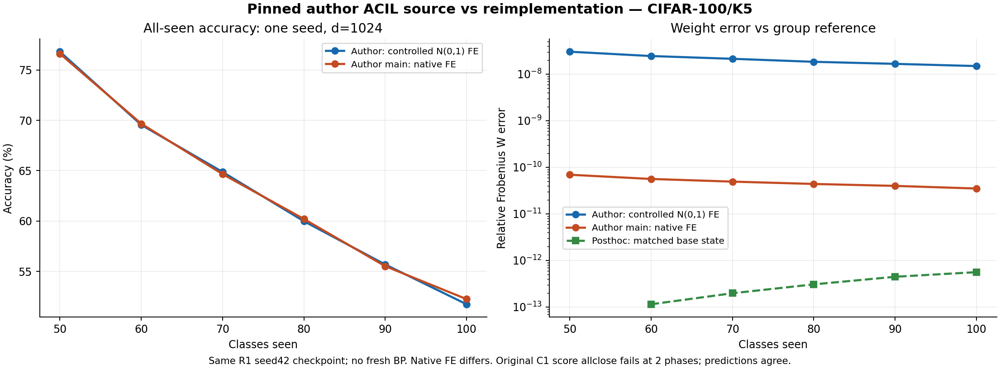

# Đối chiếu code tác giả ACIL — 07/11/2026

**Đã thực thi source tác giả, chạy đủ CIFAR-100/K5 và định vị các khác biệt. Kết quả là hoàn tất đối chiếu với một số kiểm tra không đạt, không phải mọi output đều giống nhau.** Hai lượt chính dùng chung checkpoint 160 seed 42 và full feature fixture của R3; một chẩn đoán hậu nghiệm kiểm thêm 5 cập nhật incremental sau khi căn chỉnh state base. Không train backbone mới hoặc sửa core của tác giả.

| Lượt | Phạm vi | Ā (%) | Final (%) | F_base (pp) | Kết quả so với bản nhóm trên cùng FE | W&B |
|---|---|---:|---:|---:|---|---|
| C1 — controlled | Source tác giả, FE 1024 N(0,1) và thứ tự mẫu giống R3 | 63.104034 | 51.73 | 5.96 | R/W đạt 6/6; prediction giống 6/6; score pointwise đạt 4/6 | [0tlcy6id](https://wandb.ai/hsangg-2006/acil-reproduction/runs/0tlcy6id) |
| C2 — native FE / main | `main.main(args)`, native FE initializer và native shuffle; cache/mapping/checkpoint giữ cố định | 63.149153 | 52.24 | 5.20 | R/W/score/prediction đạt 6/6; CSV main khớp metric tính độc lập | [8muywodv](https://wandb.ai/hsangg-2006/acil-reproduction/runs/8muywodv) |
| C1R — posthoc diagnostic | Nạp R/W sau base của nhóm, rồi gọi cập nhật tác giả ở5 phase còn lại | Không báo như benchmark độc lập | 51.73 | Không báo như benchmark độc lập | R/W/score/prediction đạt 5/5; base không được học lại trong phép này | [yeb0jqfb](https://wandb.ai/hsangg-2006/acil-reproduction/runs/yeb0jqfb) |

Tất cả là **một seed, d=1024**; SD giữa seed là null. Không lấy các số này thay R1 d=8000/3 seeds hoặc gọi là score fresh training mặc định của tác giả. Ba W&B Finished/public nghĩa là tracking đã hoàn tất; C1 vẫn giữ `analytic_equivalence_passed=false`. Raw suite vẫn giữ `status=failed` do gate allclose ban đầu không đạt; không sửa thành pass sau khi thấy số.

## 1. Source, môi trường và dữ liệu thực chạy

- Source tác giả: [ZHUANGHP/Analytic-continual-learning tại commit0afd6bf](https://github.com/ZHUANGHP/Analytic-continual-learning/tree/0afd6bf87622e808ce7f730f8556e78229b9e758). Đây là bản cập nhật năm 2024, gồm implementation ACIL/G-ACIL hỗ trợ minibatch; không khẳng định là snapshot source năm 2022.
- Checkout nằm ngoài repo nhóm; các file tracked có hash trước/sau giống nhau và Git status sạch. Hash runtime là bytes thực thi trên Windows (text CRLF), còn Git blob dùng LF; manifest giữ cả hai và xác nhận khác biệt chỉ do line ending. Raw JSON/W&B giữ hash runtime gốc. Core được import từ checkout đó, không chép vào `src/` nhóm.
- Code điều phối C1/C2: [compare_author_acil.py](../scripts/compare_author_acil.py), source thực chạy commit `2d74c46` (full commit/hash trong raw JSON). Chẩn đoán C1R: [diagnose_author_base_precision.py](../scripts/diagnose_author_base_precision.py), commit `5429ad9`.
- Venv riêng: Python 3.12.7, PyTorch 2.5.1+cpu, torchvision 0.20.1+cpu, NumPy 2.1.3, SciPy 1.14.1, scikit-learn 1.5.2; CPU 4 threads/float64 cho analytic. YAML tác giả ghi Python 3.11 và torch>=2.2; Python 3.12 là sai khác được công bố, không gọi đây là môi trường nguyên bản bitwise.
- Dataset: đủ 50.000 train/10.000 test CIFAR-100 từ HF revision đã pin của R1/R3; feature 64 chiều, global label mapping, normalization base-only và checkpoint 160 seed 42 giữ nguyên. Fixture R3/Kaggle version 1/scriptVersionId 366444048; checkpoint từ R1 seed 42/version 1/scriptVersionId 365844618, SHA `1f2a747347e26db933b11a9910ee780a8f8597187b40bc2191ad42108cea550d`.
- Cả hai lượt dùng 50 base+5×10 lớp, gamma=0.1, analytic batch 128 và 6 mốc đánh giá all-seen. Không crop/flip hoặc học thêm representation trong comparison.

Runner đo 184.54s cho phần thực thi gồm kiểm input, diagnostics, hai lượt, oracle/evaluation và ghi state. Con số này không gồm cài môi trường/tracking và **không phải pure analytic time** để so tốc độ Torch với NumPy. R3 vẫn là nguồn số đo hiệu năng đã chốt.

## 2. Đã chạy code thật như thế nào?

**C1** tạo `analytic.ACIL.ACIL` nguyên bản với backbone Identity trên feature cache. Buffer được nạp FE N(0,1)64×1024 đúng hash R3 tại ranh giới model. Sau đó gọi nguyên bản `fit`, `forward`, `update` trên toàn bộ ảnh theo thứ tự R3; không sửa công thức trong `RecursiveLinear`. So trạng thái mỗi phase với R3 batch 128 và joint oracle đã được kiểm độc lập.

**C2** thực sự gọi hàm `main.main(args)` trong `main.py` của tác giả, với `ACILLearner`, `Features`, DataLoader shuffle, metric và xuất `IL.csv` nguyên bản. Các adapter được công bố gồm:

1. Cache F64/nhãn toàn cục được tạo từ fixture pin, thay việc tải ảnh lại qua torchvision. Lần gọi dataset ban đầu trả `Features` của tác giả để giữ đúng nguồn/mapping; cache branch tiếp theo của main chạy nguyên bản.
2. Tên tensor của checkpoint nhóm được chuyển `stage`→`layer`, `classifier`→`fc`, strict-load vào ResNet-32 tác giả rồi lưu bridge backbone. Không gọi base training; có guard gây lỗi nếu BP mới được gọi.
3. Factory/observer chỉ lưu R/W và kiểm output sau `before_validation`; không thay `fit/forward/update`. FE được khởi tạo nguyên bản, không nạp FE nhóm như C1.
4. Args được truyền bằng dictionary và lưu lại; không gọi parser CLI. Cache đã có global labels nên dùng `dataset_seed=None` trong main, giữ class mapping của nhóm; không giả vờ đã chạy class order mặc định tác giả trên nhãn CIFAR gốc.

Xem [args C2](author_comparison_native_args.json), [CSV do main xuất](author_comparison_native_IL.csv), [hướng dẫn chạy lại](../docs/HUONG_DAN_CHAY_CODE_TAC_GIA.md). CSV công bố chuẩn hóa CRLF→LF, giữ nguyên mọi giá trị; manifest giữ cả hash raw gốc tại local và hash bytes công bố. Vì có các điều kiện kiểm soát này, C2 là phép so implementation của tác giả trên cùng representation, **chưa phải chạy lại toàn bộ recipe native 300 epochs/d8192 từ ảnh thô**.

## 3. Đối chiếu từng tầng

### 3.1. Mapping: tái hiện được lỗi có điều kiện

Chạy `Features/DatasetWrapper` nguyên bản trên fixture 100 sample, mỗi class một sample, `shuffle_seed=42`, base 50. Wrapper shuffle danh sách class indices nhưng nhãn trả về vẫn giữ ID trước shuffle; chúng không thành 0..49. Khi gọi `ACILLearner.base_training` với FC 50, validation epoch 0 phát sinh **`IndexError: Target 91 is out of bounds.`**, trước optimizer step.

Đây là lỗi có điều kiện ở phiên bản đã pin khi dùng class shuffle mà chưa remap target, không phải tuyên bố mọi cấu hình mặc định của tác giả đều lỗi. Trong pipeline nhóm, `original_to_global` được áp dụng chung train/test trước khi chia phase; base luôn 0..49. C2 dùng cache đã remap và không kích hoạt lại class shuffle của wrapper.

Nguồn định vị: [DatasetWrapper.py](https://github.com/ZHUANGHP/Analytic-continual-learning/blob/0afd6bf87622e808ce7f730f8556e78229b9e758/datasets/DatasetWrapper.py), [ACILLearner.base_training](https://github.com/ZHUANGHP/Analytic-continual-learning/blob/0afd6bf87622e808ce7f730f8556e78229b9e758/analytic/ACIL.py). Labels/exception thật nằm trong `diagnostics.mapping` của [raw JSON](author_comparison_results.json).

### 3.2. Preprocessing: quy tắc normalization khác nhau

| Thống kê | Nhóm: base train seed 42 | Tác giả: hằng số CIFAR-100 |
|---|---|---|
| Mean RGB | 0.50988568 /0.48648575 /0.44241998 | 0.50707516 /0.48654887 /0.44091784 |
| Std RGB | 0.26529790 /0.25878251 /0.27639423 | 0.26733429 /0.25643847 /0.27615047 |

Kiểm 1.000 ảnh test cân bằng 10 ảnh/lớp, chọn theo index trước khi xem score. Trên cùng ảnh, max absolute difference của tensor chuẩn hóa là **0.0251534**; nếu chỉ đổi normalization đầu vào cho cùng backbone thì max feature difference là **0.3558044**. Đây là diagnostic đầu vào; chưa phải ablation train/evaluate đầy đủ theo normalization tác giả và chưa quy gap R1−paper cho yếu tố này.

### 3.3. Backbone: cùng tensor trước pooling, khác nhỏ do reduction FP 32

Strict-load tất cả tensor sau key mapping vào ResNet-32 tác giả. Với cùng 1.000 ảnh đã normalize theo nhóm:

- Tensor sau stage 3/trước pooling **giống bitwise**, max error 0.
- Feature sau global pooling: max error **3.8146973×10⁻⁶**, đạt FP 32 allclose rtol=1e-5/atol=1e-6.
- BP logits: max error **7.6293945×10⁻⁶**, **không đạt** mọi phần tử theo cùng ngưỡng ban đầu; prediction vẫn giống 1000/1000.
- Chẩn đoán FP 64 bổ sung trên 100 ảnh, mỗi lớp một ảnh: max feature error **3.5527137×10⁻¹⁵**, logits **1.0658141×10⁻¹⁴**, đạt ngưỡng 1e-12. Kết quả FP 64 không thay thế fail FP 32.

Group dùng adaptive average pool, tác giả dùng average pool với kernel bằng kích thước feature map. Hook trước pooling giống hệt và sai khác sau pooling giảm mạnh ở FP 64 là bằng chứng định vị sai khác vào reduction số thực hữu hạn; chưa có bằng chứng kiến trúc residual/shortcut làm đổi tensor trước pooling trong phép kiểm này. Không sửa backbone R1 chỉ để lấy bitwise equality.

### 3.4. Feature expansion: native initializer khác N(0,1)

C1 nạp đúng E của R3. Forward FE Torch so với NumPy `ReLU(F@E)` đạt rtol 1e-12/atol 1e-10; max error **3.5527137×10⁻¹⁴** trên các batch train.

C2 dùng [RandomBuffer](https://github.com/ZHUANGHP/Analytic-continual-learning/blob/0afd6bf87622e808ce7f730f8556e78229b9e758/analytic/Buffer.py) gọi `reset_parameters` kế thừa Linear. Ma trận thực đo có mean 0.000144746, std 0.072401722, min−0.124996676, max 0.124996302, không bias; khác scale/phân phối/direction của E N(0,1). C2 vẫn dùng d=1024/gamma=0.1 đã kiểm soát, không dùng d8192 mặc định.

Chênh C2−C1 là **+0.045119 pp Ā**, **+0.51 pp final** trên một seed. FE và batch order cùng khác giữa hai lượt; chưa tách riêng nguyên nhân hoặc kiểm ý nghĩa thống kê của chênh lệch này.

## 4. Analytic: giữ nguyên cả kết quả không đạt

Ngưỡng chốt trước run là `allclose(rtol=1e-6, atol=1e-8)` cho R/W/score, cùng điều kiện 0 argmax khác. Relative Frobenius error là chỉ số báo cáo riêng, không thay thế điều kiện pointwise.

| Lượt | Max relative W error so nhóm | Max abs score error so nhóm | Số mốc đạt R/W/score | Argmax khác |
|---|---:|---:|---|---:|
| C1 cold-start, cùng FE R3 | 3.0253313e-8 | 2.0838302e-8 | R 6/6, W 6/6, score 4/6 | 0 |
| C2 native FE | 6.9112095e-11 | 3.3487574e-11 | Cả ba 6/6 | 0 |
| C1R matched base state | 5.6067016e-13 | 6.6453787e-13 | Cả ba 5/5 | 0 |

C1 vượt score tolerance ở **phase 3 và 4**. Đếm lại từ state: mỗi phase chỉ 1 phần tử ngoài ngưỡng, tổng 2 trong 3.550.000 phần tử score qua 6 mốc; không có dự đoán thay đổi. Phase 0 có max absolute error lớn hơn nhưng vẫn đạt pointwise vì ngưỡng từng phần tử là `1e-8 + 1e-6*abs(reference)`. Không thể chỉ so max error với atol để kết luận pass/fail.

**C1R là diagnostic hậu nghiệm được ghi kế hoạch trước khi thực thi:** nạp R0/W0 của nhóm sau base rồi gọi nguyên bản cập nhật tác giả ở5 phase incremental. Sai khác giảm về cỡ 1e-13 và tất cả 5 mốc đạt. Điều này định vị phần lớn chênh lệch cold-start đã hình thành ở bước tạo/tích lũy state base, không phải một lỗi lớn làm sai nhãn hoặc classifier incremental. C1 ban đầu vẫn false.

Code tác giả bắt đầu từ R=I/gamma rồi RLS cả các batch base; nhóm dùng Gram/cross và Cholesky cho base. Tác giả dùng `torch.inverse` ở hệ không gian batch; nhóm giải hệ bằng NumPy. Các khác biệt số học này là cơ chế phù hợp với quan sát; C1R **chưa tách riêng** ảnh hưởng inverse, phép nhân/cộng, precision FE và thư viện để quy cho duy nhất một yếu tố. Không dùng finite-precision differences này để bác bỏ định lý tương đương trong số học chính xác.

## 5. Accuracy, metric và tính toàn vẹn

| Phase | Lớp seen | Test | C1 accuracy (%) | C2 accuracy (%) | C1 base (%) | C2 base (%) |
|---:|---:|---:|---:|---:|---:|---:|
| 0 | 50 | 5000 | 76.820000 | 76.620000 | 76.82 | 76.62 |
| 1 | 60 | 6000 | 69.550000 | 69.666667 | 74.24 | 74.54 |
| 2 | 70 | 7000 | 64.871429 | 64.657143 | 73.30 | 73.36 |
| 3 | 80 | 8000 | 59.975000 | 60.200000 | 72.30 | 72.76 |
| 4 | 90 | 9000 | 55.677778 | 55.511111 | 71.76 | 71.72 |
| 5 | 100 | 10000 | 51.730000 | 52.240000 | 70.86 | 71.42 |

Ā trung bình đều 6 mốc gồm base; F_base=B0−B5 theo [metrics](../docs/metrics.md). CSV main tác giả dùng accuracy 0..1, đã kiểm sau nhân 100 so với JSON và Ā tính độc lập. Không lấy final thay Ā hoặc gọi 3 run là 3 seed.

Đã kiểm độc lập tại local **17 NPZ**:12 state C1/C2 được giải lại joint từ full fixed features, 5 state C1R đối chiếu state R3 đã kiểm. Shape/dtype/hữu hạn/symmetry/hash/accuracy và kết quả đạt hoặc không đạt được xác nhận; C1 pointwise failures vẫn tồn tại. Author source hashes trước/sau và source runner thực chạy khớp commit. Không sửa JSON lịch sử R1/R2/R3.

## 6. Attempt history và tracking

1. Attempt đầu dừng ở assertion FP 32 backbone; chưa chạy C1/C2. [Raw failed](archive/AUTHOR-COMPARE-01-attempt1-failed.json) giữ source/hash/status.
2. Attempt thứ hai chạy chẩn đoán và base C1 nhưng dừng do adapter nhóm đọc nhầm field `state_file` thay cho `file` của oracle. Đây là lỗi adapter, không phải lỗi ACIL tác giả. [Raw failed](archive/AUTHOR-COMPARE-01-attempt2-failed.json) được giữ; source sau đó kiểm schema/hash trước computation.
3. Attempt thứ ba thực thi đủ C1/C2, lưu 12 state/12 so sánh; gate khoa học C1 không đạt nên raw suite và exit code vẫn failed. Không nới tolerance/chọn lại gamma/d hoặc bỏ phase để đổi outcome. C1R là follow-up riêng, không ghi đè C1.

Tracking tạo payload sau khi có bằng chứng, sync và kiểm SDK/API công khai không Authorization/Cookie. C1/C2 có 6 history rows mỗi lượt, C1R có 5. Summary có alias riêng để không bị metric phase cuối ghi đè. Flags C1=false, C2=true, C1R=true đã được kiểm trên public API. W&B Finished mô tả logging xong; người đọc phải xem flag và phạm vi, không suy mọi test đều đạt từ chữ Finished.

## 7. Artifact và cách chạy lại

- [Raw C1/C2](author_comparison_results.json), [raw C1R](author_comparison_base_diagnostic.json), [tracking thực tế](author_comparison_ready.json), [summary](author_comparison_summary.json), [manifest](AUTHOR-COMPARE-01-provenance.json).
- [Kế hoạch ban đầu và bổ sung có phiên bản](../docs/DOI_CHIEU_CODE_TAC_GIA_KE_HOACH.md), [hướng dẫn môi trường/input/lệnh chạy](../docs/HUONG_DAN_CHAY_CODE_TAC_GIA.md), [requirements riêng](../requirements-author-comparison.txt).
- [Runner](../scripts/compare_author_acil.py), [diagnostic](../scripts/diagnose_author_base_precision.py), [tracking helper](../scripts/track_author_comparison.py), [plot script](../scripts/plot_author_comparison.py), [regression tests](../scripts/tests/test_author_comparison.py).
- Input R1/R3 lấy từ Output Kaggle đúng version; **17state mới của comparison được tạo và giữ tại `reports/local/`, chưa upload lên Kaggle/W&B Artifacts**. Git/W&B giữ source, số liệu, hash và run; muốn kiểm lại ma trận trên máy khác cần chạy lại runner từ input pin. Source tác giả ở checkout ngoài project, không chép core vào Git nhóm.

**Công việc chạy và đối chiếu code tác giả đã có bằng chứng thực thi và phân tích sai khác.** Phần sản phẩm giữa kỳ còn cần ghép đọc hiểu, phương pháp, kết quả và các giới hạn vào PPTX đúng yêu cầu. Chưa chạy benchmark native fresh training 300 epochs/d8192, không tuyên bố toàn bộ bảng/dataset/large-K của paper đã được tái lập.
