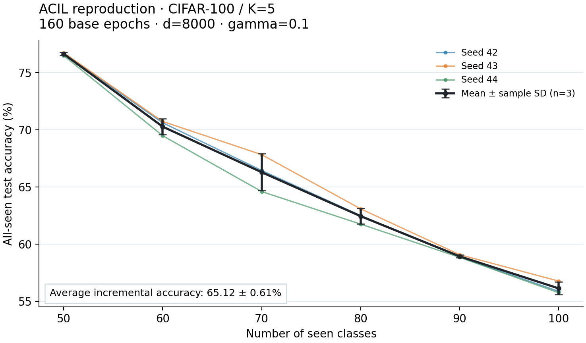
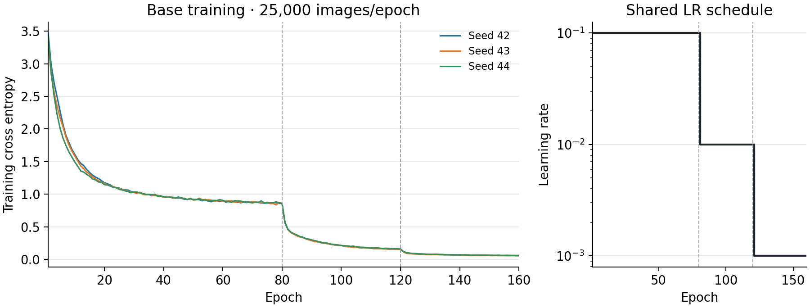
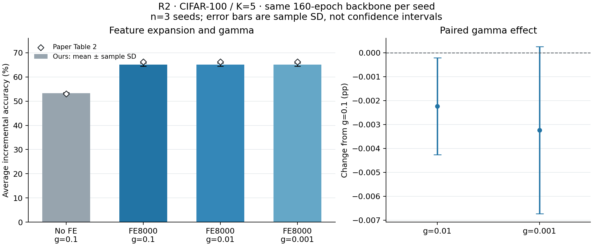
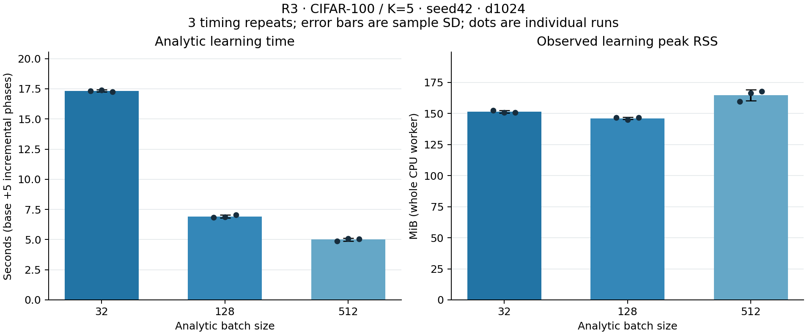

# Báo cáo thực nghiệm giữa kỳ — ACIL

**Ngày tổng hợp: 07/11/2026. Người thực hiện hiện tại: Sang.**

Báo cáo tổng hợp việc tự triển khai và kiểm chứng ACIL trên CIFAR-100. Bằng chứng R1/R2/R3 được đối chiếu tại commit `69015b3d5dbb38460e7b0eecb4d7dc22784df19e`, sau khi R3 đã lên `main`. Phần thực thi code tác giả được bổ sung sau đó cùng ngày, với source/manifest riêng tại mục13. Mỗi manifest giữ source thực tế của lượt tương ứng; các JSON kết quả lịch sử R1/R2/R3 không bị sửa.

## 1. Đã hoàn thành đến đâu?

**R1/R2/R3 và công việc chạy, đối chiếu implementation tác giả đã có bằng chứng thực thi.** Cập nhật sau lượt tác giả: [báo cáo đối chiếu](AUTHOR_CODE_COMPARISON_20261107.md) và mục13 bên dưới giữ cả C1 strict score failures, C2 và diagnostic C1R. Hoàn tất công việc đối chiếu không có nghĩa mọi output đều khớp. Sản phẩm giữa kỳ còn cần PPTX ghép phần đọc hiểu, thực nghiệm và phân tích sai khác.

| Hạng mục | Trạng thái đến 07/11/2026 | Bằng chứng / giới hạn |
|---|---|---|
| Đăng ký bài báo | Đã được duyệt theo xác nhận của Sang | Đây là thông tin người học cung cấp; báo cáo không kiểm quyền truy cập Moodle |
| Đọc toàn bộ bài báo | Sang đã xác nhận đọc xong | Chưa thay thế việc thể hiện hiểu biết trong slide và speaker notes |
| Tự triển khai analytic head, dữ liệu, backbone, runner | Đã có source và kiểm chứng | Các module trong `src/`, tests, notebook và manifest |
| Kiểm tra số học, smoke CIFAR, resume và profile | Đã thực hiện | Xem mục 5; đây là bước chuẩn bị, không gộp thành benchmark chính |
| R1 — benchmark chính | **Hoàn tất 3/3 seeds** | 42/43/44, mỗi seed train mới 160 epochs, d=8000, đủ 5 phase |
| R2 — ablation | **Hoàn tất 4 cấu hình × 3 seeds** | 9 lượt analytic mới + 3 baseline R1 tái dùng; 4/5 hàng Table 2 |
| R3 — phân tích batch size do nhóm thiết kế | **Hoàn tất 3 batch × 3 lần đo** | Một seed 42/d=1024, 54 so sánh theo phase với joint oracle |
| Chạy và đối chiếu code tác giả | **Đã thực thi và phân tích khác biệt** | [Báo cáo](AUTHOR_CODE_COMPARISON_20261107.md):2lượt chính +1diagnostic, giữ C1 false, C2/C1R true; n=1/d1024 |
| PPTX giữa kỳ | **Chưa có bản nghiệm thu trong repo** | Cần tích hợp đọc hiểu, phương pháp, kết quả, nguồn và notes |
| Poster cuối kỳ | Chưa nghiệm thu | Là sản phẩm tiếp theo, không phải điều kiện để nói R1/R2/R3 đã chạy xong |

Theo [yêu cầu reproduction của môn](https://hcmus-cs-ta.github.io/lab-book/intro-ml/project/statement/reproduction/), core scope cần tối thiểu hai thí nghiệm quan trọng, gồm phép so sánh chính, và một phân tích bổ sung tự thiết kế. Nhóm chọn R1/R2/R3 để tổ chức phạm vi này vì nguồn lực Kaggle và hiện một người thực hiện. R1 hiện đối chiếu ACIL tự triển khai với dòng ACIL của paper; **chưa tự chạy lại các phương pháp baseline khác trong Table 1**. Vì vậy cần trình bày chính xác phạm vi và chưa tuyên bố đã tái lập toàn bộ bảng so sánh hoặc ưu thế large-K.

## 2. Mục tiêu và các câu hỏi đã kiểm tra

| Bộ | Câu hỏi | Cách kiểm tra |
|---|---|---|
| R1 | ACIL tự triển khai đạt chất lượng phân loại bao nhiêu trên CIFAR-100/K5, lệch paper thế nào? | 3 seed độc lập; đường cong 6 mốc; Ā, final accuracy và forgetting base; đối chiếu Table 1 |
| R2 | Feature expansion giúp bao nhiêu? Kết quả nhạy với gamma trong miền đã chọn không? | Giữ checkpoint/mapping/normalization từng seed; bỏ FE hoặc đổi gamma; so sánh cặp với R1 cùng seed |
| R3 | Chia minibatch khác nhau có đổi nghiệm không? Thời gian và RSS thay đổi thế nào? | Giữ feature map và thứ tự ảnh; batch 32/128/512; 3 lần đo mỗi batch; so R/W/score/prediction với joint độc lập |

Tuyên bố tương đương cần kiểm là **nghiệm ridge incremental so với nghiệm ridge joint trên cùng đặc trưng cố định**. Nó không khẳng định accuracy luôn giữ nguyên khi thêm lớp, không khẳng định forgetting bằng 0 và không tương đương việc train lại CNN jointly trên toàn bộ ảnh.

## 3. Dữ liệu và protocol đã thực hiện

### 3.1. Nguồn dữ liệu và chia lớp

Dùng **CIFAR-100 fine labels**, ảnh RGB 32×32: 50.000 ảnh train và 10.000 ảnh test; mỗi lớp có 500 train/100 test. Loader tải và tạo cấu trúc dữ liệu tự động từ Hugging Face `uoft-cs/cifar100`, revision `aadb3af77e9048adbea6b47c21a81e47dd092ae5`. Mỗi file Parquet có SHA-256 trong `dataset_source` của JSON gốc; pipeline kiểm số ảnh, nhãn và cấu trúc trước khi chạy.

Với mỗi seed, tạo `class_order = np.random.default_rng(seed).permutation(100)`. Nhãn CIFAR gốc được ánh xạ về vị trí trong permutation; train và test dùng chung ánh xạ. Lớp được chia thành 50 lớp base và 5 phase, mỗi phase thêm 10 lớp; các tập lớp không trùng nhau.

| Mốc | Số lớp đã thấy | Ảnh train mới tại mốc | Ảnh test của tất cả lớp đã thấy |
|---:|---:|---:|---:|
| Base / phase 0 | 50 | 25.000 | 5.000 |
| Phase 1 | 60 | 5.000 | 6.000 |
| Phase 2 | 70 | 5.000 | 7.000 |
| Phase 3 | 80 | 5.000 | 8.000 |
| Phase 4 | 90 | 5.000 | 9.000 |
| Phase 5 | 100 | 5.000 | 10.000 |

Mean/std normalization chỉ được tính từ **25.000 ảnh base train của đúng seed**, rồi cố định. Test và các lớp tương lai không tham gia fit thống kê. Đánh giá luôn argmax trên toàn bộ lớp đã thấy, không cung cấp task ID và không chỉ đánh giá 10 lớp mới.

R1/R2 dùng seeds 42/43/44. Khi đổi seed, class order, training, thống kê base và FE có thể cùng đổi; SD giữa seed phản ánh tổng các nguồn biến thiên này. Trong các ablation của một seed, các thành phần đó được giữ nguyên.

### 3.2. Backbone và base training

| Thành phần | Cấu hình đã dùng |
|---|---|
| Backbone | ResNet-32 cho CIFAR, n=5, channels 16/32/64, shortcut option A; feature 64 chiều |
| BP head | FC 50 + CrossEntropyLoss trên 50 lớp base |
| Epoch | 160, chọn checkpoint epoch cuối; không chọn epoch tốt nhất theo test |
| Optimizer | SGD, LR 0.1, momentum 0.9, weight decay 0.0005, Nesterov=False |
| LR schedule | Milestones 80/120, nhân 0.1; step sau mỗi epoch |
| LR thực tế | Epoch 1–80: 0.1; 81–120: 0.01; 121–160: 0.001 |
| Batch | Train 128, eval 256; workers 0; Torch/BLAS 4 threads |
| Augmentation khi BP | Padding 4 → random crop 32 → horizontal flip p=0.5 → normalization |
| Analytic và test | Không crop/flip ngẫu nhiên; dùng normalization đã cố định |
| Thiết bị / precision | CNN float32 trên Kaggle T4; analytic NumPy float64 trên CPU |

Sau BP, pipeline tải lại checkpoint, kiểm model fingerprint/context, đóng băng backbone và đặt `eval()` để BatchNorm không thay đổi thống kê. FC 50 của BP không được dùng thay analytic classifier. Điểm A0 trong báo cáo được đo **sau analytic re-alignment base training**.

Môi trường R1 seed 42 ghi nhận Python 3.13.16, NumPy 2.1.3, Torch 2.11.0+cu 130 và SciPy 1.17.0. Metadata môi trường từng lượt nằm trong JSON; không giả định phiên bản môi trường tác giả năm 2022 giống môi trường này.

### 3.3. Analytic head và trạng thái

Với feature CNN `F`, cấu hình chính tạo `H = ReLU(F @ W_fe)`, `W_fe` shape 64×8000, phân phối N(0,1), seed=`seed+1000`, không bias. Backbone và FE cố định trong toàn bộ chuỗi incremental. Không thêm feature L2 normalization hoặc softmax trước argmax.

Implementation tối thiểu hóa `||Y − HW||²_F + gamma ||W||²_F`, dạng tổng; gamma chỉ được cộng một lần khi khởi tạo. Nếu `S = HᵀH + gamma I`, trạng thái gồm `R = S⁻¹` và `W = R HᵀY`. Code giải hệ tuyến tính; không dùng nghịch đảo tường minh để giải W.

Ở đây H có shape `(n,d)` với một hàng cho mỗi ảnh; Y là one-hot `(n,C)` theo nhãn toàn cục; R có shape `(d,d)` và W có shape `(d,C)`. Điều kiện feature map cố định là điều kiện để trạng thái cũ và batch mới cùng thuộc một hệ ridge.

Khi nhận batch hiện tại `H_b, Y_b`, module đệm các cột lớp mới của W bằng 0 rồi cập nhật:

```text
R_new = R_old − R_old H_bᵀ (I + H_b R_old H_bᵀ)⁻¹ H_b R_old
W_new = W_padded + R_new H_bᵀ (Y_b − H_b W_padded)
```

Nhãn là ID toàn cục; một lớp xuất hiện trong nhiều minibatch vẫn dùng cùng một cột W. API trả `(R, W)`; pipeline quản lý `class_order` và mapping, không giả định module trả thêm `class_ids`.

R1 dùng d=8000/gamma=0.1, analytic batch 128. R luôn 8000×8000, W tăng theo số lớp từ 8000×50 đến 8000×100. Base analytic tích lũy Gram/cross theo batch và dùng Cholesky; incremental chỉ nhận batch hiện tại với trạng thái, không giữ lại H của các phase cũ để học lại. Joint oracle chỉ xuất hiện trong verification/R3 riêng.

Với float64, riêng R ở d=8000 đã chiếm 512.000.000 bytes; R/W100/FE tổng cộng 522.496.000 bytes. Nếu giữ H của toàn bộ 50.000 ảnh ở d=8000 sẽ cần thêm 3.200.000.000 bytes, chưa tính bản sao/workspace. Đây là kích thước ma trận tính từ shape, không phải peak RAM đo được; nó giải thích vì sao cần streaming và profile trước lượt dài.

## 4. Các phần source đã xây dựng

| Nhóm chức năng | File chính | Công việc đã thực hiện |
|---|---|---|
| Analytic và kiểm chứng số học | [analytic.py](../src/analytic.py), [verification.py](../src/verification.py) | Joint ridge độc lập, initialize, initialize_batches, RLS minibatch, nhãn toàn cục, kiểm input và sai số |
| Dataset / backbone | [cifar_data.py](../src/cifar_data.py), [resnet.py](../src/resnet.py) | Tải/audit CIFAR, mapping/split/normalization; ResNet-32 CIFAR |
| Base training / resume | [base_training.py](../src/base_training.py), [verify_resume.py](../src/verify_resume.py) | Optimizer/scheduler/history, checkpoint v2 và kiểm chạy liên tục so với resume |
| Pipeline / streaming | [cifar_smoke.py](../src/cifar_smoke.py), [streaming.py](../src/streaming.py) | Smoke có oracle; benchmark streaming không giữ feature lịch sử |
| Metrics / an toàn kết quả | [metrics.py](../src/metrics.py), [run_attempt.py](../src/run_attempt.py), [reporting.py](../src/reporting.py) | Metric đầy đủ/partial, attempt riêng, trạng thái lỗi, xuất JSON và metadata tracking |
| Thực nghiệm và tổng hợp | [scripts](../scripts/), [notebooks](../notebooks/) | Notebook 06–08 cho R1, 09–11 cho R2, 12 cho R3; scripts aggregate/plot và runner |

Analytic head được tự cài từ mô tả/phương trình của paper. Repo tác giả được dùng làm nguồn đối chiếu, không được xem là source do nhóm tự viết. Các thư viện dữ liệu, tensor và giải hệ là công cụ hỗ trợ; các quyết định tái sử dụng được mô tả trong README và protocol.

Quá trình lập trình, kiểm tra và tổng hợp có ChatGPT/Codex hỗ trợ, như ghi nhận trong README. Sang và nhóm chịu trách nhiệm đọc, kiểm chứng và giải thích phương pháp, số liệu cùng toàn bộ sản phẩm khi nộp.

## 5. Những kiểm tra đã làm trước benchmark dài

| Mốc | Việc đã kiểm | Kết quả và cách sử dụng |
|---|---|---|
| Toy / VERIFY | Joint so với phase và minibatch; nhiều batch của cùng lớp; lớp lặp; shape, input, gamma>0 | Có test và JSON; VERIFY 02 có 11 tests theo snapshot lúc chạy. Accuracy toy không dùng làm benchmark ảnh |
| CIFAR smoke CPU/GPU | Tải thật, train ngắn, reload/freeze, analytic, đánh giá all-seen, JSON/W&B | Notebook 02: 2 epochs/d=256, 50→60 lớp; GPU 32.58%→29.70% |
| Smoke đủ chuỗi | Base 50 + 5×10 lớp, oracle tại 6 mốc | Notebook 03: 2 epochs/d=256; W có shape 256×100, 10.000 test; **final 22.05%**. Đây là smoke, không phải Ā hoặc benchmark 160 epochs |
| Resume CPU | Chạy 2 epochs liên tục so với 1 epoch + resume 1 | Có test trạng thái/RNG/LR/thứ tự mẫu; ResNet-32 trên 200 ảnh CIFAR thật cũng đã kiểm |
| Resume CUDA | Khôi phục model/optimizer/scheduler/RNG trên GPU | TinyCNN có BatchNorm/Dropout đạt; chưa phải bằng chứng restart ResNet-32 đủ 160 epochs trên GPU |
| Benchmark streaming | Chặn joint oracle/full collector rồi chạy đủ 100 lớp ở d=256 | Accuracy 6 mốc khớp lượt oracle CPU lịch sử |
| Profile analytic | Probe d=8000 trên subset để đo khả năng tài nguyên | Kaggle 34.07 s, peak RSS 3.20 GB trong phép profile; không phải accuracy benchmark hoặc tổng runtime R1 |
| Profile BP5 | Train thật 25.000 ảnh base/epoch, 5 epochs; một phase analytic d=256 | BP mất 76.11 s, checkpoint v2 hợp lệ, CUDA resume proof đạt; dùng để dự trù ngân sách trước 160 epochs |

Bằng chứng: [VERIFY02](VERIFY-02-provenance.json), [smoke02](CIFAR-KAGGLE-01-provenance.json), [smoke03](CIFAR-KAGGLE-02-provenance.json), [resume/streaming](RESUME-PROFILE-01-provenance.json), [analytic profile](PROFILE-KAGGLE-01-provenance.json), [BP5](BP5-KAGGLE-01-provenance.json).

Mục đích của các bước này là phát hiện lỗi và kiểm giới hạn tài nguyên trước khi tiêu tốn quota cho 160 epochs. Bộ số benchmark được báo riêng ở R1/R2; không chọn lại cấu hình sau khi thấy test score.

## 6. Metric và cách tổng hợp

| Metric | Định nghĩa thực hiện | Cách đọc |
|---|---|---|
| `A_k` | Accuracy trên test của tất cả lớp đã thấy sau phase k | Có 6 điểm k=0..5; argmax trên 50..100 lớp |
| `Ā` | `(A_0 + ... + A_5) / 6` | Trung bình đều 6 mốc, gồm base; không cân theo số ảnh |
| `A_final` | `A_5` | Accuracy cuối trên 100 lớp; khác Ā |
| `B_k` | Accuracy trên 5.000 ảnh test base, vẫn cạnh tranh với mọi lớp đã thấy | Dùng tính forgetting base |
| `F_base` | `B_0 − B_5`, đơn vị điểm phần trăm (pp) | Dương nghĩa là base accuracy giảm; giữ cả signed delta ngược dấu |
| Mean ± SD R1/R2 | Tính metric từng seed trước, sau đó mean và sample SD, ddof=1, n=3 | Không coi 6 phase là 6 seed; SD không phải khoảng tin cậy |
| Mean ± SD R3 | 3 lần đo thời gian trên cùng seed | Đo biến thiên timing; không phải SD accuracy giữa 3 seed |
| Deviation | `ours − paper` (pp); relative=`100 × (ours−paper)/abs(paper)` | Giữ dấu; không dùng final so với Ā |

Paper có bất nhất giữa dấu F trong công thức mục 4.2 và cách trình bày số dương trong Table 1. Báo cáo dùng **độ giảm B0−B5** để đối chiếu F=9.00 của bảng; signed delta B5−B0 vẫn được lưu. Đây chỉ là forgetting của nhóm base, không phải average forgetting của mọi task cũ. Chi tiết ở [metrics.md](../docs/metrics.md).

## 7. R1 — benchmark chính, đủ 3 seeds

Mỗi seed train mới một backbone 160 epochs rồi chạy analytic d=8000/gamma=0.1 trên đủ chuỗi. Có 3 checkpoint độc lập; không dùng backbone seed 42 thay cho 43/44. Checkpoint/model/context/FE được đối chiếu; lịch sử có 160 epoch, 25.000 ảnh/epoch và LR đúng 80/120.

| Seed | Ā (%) | Final (%) | F_base (pp) |
| --- | --- | --- | --- |
| 42 | 65.164550 | 55.87 | 8.32 |
| 43 | 65.706197 | 56.77 | 8.92 |
| 44 | 64.487963 | 55.75 | 7.68 |

| Metric | Nhóm: mean ± sample SD, n=3 | Paper Table 1 | Ours−paper (pp) | Sai lệch tương đối (%) |
| --- | --- | --- | --- | --- |
| Ā (%) | 65.1196 ± 0.6104 | 66.30 | -1.1804 | -1.7804 |
| Final (%) | 56.1300 ± 0.5575 | Không có cột tương ứng | — | — |
| F_base (pp) | 8.3067 ± 0.6201 | 9.00 (đọc theo độ giảm) | -0.6933 | -7.7037 |

Table 1 không cung cấp cột final accuracy phù hợp để điền vào dòng đối chiếu này; paper_final để null trong JSON. Chênh lệch R1 Ā là **−1.1804 pp**, tương đương **−1.7804% tương đối** so với 66.30%. Đây là khoảng cách đã đo, không phải bằng chứng mọi cấu hình đều tái lập chính xác paper.

| Phase | Lớp đã thấy | Số test | A all-seen: mean ± SD (%) | B base: mean ± SD (%) |
| --- | --- | --- | --- | --- |
| 0 | 50 | 5,000 | 76.6400 ± 0.1249 | 76.6400 ± 0.1249 |
| 1 | 60 | 6,000 | 70.2778 ± 0.6905 | 73.5067 ± 0.1553 |
| 2 | 70 | 7,000 | 66.2905 ± 1.6197 | 72.0200 ± 0.1587 |
| 3 | 80 | 8,000 | 62.4458 ± 0.6704 | 70.5867 ± 0.3690 |
| 4 | 90 | 9,000 | 58.9333 ± 0.1262 | 69.2200 ± 0.4359 |
| 5 | 100 | 10,000 | 56.1300 ± 0.5575 | 68.3333 ± 0.5005 |





Các lượt benchmark d=8000 **không chạy joint oracle trên toàn bộ dữ liệu**; các trường so sánh không chạy phải là null/`not_run`. Shape, dữ liệu hữu hạn, checkpoint, freeze, metric và tracking đã được kiểm; không diễn giải `verification_passed` thành đã so joint d=8000. Việc xác nhận nghiệm với joint trên dữ liệu ảnh đầy đủ được làm riêng ở R3/d=1024.

Nguồn: [báo cáo R1](R1_CIFAR100_K5_3SEEDS_20261106.md), [summary](r1_cifar100_k5_summary.json), [manifest](R1-C100-K5-3SEEDS-provenance.json). Số chi tiết từng seed giữ nguyên precision trong JSON.

## 8. R2 — bỏ feature expansion và thay gamma

R2 tái dùng đúng checkpoint 160 của mỗi seed R1. Có 9 lượt analytic mới: no-FE/gamma=0.1, FE 8000/gamma=0.01 và FE 8000/gamma=0.001 trên 3 seeds. Hàng FE 8000/gamma=0.1 dùng lại 3 run R1, không chạy lại hoặc đếm là 3 run mới. Training mới bị chặn trong runner; history 160 epochs của checkpoint không có nghĩa R2 train thêm 160 epochs.

No-FE dùng **đặc trưng CNN 64 chiều trực tiếp**; không chèn random projection 64→64/ReLU. Các hàng có FE dùng chính FE matrix của R1 cùng seed. Mapping, normalization, thứ tự mẫu, precision, batch 128 và cách đánh giá giữ nguyên.

| Cấu hình | Ā: mean ± SD (%) | Paper (%) | Deviation (pp) | Relative deviation (%) | Paired ΔĀ so với R1 (pp) |
| --- | --- | --- | --- | --- | --- |
| No-FE, d=64, γ=0.1 | 53.2547 ± 0.2768 | 52.99 | +0.2647 | +0.4995 | -11.8649 ± 0.3710 |
| FE 8000, γ=0.1 (tái dùng R1) | 65.1196 ± 0.6104 | 66.30 | -1.1804 | -1.7804 | 0.0000 ± 0.0000 |
| FE 8000, γ=0.01 | 65.1173 ± 0.6089 | 66.25 | -1.1327 | -1.7097 | -0.0022 ± 0.0020 |
| FE 8000, γ=0.001 | 65.1163 ± 0.6088 | 66.23 | -1.1137 | -1.6815 | -0.0032 ± 0.0035 |

| Cấu hình | Final: mean ± SD (%) | F_base: mean ± SD (pp) |
| --- | --- | --- |
| No-FE, d=64, γ=0.1 | 38.3267 ± 0.3743 | 1.5600 ± 0.6353 |
| FE 8000, γ=0.1 (tái dùng R1) | 56.1300 ± 0.5575 | 8.3067 ± 0.6201 |
| FE 8000, γ=0.01 | 56.1300 ± 0.5575 | 8.3067 ± 0.6201 |
| FE 8000, γ=0.001 | 56.1300 ± 0.5575 | 8.3067 ± 0.6201 |



**Diễn giải từ dữ liệu:** FE 8000/gamma=0.1 cao hơn no-FE/gamma=0.1 trung bình **11.8649 pp Ā**. Trong miền gamma=0.1/0.01/0.001, dải mean Ā của ba hàng FE chỉ **0.0032 pp**; kết quả ít thay đổi trong điều kiện đã thử. Final accuracy và F_base của ba hàng FE trùng nhau ở mức tính từ dự đoán, không có nghĩa ma trận W phải giống nhau.

Phép bỏ FE đồng thời bỏ phép chiếu và ReLU; thí nghiệm chưa tách riêng ảnh hưởng số chiều với phi tuyến. No-FE có F_base nhỏ hơn nhưng final accuracy thấp hơn nhiều, nên không kết luận no-FE tốt hơn chỉ từ forgetting. R2 chỉ thực hiện **4/5 hàng Table 2**; gamma=0 đã được loại khỏi core scope trước khi chạy vì solver hiện yêu cầu gamma>0. Chưa đo gamma=0 thì chưa kết luận thực nghiệm về việc bỏ hoàn toàn regularization.

Các ma trận R/W mới của R2 được load/kiểm trên Kaggle CPU sau vùng đo, giữ tại Output đúng version. Local kiểm JSON/proof/source/metric cùng các checkpoint R1 đã tải; **không tuyên bố đã tải toàn bộ NPZ mới của R2 về local**.

Nguồn: [báo cáo R2](R2_CIFAR100_K5_20261107.md), [summary](r2_cifar100_k5_summary.json), [manifest](R2-C100-K5-provenance.json). Table 2 chỉ có Ā cho các hàng tham chiếu; không tự gán paper_final hoặc paper_F.

## 9. R3 — phân tích minibatch, thời gian và bộ nhớ

### 9.1. Thiết kế để so sánh công bằng

Dùng checkpoint 160 seed 42 của R1, đủ 50.000 ảnh train / 10.000 ảnh test, d=1024/gamma=0.1. FE mới có shape 64×1024, N(0,1), seed 1042, cố định giữa mọi case. d=1024 được chốt trước để đủ ngân sách giải joint; **đây là cấu hình phân tích riêng, không thay d=8000 của R1**.

Trích đặc trưng CNN 64 chiều một lần từ backbone freeze/eval và giữ thứ tự index trong từng phase. Chạy 9 CPU worker mới, BLAS 4 threads, mỗi worker reset R/W. Thứ tự xoay giữa các lần lặp là 32→128→512;128→512→32;512→32→128. Mỗi batch có 3 timing repeats, vẫn chỉ một seed accuracy.

Timer cộng 6 cửa sổ học: FE transform, base Gram/solve và 5 phase RLS. Tải cache/checkpoint, CNN, checksum, warm-up, evaluation, joint oracle, ghi file và W&B nằm ngoài timer. Oracle chạy ở tiến trình riêng sau khi 9 worker đo xong. Cache train features là fixture để nghiên cứu/kiểm joint, không phải replay buffer do learner tạo.

### 9.2. Kết quả hiệu năng

| Batch | Base (s) | Tổng incremental (s) | Tổng analytic (s) | Peak RSS (MiB) | RSS tăng từ baseline (MiB) |
| --- | --- | --- | --- | --- | --- |
| 32 | 10.7104 ± 0.0672 | 6.6230 ± 0.0968 | 17.3334 ± 0.0784 | 151.3503 ± 0.9749 | 61.8073 ± 0.2019 |
| 128 | 3.1937 ± 0.0679 | 3.7310 ± 0.0420 | 6.9247 ± 0.1098 | 146.1029 ± 0.9158 | 56.0742 ± 0.1255 |
| 512 | 1.2843 ± 0.0664 | 3.7132 ± 0.0540 | 4.9975 ± 0.1123 | 164.5521 ± 4.3843 | 75.0026 ± 3.7651 |

RSS là toàn process CPU, gồm runtime/input/state/allocator, lấy mẫu 5 ms trong cửa sổ học và ở biên; có thể bỏ lỡ đỉnh rất ngắn. Đây là peak quan sát, không phải RAM chỉ riêng R/W. State R/W/FE cuối giống nhau giữa các batch: **9.28125 MiB = 9.732.096 bytes**. T4 chỉ phục vụ CNN ngoài timer; không gắn các thời gian trên cho GPU analytic.



Batch 512 nhanh hơn 128 khoảng **1.386 lần** về tổng analytic trong phiên đo, nhưng peak RSS cao hơn trung bình **18.4492 MiB**. Khi 128→512, base giảm **1.9094 s** còn incremental chỉ giảm **0.0177 s**, nhỏ so với biến thiên timing. Do đó lợi ích tổng chủ yếu đến từ base accumulation; chưa có bằng chứng mạnh rằng RLS incremental 512 nhanh hơn 128 trong mọi điều kiện.

### 9.3. Kết quả tương đương nghiệm

| Batch | Số so sánh phase | Max relative W error | Max relative R error | Max abs score error | Argmax khác joint |
| --- | --- | --- | --- | --- | --- |
| 32 | 18 | 1.159e-11 | 3.823e-15 | 2.475e-12 | 0 |
| 128 | 18 | 9.679e-12 | 3.399e-15 | 2.302e-12 | 0 |
| 512 | 18 | 9.782e-12 | 3.272e-15 | 2.178e-12 | 0 |

Tổng cộng **54 so sánh = 9 case × 6 phase**. R/W/score đều đạt `allclose(rtol=1e-6, atol=1e-8)`, không có argmax khác joint. Sai số tương đối W lớn nhất khoảng **1.159×10⁻¹¹**. Ba repeats cùng batch có R/W giống bitwise; giữa các batch kết luận dựa trên tolerance, không yêu cầu bitwise.

Joint oracle ghép toàn bộ H/nhãn đã thấy rồi giải ridge độc lập cho W và hệ Gram cho R tại mỗi mốc. Toàn bộ fixture và 60 NPZ (54 state+6 joint) đã được tải/kiểm tại local; joint còn được giải lại từ full fixed features. Các con số trong bảng trên là phép so sánh trên Kaggle; kiểm local là bước đối chiếu thêm, không dùng thay số đo timing.

| Phase | Lớp đã thấy | A all-seen (%) | B base (%) |
| --- | --- | --- | --- |
| 0 | 50 | 76.820000 | 76.820000 |
| 1 | 60 | 69.550000 | 74.240000 |
| 2 | 70 | 64.871429 | 73.300000 |
| 3 | 80 | 59.975000 | 72.300000 |
| 4 | 90 | 55.677778 | 71.760000 |
| 5 | 100 | 51.730000 | 70.860000 |

Mọi case và oracle có cùng accuracy; Ā **63.104034%**, final **51.73%**, F_base **5.96 pp**. Đây là một seed/d=1024, không có SD accuracy giữa seed và không dùng thay kết quả benchmark R1.

Nguồn: [kế hoạch trước run](../docs/R3_KE_HOACH_DO.md), [báo cáo R3](R3_CIFAR100_K5_BATCH_20261107.md), [summary](r3_cifar100_k5_summary.json), [execution manifest](R3-KAGGLE-01-provenance.json), [analysis manifest](R3-C100-K5-provenance.json).

## 10. Những thay đổi quan trọng và vì sao phải làm

| Vấn đề / quyết định | Cách đã xử lý | Ý nghĩa đối với kết quả |
|---|---|---|
| Update từng batch từng thêm cột W dù lớp đã có | Dùng ID nhãn toàn cục; đệm cột theo số lớp; test chia phase thành nhiều batch | Số cột phản ánh lớp, không phản ánh số lần gọi; minibatch giữ đúng mục tiêu ridge |
| Lượt mới lỗi có thể để JSON cũ vẫn báo thành công | Attempt/output riêng; trạng thái running/failed/complete; kiểm cùng attempt ID | Không nhận kết quả seed cũ làm kết quả lượt mới |
| Cell notebook cố định W=[256,60] | Tính shape kỳ vọng từ config và tạo lại notebook | Có thể kiểm đúng cả một phase và đủ 100 lớp/d khác |
| Git đổi CRLF→LF làm lệch checksum | Chuẩn hóa UTF-8/LF; hash bytes công bố; giữ hash raw ban đầu trong provenance | Khắc phục truy nguyên mà không sửa số hoặc train lại |
| Benchmark d=8000 dễ tốn RAM nếu giữ toàn bộ lịch sử H/oracle | Streaming base Gram/cross và RLS; joint diagnostic tách khỏi benchmark | Giảm chi phí phụ; không đánh tráo oracle giữ lịch sử thành thuật toán không replay |
| Kaggle có giới hạn phiên/quota, cần resume | Checkpoint v2 gồm model/optimizer/scheduler/config/context/RNG/loader/history; kiểm epoch hoàn tất | Resume có ràng buộc đúng checkpoint; checkpoint 2/5 epochs không giả làm base 160 đã hoàn tất |
| Nguy cơ chọn cấu hình theo test hoặc trộn metric | Chốt protocol/metrics trước benchmark; giữ đủ seed; Ā/final/F và đơn vị thống nhất | So sánh có phạm vi rõ, không lọc seed thấp hoặc thay metric thuận lợi |
| W&B ID/URL điền tay hoặc JSON báo synced trước khi log xong | Lấy ID/URL thật từ SDK; giữ raw capture; actual tracking và manifest cập nhật sau sync/xác minh | README–version Kaggle–source–JSON–W&B trỏ cùng lượt; offline log không đòi train lại |
| R3 history và summary trùng tên field | Reconcile sau Finished từ raw 6 phase; thêm alias `r3/learning_seconds_total` và `r3/max_abs_score_error_all_phases` | Summary giữ tổng thời gian/max mọi phase; không bị giá trị phase cuối ghi đè; không chạy lại phép đo |

Trong R3, helper reconciliation chỉ cập nhật tracking theo dữ liệu gốc đã kiểm; raw numeric/history không bị thay. Sai khác round-trip số thực qua API được kiểm với rtol=1e-14/atol=0, int/bool/hash chính xác. Ngưỡng này dành cho vận chuyển JSON, khác ngưỡng kiểm nghiệm RLS và không được dùng để nới điều kiện khoa học.

## 11. Tests, truy nguyên và khả năng chạy lại

Các lượt Kaggle benchmark ghi 54 core tests: **53 passed, 1 historical-snapshot skip**, trong đó CUDA resume test đạt. R3 còn chạy 5 driver tests trên Kaggle; sau khi phát hiện lỗi summary, có thêm 4 tracking regression tests tại local. Đây là các bộ/snapshot có phạm vi riêng, không cộng tùy tiện thành một số tests của cùng phiên.

Chuỗi bằng chứng của một kết quả gồm **source thực chạy → version Kaggle cố định → attempt/config/checkpoint → JSON gốc và SHA-256 → W&B run thật → summary/figure**. Metadata capture offline được giữ nguyên trong raw JSON; file ready/provenance bổ sung trạng thái sync thực tế sau khi đối chiếu. Các run chính đã được kiểm Finished và truy cập công khai không dùng Authorization/Cookie tại thời điểm nghiệm thu ghi trong manifest.

Có **21 W&B run riêng biệt** cho các bộ chính: 3 R1 + 9 R2 mới + 9 R3. Ba baseline của R2 là 3 run R1 được tái dùng nên không đếm thêm. Chỉ R1 tạo 3 backbone 160 epochs mới; R2/R3 dùng checkpoint đã hoàn tất. Các run toy/smoke/profile nằm ngoài con số 21.

Khi tổng hợp báo cáo này, đã gọi lại các hàm aggregate **trong bộ nhớ**, đối chiếu chính xác với 3 summary hiện có và kiểm hash các artifact của manifest tổng hợp. Không chạy lại training, không ghi đè summary chỉ để đổi timestamp và không sửa hình đã công bố.

### 11.1. Bảng notebook, version và W&B của bộ chính

| Bộ | Lượt thực nghiệm | Notebook | Kaggle version cố định | W&B Finished/public đã kiểm |
| --- | --- | --- | --- | --- |
| R1 | seed 42, d=8000, γ=0.1 | [06_benchmark_seed42_ready.ipynb](../notebooks/06_benchmark_seed42_ready.ipynb) | [v1](https://www.kaggle.com/code/hsangg206/06-benchmark-seed42/output?scriptVersionId=365844618) | [zt1014ei](https://wandb.ai/hsangg-2006/acil-reproduction/runs/zt1014ei) |
| R1 | seed 43, d=8000, γ=0.1 | [07_benchmark_seed43_ready.ipynb](../notebooks/07_benchmark_seed43_ready.ipynb) | [v1](https://www.kaggle.com/code/hsangg206/07-benchmark-seed43/output?scriptVersionId=366266785) | [v51m2dan](https://wandb.ai/hsangg-2006/acil-reproduction/runs/v51m2dan) |
| R1 | seed 44, d=8000, γ=0.1 | [08_benchmark_seed44_ready.ipynb](../notebooks/08_benchmark_seed44_ready.ipynb) | [v1](https://www.kaggle.com/code/hsangg206/08-benchmark-seed44/output?scriptVersionId=366266800) | [vqcs1ql4](https://wandb.ai/hsangg-2006/acil-reproduction/runs/vqcs1ql4) |
| R2 | seed 42: No-FE, d=64, γ=0.1 | [09_r2_ablation_seed42.ipynb](../notebooks/09_r2_ablation_seed42.ipynb) | [v1](https://www.kaggle.com/code/hsangg206/09-r2-ablation-seed42/output?scriptVersionId=366341660) | [xdrm0d27](https://wandb.ai/hsangg-2006/acil-reproduction/runs/xdrm0d27) |
| R2 | seed 43: No-FE, d=64, γ=0.1 | [10_r2_ablation_seed43.ipynb](../notebooks/10_r2_ablation_seed43.ipynb) | [v1](https://www.kaggle.com/code/hsangg206/10-r2-ablation-seed43/output?scriptVersionId=366341726) | [7wgme4so](https://wandb.ai/hsangg-2006/acil-reproduction/runs/7wgme4so) |
| R2 | seed 44: No-FE, d=64, γ=0.1 | [11_r2_ablation_seed44.ipynb](../notebooks/11_r2_ablation_seed44.ipynb) | [v1](https://www.kaggle.com/code/hsangg206/11-r2-ablation-seed44/output?scriptVersionId=366348428) | [81aci8h1](https://wandb.ai/hsangg-2006/acil-reproduction/runs/81aci8h1) |
| R2 | seed 42: FE 8000, γ=0.01 | [09_r2_ablation_seed42.ipynb](../notebooks/09_r2_ablation_seed42.ipynb) | [v1](https://www.kaggle.com/code/hsangg206/09-r2-ablation-seed42/output?scriptVersionId=366341660) | [qcgdklxh](https://wandb.ai/hsangg-2006/acil-reproduction/runs/qcgdklxh) |
| R2 | seed 43: FE 8000, γ=0.01 | [10_r2_ablation_seed43.ipynb](../notebooks/10_r2_ablation_seed43.ipynb) | [v1](https://www.kaggle.com/code/hsangg206/10-r2-ablation-seed43/output?scriptVersionId=366341726) | [xfleip26](https://wandb.ai/hsangg-2006/acil-reproduction/runs/xfleip26) |
| R2 | seed 44: FE 8000, γ=0.01 | [11_r2_ablation_seed44.ipynb](../notebooks/11_r2_ablation_seed44.ipynb) | [v1](https://www.kaggle.com/code/hsangg206/11-r2-ablation-seed44/output?scriptVersionId=366348428) | [dub202jk](https://wandb.ai/hsangg-2006/acil-reproduction/runs/dub202jk) |
| R2 | seed 42: FE 8000, γ=0.001 | [09_r2_ablation_seed42.ipynb](../notebooks/09_r2_ablation_seed42.ipynb) | [v1](https://www.kaggle.com/code/hsangg206/09-r2-ablation-seed42/output?scriptVersionId=366341660) | [3yp99ewh](https://wandb.ai/hsangg-2006/acil-reproduction/runs/3yp99ewh) |
| R2 | seed 43: FE 8000, γ=0.001 | [10_r2_ablation_seed43.ipynb](../notebooks/10_r2_ablation_seed43.ipynb) | [v1](https://www.kaggle.com/code/hsangg206/10-r2-ablation-seed43/output?scriptVersionId=366341726) | [aler6nj2](https://wandb.ai/hsangg-2006/acil-reproduction/runs/aler6nj2) |
| R2 | seed 44: FE 8000, γ=0.001 | [11_r2_ablation_seed44.ipynb](../notebooks/11_r2_ablation_seed44.ipynb) | [v1](https://www.kaggle.com/code/hsangg206/11-r2-ablation-seed44/output?scriptVersionId=366348428) | [l9c50ezb](https://wandb.ai/hsangg-2006/acil-reproduction/runs/l9c50ezb) |
| R3 | batch 32, repeat 1; seed 42 | [12_r3_batch_analysis.ipynb](../notebooks/12_r3_batch_analysis.ipynb) | [v1 /366444048](https://www.kaggle.com/code/hsangg206/12-r3-batch-analysis/output?scriptVersionId=366444048) | [luf7uv40](https://wandb.ai/hsangg-2006/acil-reproduction/runs/luf7uv40) |
| R3 | batch 32, repeat 2; seed 42 | [12_r3_batch_analysis.ipynb](../notebooks/12_r3_batch_analysis.ipynb) | [v1 /366444048](https://www.kaggle.com/code/hsangg206/12-r3-batch-analysis/output?scriptVersionId=366444048) | [yqxph1bb](https://wandb.ai/hsangg-2006/acil-reproduction/runs/yqxph1bb) |
| R3 | batch 32, repeat 3; seed 42 | [12_r3_batch_analysis.ipynb](../notebooks/12_r3_batch_analysis.ipynb) | [v1 /366444048](https://www.kaggle.com/code/hsangg206/12-r3-batch-analysis/output?scriptVersionId=366444048) | [59vlfxzv](https://wandb.ai/hsangg-2006/acil-reproduction/runs/59vlfxzv) |
| R3 | batch 128, repeat 1; seed 42 | [12_r3_batch_analysis.ipynb](../notebooks/12_r3_batch_analysis.ipynb) | [v1 /366444048](https://www.kaggle.com/code/hsangg206/12-r3-batch-analysis/output?scriptVersionId=366444048) | [o54hbdfp](https://wandb.ai/hsangg-2006/acil-reproduction/runs/o54hbdfp) |
| R3 | batch 128, repeat 2; seed 42 | [12_r3_batch_analysis.ipynb](../notebooks/12_r3_batch_analysis.ipynb) | [v1 /366444048](https://www.kaggle.com/code/hsangg206/12-r3-batch-analysis/output?scriptVersionId=366444048) | [4481bnn1](https://wandb.ai/hsangg-2006/acil-reproduction/runs/4481bnn1) |
| R3 | batch 128, repeat 3; seed 42 | [12_r3_batch_analysis.ipynb](../notebooks/12_r3_batch_analysis.ipynb) | [v1 /366444048](https://www.kaggle.com/code/hsangg206/12-r3-batch-analysis/output?scriptVersionId=366444048) | [3gv0moj7](https://wandb.ai/hsangg-2006/acil-reproduction/runs/3gv0moj7) |
| R3 | batch 512, repeat 1; seed 42 | [12_r3_batch_analysis.ipynb](../notebooks/12_r3_batch_analysis.ipynb) | [v1 /366444048](https://www.kaggle.com/code/hsangg206/12-r3-batch-analysis/output?scriptVersionId=366444048) | [lnk0grbq](https://wandb.ai/hsangg-2006/acil-reproduction/runs/lnk0grbq) |
| R3 | batch 512, repeat 2; seed 42 | [12_r3_batch_analysis.ipynb](../notebooks/12_r3_batch_analysis.ipynb) | [v1 /366444048](https://www.kaggle.com/code/hsangg206/12-r3-batch-analysis/output?scriptVersionId=366444048) | [5ehmjvh3](https://wandb.ai/hsangg-2006/acil-reproduction/runs/5ehmjvh3) |
| R3 | batch 512, repeat 3; seed 42 | [12_r3_batch_analysis.ipynb](../notebooks/12_r3_batch_analysis.ipynb) | [v1 /366444048](https://www.kaggle.com/code/hsangg206/12-r3-batch-analysis/output?scriptVersionId=366444048) | [xesh2kjl](https://wandb.ai/hsangg-2006/acil-reproduction/runs/xesh2kjl) |

Source và JSON chi tiết từng lượt tra trong [manifest R1](R1-C100-K5-3SEEDS-provenance.json), [manifest R2](R2-C100-K5-provenance.json) và [manifest R3](R3-KAGGLE-01-provenance.json). Thư mục notebook và bảng mapping trong README là điểm vào để chạy lại; dùng đúng source pin theo manifest khi muốn tái tạo một lượt lịch sử.

### 11.2. Tái tạo bảng và hình từ kết quả đã lưu

Từ thư mục gốc repo, sau khi cài dependency đúng môi trường:

```powershell
python scripts/aggregate_r1.py
python scripts/aggregate_r2.py
python scripts/aggregate_r3.py
```

Các lệnh trên tạo lại summary và có thể đổi timestamp; nên chạy trong checkout/thư mục làm việc riêng khi chỉ muốn kiểm lịch sử. Dùng môi trường vẽ có `requirements-plots.txt` rồi chạy `plot_r1.py`, `plot_r2.py`, `plot_r3.py` trong `scripts/` để tạo lại PNG. Muốn chạy số học hoặc training cần môi trường `requirements-cifar.txt`; `requirements-verification.txt` chỉ phục vụ kiểm analytic tối thiểu, không đủ toàn bộ pipeline.

Trọng số, NPZ/cache lớn giữ tại Output Kaggle và `reports/local/` bị Git bỏ qua; GitHub giữ source, notebook, JSON, manifest và hình. Vì vậy clone repo không tự có mọi checkpoint/NPZ: cần lấy đúng artifact/version có hash trước khi chạy R2/R3 hoặc kiểm lại ma trận. Credential không nằm trong source/notebook/report.

## 12. Sai lệch, giới hạn và những việc còn phải hoàn thành

### 12.1. Điều đã được dữ liệu hỗ trợ

- R1 đo được Ā 65.1196 ± 0.6104%, thấp hơn dòng ACIL/CIFAR-100/K5 của paper 1.1804 pp; đã có 3 seed thay vì chỉ một lượt thuận lợi.
- R2 cho thấy toàn bộ thành phần FE đem lại chênh lệch Ā đáng kể trong cấu hình đã thử; gamma=0.1→0.001 thay đổi rất ít trên ba seed này.
- R3 cho thấy các cách chia batch đã thử cho nghiệm và dự đoán khớp joint trong tolerance, với đánh đổi thời gian/RSS đo được trên cùng môi trường.

### 12.2. Những kết luận chưa được phép rút ra

| Giới hạn | Hệ quả khi viết báo cáo / slide |
|---|---|
| Chỉ CIFAR-100/K5 | Chưa tái lập ImageNet, nhiều K hoặc ưu thế large-K; chưa chạy lại các baseline cạnh tranh khác |
| Class order, base-only normalization, shortcut option A và FE N(0,1) là quyết định nhóm đã ghi | Chưa khẳng định trùng toàn bộ chi tiết tác giả; là nguồn sai khác có thể có, chưa chứng minh là nguyên nhân cụ thể của gap |
| Paper d=8000 và recipe 160 epochs khác một số cấu hình trong repo tác giả cập nhật | Phải pin phiên bản/config khi so sánh; không trộn số README mới của tác giả với Table 1/2 năm 2022 |
| Không có joint oracle full d=8000 trong R1/R2 | Không ghi đã kiểm thực nghiệm joint ở d=8000; dùng bằng chứng số học và R3 đúng phạm vi |
| R2 không có gamma=0, không tách projection khỏi ReLU | Chỉ báo 4/5 hàng Table 2 và tác động của toàn bộ FE |
| R3 một seed, d=1024, 3 timing repeats, CPU 4 threads | Không khái quát thành 3 seed accuracy, hiệu năng GPU hoặc tốc độ mọi kích thước d |
| R3 cache/oracle giữ feature lịch sử để nghiên cứu | Phân biệt hạ tầng kiểm chứng với learner; không tuyên bố cả notebook không giữ dữ liệu cũ |
| Không lưu mẫu cũ trong learner | Chưa phải chứng minh differential privacy hoặc chống khôi phục thông tin từ trạng thái |
| Resume CUDA kiểm bằng TinyCNN | Không gọi đó là kiểm bitwise restart ResNet-32/160 epochs trên GPU |
| Code tác giả mới so trên cùng representation/cache, n=1/d1024 | Đã chạy và định vị mapping/normalization/pooling/FE/base-state differences; chưa chạy recipe native fresh training300epochs/d8192 |

Đối chiếu môi trường và quyết định thiết kế là phân tích có căn cứ từ cấu hình. Muốn quy gap cho từng yếu tố phải có phép đối chiếu/ablation riêng; không dùng lý do “khác seed/GPU” như một nguyên nhân đã chứng minh.

### 12.3. Thứ tự công việc còn lại

1. **Đưa kết quả đối chiếu tác giả đã chạy vào PPTX.** Xem mục13 và báo cáo riêng; trình bày đúng cả C1 không đạt strict score gate, C2 đạt và C1R là diagnostic hậu nghiệm, cùng giới hạn n=1/d1024/cache/checkpoint reuse.
2. **Hoàn thiện diễn giải và nguồn cho giữa kỳ.** Dùng báo cáo này làm phần kết quả; thêm câu chuyện bài toán, ít nhất hai phương pháp tiền nhiệm, đóng góp, công thức/điều kiện định lý và complexity bằng lời/visual của nhóm. Tách phần đã đo khỏi giả thuyết giải thích sai lệch.
3. **Ghép và nghiệm thu PPTX.** Theo [yêu cầu slide](https://hcmus-cs-ta.github.io/lab-book/intro-ml/project/statement/reading/): 20–40 slides kể cả appendix; mỗi slide có notes tối đa 500 từ; hình tự vẽ; IEEE citation ngay slide có dùng nguồn, không có slide references riêng; file <20 MB. Mỗi số thực nghiệm dẫn W&B phù hợp. Nộp PPTX và link repo thành hai mục riêng trên Moodle.
4. **Nộp giữa kỳ trước 21/11/2026, 23:59**, theo hạn Sang cung cấp; kiểm lại thông báo Moodle khi nộp. Poster hạn 05/12/2026, 23:59 là mốc sau, cần phần phản biện và thực nghiệm riêng theo yêu cầu cuối kỳ.

Không cần train lại R1/R2/R3 chỉ để viết báo cáo hoặc lấy lại log. Các báo cáo R1/R2 cũ có đoạn “tiếp theo R2/R3” là snapshot tại ngày nghiệm thu từng bộ; trạng thái tổng hợp hiện tại dùng mục 1 của báo cáo này.

## 13. Cập nhật sau khi chạy code tác giả ngày07/11/2026

Đã chạy source0afd6bf trong venv riêng qua hai lượt full CIFAR100/K5, dùng checkpoint160 seed42/d1024, cùng fixture đã kiểm. C1 controlled có cùng accuracy/prediction với R3 nhưng2phần tử score ởphase3/4 ngoài tolerance đã chốt; R/W đều đạt, raw gate C1 vẫnfalse. C2 dùng main/FE/shuffle tác giả trên cùng cache đạt6/6so sánh. Diagnostic C1R nạp state base nhóm rồi cập nhật tác giả đạt5/5, max score error6.65e-13; không thay thế cold-start C1.

Đã tái hiện lỗi target khi bật class shuffle mà nhãn chưa remap, kiểm normalization trên1.000ảnh và định vị sai khác FP32 tại global pooling. Có3W&B Finished/public với17history rows, flags false/true/true được giữ nguyên; không train backbone mới hoặc thay số R1/R2/R3. Tổng24run riêng biệt cho R1/R2/R3 cộng nhóm đối chiếu này, gồm2lượt tác giả chính và1diagnostic bổ sung; không coi chúng là24seed.

[Báo cáo chi tiết](AUTHOR_CODE_COMPARISON_20261107.md) · [Raw](author_comparison_results.json) · [Diagnostic](author_comparison_base_diagnostic.json) · [Tracking](author_comparison_ready.json) · [Manifest](AUTHOR-COMPARE-01-provenance.json). Công việc tiếp theo là hoàn thiện đọc hiểu/phân tích và PPTX; các đoạn về “chưa chạy code tác giả” trong snapshot cũ không còn là trạng thái hiện tại.

## Nguồn và tài liệu đối chiếu

- [Yêu cầu tổng quan đồ án](https://hcmus-cs-ta.github.io/lab-book/intro-ml/project/statement/), [Experimental Reproduction](https://hcmus-cs-ta.github.io/lab-book/intro-ml/project/statement/reproduction/), [Reading the Paper / PPTX](https://hcmus-cs-ta.github.io/lab-book/intro-ml/project/statement/reading/): truy cập đối chiếu 07/11/2026; hạn nộp cụ thể lấy từ Sang/Moodle, không suy từ trang công khai.
- [H. Zhuang và cộng sự, ACIL, NeurIPS 2022](https://proceedings.neurips.cc/paper_files/paper/2022/file/4b74a42fc81fc7ee252f6bcb6e26c8be-Paper-Conference.pdf): Table 1 CIFAR-100/K5 và Table 2 là nguồn số tham chiếu. Không sao chép hình paper vào báo cáo này.
- [Protocol chốt](../docs/protocol_chot.md), [metrics](../docs/metrics.md), [đặc tả module](../docs/Dac_ta_ACIL.md): định nghĩa và quyết định triển khai của nhóm.
- Các summary, raw JSON và manifest R1/R2/R3 được dẫn tại từng mục; mọi hình trong báo cáo được tạo từ kết quả của nhóm.
