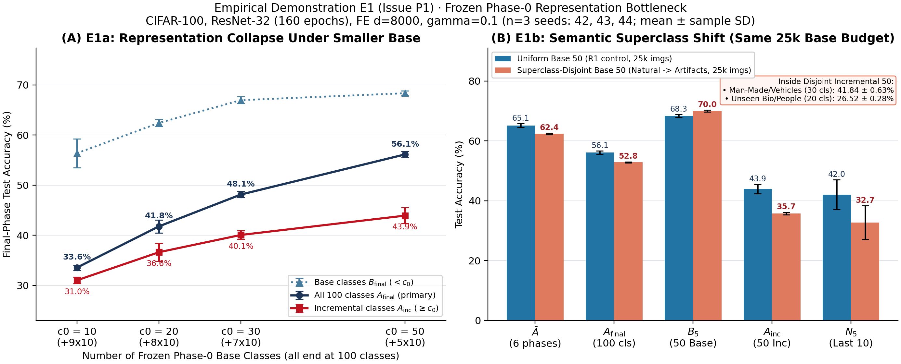

# Báo cáo Thực nghiệm Cuối kỳ `E1` — Giả định Đủ đầy Biểu diễn của Tập Lớp Base Đóng băng (`2026-11-18`)

- **Vấn đề lý thuyết kiểm chứng (`P1`):** Định lý 3.1 của ACIL chỉ bảo đảm $W_K = \tilde{W}_K$ trên ánh xạ đặc trưng cố định $\phi_{\theta_0}(x)$ học từ Phase 0. Phương pháp ngầm giả định tập lớp Base $\mathcal{C}_0$ đủ lớn ($50\%$ số lớp) và cùng phân phối ngữ nghĩa với các lớp đến sau để không gian đặc trưng đóng băng tách tuyến tính được các lớp mới qua chiếu ngẫu nhiên $W_{\mathrm{fe}}$.
- **Kế hoạch khóa trước khi chạy:** [`docs/KE_HOACH_EMPIRICS_CUOI_KY.md`](../docs/KE_HOACH_EMPIRICS_CUOI_KY.md).
- **Tệp dữ liệu & truy nguyên SHA-256:**
  - Tổng hợp 3 seeds (`n=3`, `ddof=1`): [`reports/e1_base_assumption_summary.json`](e1_base_assumption_summary.json) (đối chiếu chuẩn `c_0 = 50` đồng phân phối từ [`reports/r1_cifar100_k5_summary.json`](r1_cifar100_k5_summary.json))
  - Raw JSON `E1a` (9 lượt): [`e1a_c0_10_seed42_results.json`](e1a_c0_10_seed42_results.json), [`e1a_c0_20_seed42_results.json`](e1a_c0_20_seed42_results.json), [`e1a_c0_30_seed42_results.json`](e1a_c0_30_seed42_results.json), [`e1a_c0_10_seed43_results.json`](e1a_c0_10_seed43_results.json), [`e1a_c0_20_seed43_results.json`](e1a_c0_20_seed43_results.json), [`e1a_c0_30_seed43_results.json`](e1a_c0_30_seed43_results.json), [`e1a_c0_10_seed44_results.json`](e1a_c0_10_seed44_results.json), [`e1a_c0_20_seed44_results.json`](e1a_c0_20_seed44_results.json), [`e1a_c0_30_seed44_results.json`](e1a_c0_30_seed44_results.json)
  - Raw JSON `E1b` (3 lượt): [`e1b_superclass_disjoint_seed42_results.json`](e1b_superclass_disjoint_seed42_results.json), [`e1b_superclass_disjoint_seed43_results.json`](e1b_superclass_disjoint_seed43_results.json), [`e1b_superclass_disjoint_seed44_results.json`](e1b_superclass_disjoint_seed44_results.json)
  - Manifest SHA-256, Kaggle `scriptVersionId` & xác minh W&B ẩn danh: [`reports/E1-FINAL-EMPIRICS-provenance.json`](E1-FINAL-EMPIRICS-provenance.json)
  - Biểu đồ phục vụ Poster A2: [`reports/figures/e1_base_representation_bottleneck.png`](figures/e1_base_representation_bottleneck.png)
- **Notebooks Kaggle GPU T4 (6 kernels hoàn tất ở Version 1):**
  - `E1a`: [Notebook 13 (`v1/370801804`)](https://www.kaggle.com/code/hsangg206/13-e1a-base-ratio-seed42/output?scriptVersionId=370801804) · [Notebook 14 (`v1/370801839`)](https://www.kaggle.com/code/hsangg206/14-e1a-base-ratio-seed43/output?scriptVersionId=370801839) · [Notebook 15 (`v1/370817341`)](https://www.kaggle.com/code/hsangg206/15-e1a-base-ratio-seed44/output?scriptVersionId=370817341)
  - `E1b`: [Notebook 16 (`v1/370817350`)](https://www.kaggle.com/code/hsangg206/16-e1b-superclass-shift-seed42/output?scriptVersionId=370817350) · [Notebook 17 (`v1/370827515`)](https://www.kaggle.com/code/hsangg206/17-e1b-superclass-shift-seed43/output?scriptVersionId=370827515) · [Notebook 18 (`v1/370833058`)](https://www.kaggle.com/code/hsangg206/18-e1b-superclass-shift-seed44/output?scriptVersionId=370833058)
- **Runs W&B công khai (`hsangg-2006/acil-reproduction`, nhãn `final-empirics`, `P1-base-assumption`, `P1-base-shift`):**
  - `E1a (seed 42)`: [`c1c00gop`](https://wandb.ai/hsangg-2006/acil-reproduction/runs/c1c00gop) (`c0=10`) · [`1sxua0j4`](https://wandb.ai/hsangg-2006/acil-reproduction/runs/1sxua0j4) (`c0=20`) · [`teevqsnt`](https://wandb.ai/hsangg-2006/acil-reproduction/runs/teevqsnt) (`c0=30`)
  - `E1a (seed 43)`: [`4mwubtt2`](https://wandb.ai/hsangg-2006/acil-reproduction/runs/4mwubtt2) (`c0=10`) · [`t65feqkw`](https://wandb.ai/hsangg-2006/acil-reproduction/runs/t65feqkw) (`c0=20`) · [`ysgblws2`](https://wandb.ai/hsangg-2006/acil-reproduction/runs/ysgblws2) (`c0=30`)
  - `E1a (seed 44)`: [`pbct2s6d`](https://wandb.ai/hsangg-2006/acil-reproduction/runs/pbct2s6d) (`c0=10`) · [`q3t7kvyb`](https://wandb.ai/hsangg-2006/acil-reproduction/runs/q3t7kvyb) (`c0=20`) · [`lpps6veq`](https://wandb.ai/hsangg-2006/acil-reproduction/runs/lpps6veq) (`c0=30`)
  - `E1b (disjoint c0=50)`: [`db4wwmvz`](https://wandb.ai/hsangg-2006/acil-reproduction/runs/db4wwmvz) (`seed 42`) · [`2cy9asyu`](https://wandb.ai/hsangg-2006/acil-reproduction/runs/2cy9asyu) (`seed 43`) · [`e9wono5t`](https://wandb.ai/hsangg-2006/acil-reproduction/runs/e9wono5t) (`seed 44`)

---

## 1. Bảng Kết quả `E1a` — Thu hẹp Quy mô Tập Lớp Base (`3 Seeds: 42, 43, 44`, `mean ± sample SD`)

Trên từng seed, mọi cấu hình giữ nguyên hoán vị 100 lớp `class_order`, huấn luyện mới ResNet-32 trong 160 epochs chỉ trên $c_0$ lớp đầu (chuẩn hóa `mean/std` tính riêng trên $500 \cdot c_0$ ảnh train của Phase 0), đóng băng backbone, rồi học giải tích các lớp còn lại theo từng bước 10 lớp/phase với $d = 8000$, $\gamma = 0.1$, minibatch $b = 128$, `float64`. Tất cả cấu hình đều kết thúc trên đúng 100 lớp (`10,000` ảnh test) ở pha cuối, vì vậy $A_{\mathrm{final}}$ là thước đo đối chiếu ngang bằng trực tiếp nhất.

| Quy mô lớp Base $c_0$ | Kịch bản pha (`K` pha mới) | $\bar{A}$ qua $K+1$ mốc (%)* | $A_{\mathrm{final}}$ 100 lớp (%) | $B_0$ đầu kỳ (%) | $B_{\mathrm{final}}$ lớp Base (%) | $A_{\mathrm{inc}}$ lớp mới ($\ge c_0$, %) | $N_{\mathrm{last}}$ 10 lớp cuối (%) | $\Delta_{\text{gap}} = B_{\mathrm{final}} - A_{\mathrm{inc}}$ (pp) | $F_{\mathrm{base}}$ (pp) |
|---|---|---:|---:|---:|---:|---:|---:|---:|---:|
| **`c_0 = 50` (Chuẩn `R1`)** | `50 + 5 × 10` (`6` mốc) | **`65.12 ± 0.61`** | **`56.13 ± 0.56`** | `76.64 ± 0.12` | **`68.33 ± 0.50`** | **`43.93 ± 1.59`** | `42.00 ± 4.96` | `24.41 ± 2.08` | `8.31 ± 0.62` |
| `c_0 = 30` | `30 + 7 × 10` (`8` mốc) | `60.68 ± 0.83` | `48.14 ± 0.59` (`-7.99 pp`) | `81.92 ± 0.57` | `66.96 ± 0.68` | `40.08 ± 0.88` | `39.27 ± 3.16` | `26.88 ± 1.25` | `14.97 ± 0.12` |
| `c_0 = 20` | `20 + 8 × 10` (`9` mốc) | `55.18 ± 1.48` | `41.79 ± 1.29` (`-14.34 pp`) | `81.83 ± 1.47` | `62.42 ± 0.73` | `36.63 ± 1.80` | `35.53 ± 4.88` | `25.78 ± 2.52` | `19.42 ± 2.17` |
| **`c_0 = 10`** | `10 + 9 × 10` (`10` mốc) | **`46.28 ± 0.33`** | **`33.57 ± 0.53` (`-22.56 pp`)** | `84.67 ± 1.52` | **`56.37 ± 2.87`** | **`31.03 ± 0.67` (`-12.90 pp`)** | `28.27 ± 2.57` | `25.33 ± 3.24` | `28.30 ± 2.46` |

*(\*Lưu ý: $\bar{A}$ trung bình trên $K+1$ mốc có độ khó trung bình khác nhau giữa $K \in \{5, 7, 8, 9\}$; so sánh chính giữa các mức $c_0$ đặt trên $A_{\mathrm{final}}$ 100 lớp và $A_{\mathrm{inc}}$).*

### Nhận xét từ số liệu `E1a`
1. **Xác nhận mạnh giả thuyết `P1` (phần quy mô tập Base):** Khi giảm số lớp huấn luyện backbone ở Phase 0 từ $c_0 = 50$ xuống $30 \to 20 \to 10$, độ chính xác trên đủ 100 lớp ở pha cuối $A_{\mathrm{final}}$ sụt giảm đơn điệu và rất lớn: từ **`56.13 ± 0.56%`** xuống **`48.14%` (`-7.99 pp`)**, **`41.79%` (`-14.34 pp`)** và chỉ còn **`33.57 ± 0.53%` (`-22.56 pp`)** tại $c_0 = 10$ — vượt xa ngưỡng bác bỏ $2.0\text{ pp}$ đã khóa trước.
2. **Tối ưu đại số nhưng nghẽn biểu diễn:** Trên tất cả 9 lượt chạy GPU của `E1a`, kiểm chứng nội tại với nghiệm học gộp Ridge (`Joint Ridge Oracle`) ở pha cuối đều đạt sai số tương đối trọng số `relative_w_error` $\approx 3.0\text{–}3.6 \times 10^{-14}$ và **`0 / 10,000` mẫu lệch dự đoán**. Nghĩa là phép cập nhật đệ quy Woodbury không hề mất thông tin tuyến tính; toàn bộ mức sụt giảm `-22.56 pp` đến từ việc 10 lớp đầu quá hẹp để ép ResNet-32 học được bộ đặc trưng đủ phong phú cho 90 lớp xuất hiện sau. Đồng thời, khi 90 lớp mới dồn vào cùng không gian đặc trưng nghèo nàn, nhiễu chồng lấp ranh giới cũng kéo $B_{\mathrm{final}}$ của chính 10 lớp đầu giảm từ `84.67%` xuống `56.37%` ($F_{\mathrm{base}} = 28.30\text{ pp}$).

---

## 2. Bảng Kết quả `E1b` — Dịch chuyển Miền Ngữ nghĩa tại Cố định `c_0 = 50` (`3 Seeds: 42, 43, 44`)

Nhánh `E1b` giữ cố định **đúng `c_0 = 50` lớp (`25,000` ảnh train)** ở Phase 0 và `K = 5 × 10` lớp mới như chuẩn bài báo, chỉ thay đổi độ phủ ngữ nghĩa theo 20 *coarse superclasses* gốc của CIFAR-100: so sánh phân phối ngẫu nhiên đồng đều (`Uniform Base 50` từ `R1`, phủ `19–20/20` superclasses ngay ở Phase 0) với phân hoạch lệch miền hoàn toàn (`Superclass-Disjoint Base 50`, trong đó Phase 0 chỉ chứa 10 superclasses Tự nhiên/Thực vật/Động vật và Phases `1..5` chứa 10 superclasses còn lại với `0` superclass chung).

| Chế độ phân bổ 50 lớp Base | Số superclass chung | $\bar{A}$ 6 mốc (%) | $A_{\mathrm{final}}$ 100 lớp (%) | $B_0$ 50 lớp Base (%) | $B_5$ 50 lớp Base cuối (%) | $A_{\mathrm{inc}}$ 50 lớp mới (%) | $N_5$ 10 lớp pha cuối (%) | $\Delta_{\text{gap}} = B_5 - A_{\mathrm{inc}}$ (pp) | $F_{\mathrm{base}}$ (pp) |
|---|---:|---:|---:|---:|---:|---:|---:|---:|---:|
| **`Uniform Base 50` (`R1`)** | `19–20 / 20` | **`65.12 ± 0.61`** | **`56.13 ± 0.56`** | `76.64 ± 0.12` | `68.33 ± 0.50` | **`43.93 ± 1.59`** | `42.00 ± 4.96` | **`24.41 ± 2.08`** | `8.31 ± 0.62` |
| **`Superclass-Disjoint Base 50` (`E1b`)** | **`0 / 20`** | **`62.36 ± 0.27`** | **`52.84 ± 0.17`** | `73.40 ± 0.77` | **`69.97 ± 0.31`** | **`35.71 ± 0.40`** | `32.70 ± 5.60` | **`34.26 ± 0.62`** | `3.43 ± 0.57` |
| **Chênh lệch (`E1b` − `R1`)** | — | **`-2.76 pp`** | **`-3.29 pp`** | `-3.24 pp` | **`+1.64 pp`** | **`-8.21 pp`** | **`-9.30 pp`** | **`+9.85 pp`** | `-4.88 pp` |

### Phân rã chẩn đoán bên trong 50 lớp tăng dần của `E1b`
- **30 lớp đồ vật nhân tạo, công trình & phương tiện thuần túy** (`food_containers`, `household_electrical_devices`, `household_furniture`, `large_man-made_outdoor_things`, `vehicles_1`, `vehicles_2`): đạt **`41.84 ± 0.63%`** (thấp hơn rõ rệt so với mức `48.11 ± 1.80%` mà nhóm lớp nhân tạo đạt được ngay cả ở cấu hình ít dữ liệu hơn `E1a c_0 = 30` có phủ đều superclass).
- **20 lớp con người & nhánh sinh vật chưa từng gặp ở Phase 0** (`people`, `reptiles`, `small_mammals`, `non-insect_invertebrates`): chỉ đạt **`26.52 ± 0.28%`** (thấp hơn gần `10 pp` so với mức `36.23 ± 0.52%` ở `E1a c_0 = 30`).

### Nhận xét từ số liệu `E1b`
1. **Xác nhận giả thuyết `P1` (phần đồng phân phối ngữ nghĩa):** Dù được huấn luyện trên cùng `25,000` ảnh của 50 lớp ở Phase 0, việc tách rời miền ngữ nghĩa giữa Phase 0 và các pha tăng dần làm độ chính xác trên 50 lớp mới $A_{\mathrm{inc}}$ giảm mạnh **`-8.21 pp`** (`43.93% -> 35.71%`), kéo $A_{\mathrm{final}}$ giảm **`-3.29 pp`** (`56.13% -> 52.84%`) và $\bar{A}$ giảm **`-2.76 pp`** (`65.12% -> 62.36%`).
2. **Sự phân cực ngược chiều giữa $B_5$ và $A_{\mathrm{inc}}$:** Đáng chú ý là ở `E1b`, độ chính xác cuối kỳ của 50 lớp Base $B_5$ không những không giảm theo mà còn **cao hơn `R1` `+1.64 pp`** (`69.97%` so với `68.33%`, mức quên $F_{\mathrm{base}}$ chỉ `3.43 pp`), làm khoảng lệch chuyển giao $\Delta_{\text{gap}} = B_5 - A_{\mathrm{inc}}$ nới rộng thêm **`+9.85 pp`** lên **`34.26 ± 0.62 pp`**. Phân rã nội bộ cho thấy hai cơ chế suy giảm bổ sung nhau trên đặc trưng đóng băng $\theta_0$: (i) các lớp phương tiện/đồ vật nhân tạo thiếu bộ lọc hình học chuyên biệt từ Phase 0 nên giảm khoảng `6–8 pp` so với chia đều; và (ii) các nhóm sinh vật mới chưa gặp (`small_mammals`, `reptiles`, `people`) bị chiếu đè trực tiếp vào vùng đặc trưng dày đặc của 50 lớp động/thực vật Phase 0 mà không có cập nhật gradient tương phản để tách ranh giới tinh, dẫn tới nhầm lẫn một chiều về phía các lớp Base cũ.
3. **Liên hệ trực tiếp tới hướng phát triển `FD1`:** Kết quả của cả `E1a` lẫn `E1b` chứng minh điểm nghẽn thực sự của ACIL nằm ở chất lượng chuyển giao của biểu diễn Phase 0 đóng băng, củng cố trực tiếp đề xuất `FD1` (học biểu diễn tự giám sát/tương phản ít phụ thuộc nhãn lớp đầu hoặc thích nghi hạng thấp có hiệu chỉnh tương quan).

