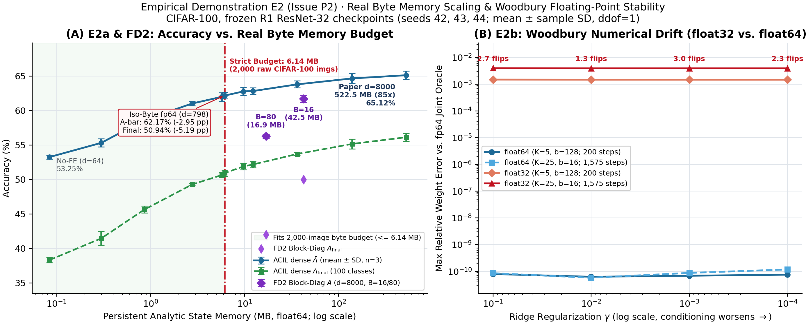

# Báo cáo Thực nghiệm Cuối kỳ `E2` — Ngân sách Bộ nhớ Byte Thực tế & Độ ổn định Số học Woodbury (`2026-11-18`)

- **Vấn đề lý thuyết kiểm chứng (`P2`):** Chi phí lưu trữ bậc hai $\mathcal{O}(d^2)$ theo số byte thực tế của ma trận tự tương quan nghịch đảo $R_k \in \mathbb{R}^{d \times d}$ trong thiết lập *Strict-Memory* ([1-Supp], Bảng A) và độ nhạy dấu phẩy động của phép cập nhật đệ quy Woodbury khi hạ từ `float64` xuống `float32`.
- **Kế hoạch khóa trước khi chạy:** [`docs/KE_HOACH_EMPIRICS_CUOI_KY.md`](../docs/KE_HOACH_EMPIRICS_CUOI_KY.md).
- **Tệp dữ liệu & truy nguyên SHA-256:**
  - Tổng hợp 3 seeds (`n=3`, `ddof=1`): [`reports/e2_memory_precision_summary.json`](e2_memory_precision_summary.json)
  - Raw JSON từng seed: [`e2_seed42_results.json`](e2_seed42_results.json), [`e2_seed43_results.json`](e2_seed43_results.json), [`e2_seed44_results.json`](e2_seed44_results.json)
  - Manifest SHA-256 & xác minh W&B ẩn danh: [`reports/E2-FINAL-EMPIRICS-provenance.json`](E2-FINAL-EMPIRICS-provenance.json)
  - Biểu đồ phục vụ Poster A2: [`reports/figures/e2_memory_and_woodbury_precision.png`](figures/e2_memory_and_woodbury_precision.png)
- **Runs W&B công khai (`hsangg-2006/acil-reproduction`, nhãn `final-empirics`, `P2-memory-scaling`, `P2-memory-precision`):**
  - `E2a + FD2`: [`givauiwx`](https://wandb.ai/hsangg-2006/acil-reproduction/runs/givauiwx) (`seed 42`) · [`e3z5fld4`](https://wandb.ai/hsangg-2006/acil-reproduction/runs/e3z5fld4) (`seed 43`) · [`x9uxqlxu`](https://wandb.ai/hsangg-2006/acil-reproduction/runs/x9uxqlxu) (`seed 44`)
  - `E2b`: [`bf8zhv34`](https://wandb.ai/hsangg-2006/acil-reproduction/runs/bf8zhv34) (`seed 42`) · [`luzl13ud`](https://wandb.ai/hsangg-2006/acil-reproduction/runs/luzl13ud) (`seed 43`) · [`dwmcy1ob`](https://wandb.ai/hsangg-2006/acil-reproduction/runs/dwmcy1ob) (`seed 44`)

---

## 1. Bảng Kết quả `E2a` & Nguyên mẫu `FD2` trên 3 Seeds (`42, 43, 44`, `mean ± sample SD`)

Tất cả các cấu hình tái sử dụng đúng 3 checkpoints ResNet-32 160 epochs của `R1` (đối chiếu khớp SHA-256, `0` lượt huấn luyện CNN mới), cố định $\gamma = 0.1$, $K = 5$, minibatch $b = 128$, `4` luồng CPU/BLAS. Ngân sách chuẩn của kho $M = 2{,}000$ ảnh gốc CIFAR-100 (`32×32×3 uint8`) là **`6,144,000 bytes` (`6.144 MB`)**.

| Nhánh / Cấu hình | Dung lượng `float64` (MB) | Dung lượng `float32` (MB) | Tỷ số Byte (`fp64` / `2k` ảnh) | Peak RSS học (MiB) | Thời gian học (s) | $\bar{A}$ (%) | $A_{\mathrm{final}}$ 100 lớp (%) | $A_{\mathrm{inc}}$ 50 lớp mới (%) | Lệch nhãn Joint Oracle |
|---|---:|---:|---:|---:|---:|---:|---:|---:|---:|
| `d = 64` (No-FE) | `0.084` | `0.042` | `0.01x` | `542.8 ± 15.8` | `0.32 ± 0.05` | `53.25 ± 0.28` | `38.33 ± 0.37` | `3.73 ± 1.11` | `0 / 30,000` |
| `d = 128` | `0.299` | `0.150` | `0.05x` | `542.9 ± 15.8` | `0.73 ± 0.26` | `55.32 ± 0.58` | `41.48 ± 0.98` | `10.73 ± 2.99` | `0 / 30,000` |
| `d = 256` | `0.860` | `0.430` | `0.14x` | `543.5 ± 15.8` | `1.38 ± 0.26` | `58.64 ± 0.57` | `45.65 ± 0.50` | `18.54 ± 1.50` | `0 / 30,000` |
| `d = 512` | `2.769` | `1.384` | `0.45x` | `549.6 ± 15.8` | `4.46 ± 0.91` | `61.02 ± 0.32` | `49.29 ± 0.16` | `26.43 ± 1.20` | `0 / 30,000` |
| `d = 768` | `5.726` | `2.863` | `0.93x` | `557.8 ± 15.6` | `7.07 ± 1.65` | `61.99 ± 0.62` | `50.65 ± 0.34` | `29.83 ± 1.40` | `0 / 30,000` |
| **`d = 798` (Trần Byte fp64)** | **`6.141`** | `3.071` | **`1.00x`** | `559.2 ± 15.6` | `6.12 ± 1.09` | **`62.17 ± 0.47`** | **`50.94 ± 0.43`** | **`30.29 ± 1.47`** | `0 / 30,000` |
| `d = 1024` | `9.732` | `4.866` | `1.58x` | `570.7 ± 15.6` | `14.11 ± 2.02` | `62.78 ± 0.56` | `51.90 ± 0.48` | `32.62 ± 1.57` | `0 / 30,000` |
| **`d = 1160` (Trần Byte fp32)** | `12.287` | **`6.143`** | `2.00x` (`1.00x` fp32) | `577.8 ± 15.8` | `10.99 ± 1.74` | **`62.82 ± 0.48`** | **`52.18 ± 0.47`** | **`33.52 ± 1.61`** | `0 / 30,000` |
| `d = 2048` | `36.241` | `18.121` | `5.90x` | `649.0 ± 15.8` | `55.55 ± 7.82` | `63.80 ± 0.50` | `53.70 ± 0.24` | `37.27 ± 1.20` | `0 / 30,000` |
| `d = 4096` | `139.592` | `69.796` | `22.72x` | `944.1 ± 15.6` | `234.72 ± 5.56` | `64.66 ± 0.74` | `55.16 ± 0.70` | `40.97 ± 1.77` | `0 / 30,000` |
| **`d = 8000` (Chuẩn bài báo)** | **`522.496`** | `261.248` | **`85.04x`** | `2045.4 ± 14.3` | `758.08 ± 12.16` | **`65.12 ± 0.61`** | **`56.13 ± 0.56`** | **`43.93 ± 1.59`** | `0 / 30,000` |
| `FD2: d = 8000, B = 16` (`m=500`) | `42.496` | `21.248` | `6.92x` | `626.4 ± 15.6` | `292.30 ± 9.75` | `61.70 ± 0.52` | `49.98 ± 0.22` | `26.96 ± 1.19` | `7,613 / 30,000`* |
| `FD2: d = 8000, B = 80` (`m=100`) | `16.896` | `8.448` | `2.75x` | `593.8 ± 15.9` | `93.39 ± 2.41` | `56.29 ± 0.30` | `41.99 ± 0.56` | `9.15 ± 1.73` | `12,454 / 30,000`* |

*(\*Ở hai hàng `FD2`, cột cuối đo số mẫu dự đoán khác với nghiệm Joint Ridge dày đặc $d=8000$ để lượng hóa sai số xấp xỉ khi bỏ các khối ngoài đường chéo; trong nội bộ từng khối con, nghiệm đệ quy vẫn khớp nghiệm Joint của khối đó).*

### Nhận xét từ số liệu `E2a` & `FD2`
1. **Kiểm chứng giả thuyết `P2` về thiết lập *Strict-Memory*:** Khi giới hạn trạng thái lưu trữ của ACIL về đúng ngân sách `6.144 MB` của 2,000 ảnh CIFAR-100, độ chính xác trung bình $\bar{A}$ giảm **$-2.95\text{ pp}$** (`65.12%` $\to$ `62.17%` tại $d = 798$ ở `float64`) hoặc **$-2.30\text{ pp}$** (`65.12%` $\to$ `62.82%` tại $d = 1160$ ở `float32`); độ chính xác 100 lớp cuối $A_{\mathrm{final}}$ sụt mạnh hơn, lần lượt **$-5.19\text{ pp}$** (`56.13%` $\to$ `50.94%`) và **$-3.95\text{ pp}$** (`56.13%` $\to$ `52.18%`), trong đó riêng 50 lớp học tăng dần $A_{\mathrm{inc}}$ giảm **$-13.64\text{ pp}$** (`43.93%` $\to$ `30.29%`). Điều này xác nhận việc Bảng A [1-Supp] giữ nguyên $d = 8000$ (`522.5 MB`, gấp `85×` ngân sách byte của đối thủ) mang lại lợi thế đáng kể cho ACIL trên tập ảnh nhỏ.
2. **Phát hiện thực nghiệm đáng chú ý trên nguyên mẫu `FD2` (*Block-Diagonal RFAM*):** Dù giảm $16\times$ dung lượng ma trận $R_k$ (`512 MB -> 32 MB`, tổng trạng thái `42.50 MB`), cấu hình `FD2 (d=8000, B=16)` đạt $\bar{A} = 61.70\%$, thấp hơn cấu hình ma trận dày đặc `d = 2048` có dung lượng nhỏ hơn (`36.24 MB`, đạt $\bar{A} = 63.80\%$). Nguyên nhân đại số là toàn bộ $8{,}000$ đặc trưng ngẫu nhiên $\operatorname{ReLU}(F W_{\mathrm{fe}})$ đều xuất phát từ cùng không gian $64$ chiều của ResNet-32 nên có tương quan chéo rất mạnh giữa các khối; việc triệt tiêu các khối ngoài đường chéo làm mất khả năng khử cộng tuyến toàn cục của nghiệm Ridge. Như vậy, dưới ràng buộc bộ nhớ chặt, giữ đầy đủ tương quan chéo trên không gian chiều vừa phải ($d \in [1024, 2048]$) hoặc nén trực giao phụ thuộc dữ liệu hiệu quả hơn chia khối độc lập mù trên chiếu ngẫu nhiên.

---

## 2. Bảng Kết quả `E2b` — Độ trôi Số học Woodbury (`float32` vs `float64`, $d = 1024$, 3 Seeds)

| Chế độ bước lặp | Hệ số $\gamma$ | `float64`: `max_rel_W` (mean) | `float64`: Tổng lệch nhãn pha cuối (trên `30,000` mẫu) | `float32`: `max_rel_W` (mean / worst) | `float32`: Sai số mất đối xứng $\|R - R^T\|_F$ | `float32`: Tổng lệch nhãn pha cuối (trên `30,000` mẫu) |
|---|---:|---:|---:|---:|---:|---:|
| `K = 5, b = 128` (`200` bước) | `0.1` | `7.91e-11` | **`0`** | `1.49e-03` / `1.94e-03` | `7.25e-09` | `3` |
| `K = 5, b = 128` (`200` bước) | `0.01` | `6.26e-11` | **`0`** | `1.47e-03` / `1.94e-03` | `7.97e-09` | `7` |
| `K = 5, b = 128` (`200` bước) | `0.001` | `6.84e-11` | **`0`** | `1.47e-03` / `1.94e-03` | `9.96e-09` | `4` |
| `K = 5, b = 128` (`200` bước) | `0.0001` | `7.49e-11` | **`0`** | `1.47e-03` / `1.94e-03` | `8.58e-09` | `6` |
| `K = 25, b = 16` (`1,575` bước) | `0.1` | `8.51e-11` | **`0`** | `3.97e-03` / `5.18e-03` | `1.76e-08` | `8` |
| `K = 25, b = 16` (`1,575` bước) | `0.01` | `5.75e-11` | **`0`** | `3.94e-03` / `5.19e-03` | `2.13e-08` | `4` |
| `K = 25, b = 16` (`1,575` bước) | `0.001` | `8.73e-11` | **`0`** | `3.94e-03` / `5.19e-03` | `2.18e-08` | **`9`** |
| `K = 25, b = 16` (`1,575` bước) | `0.0001` | `1.17e-10` | **`0`** | `3.93e-03` / `5.18e-03` | `1.70e-08` | `7` |

### Nhận xét từ số liệu `E2b`
- Ở kiểu `float64`, bất kể tăng số bước cập nhật Woodbury gấp gần $8\times$ (`200 -> 1,575` bước) hay hạ $\gamma$ xuống $10^{-4}$, sai số tương đối trọng số vẫn ghim chặt ở vùng $6 \times 10^{-11}\text{–}1.2 \times 10^{-10}$ với **đúng `0` nhãn dự đoán lệch so với nghiệm học gộp trên toàn bộ 3 seeds**.
- Khi chuyển sang `float32` để tiết kiệm một nửa bộ nhớ, sai số tương đối trọng số tăng vọt hơn **$4 \times 10^7$ lần** (lên $1.5 \times 10^{-3}$ ở `200` bước và $4.0 \times 10^{-3}$ ở `1,575` bước), làm phát sinh các mẫu đổi nhãn $\operatorname{argmax}$ ở mọi cấu hình khảo sát. Dù mức giảm độ chính xác trung bình ở $d = 1024$ còn nhỏ ($\le 0.01\text{ pp}$), kết quả này lý giải vì sao muốn bảo đảm tính bất biến theo thứ tự/số bước (*exact order/step invariance* của Định lý 3.1) thì thực thi chuẩn phải trả chi phí `8 bytes/phần tử` của `float64`.

