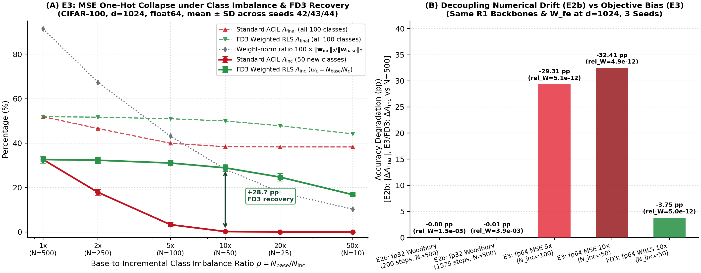

# Báo cáo Thực nghiệm Phụ `E3` — Phân tách Độ trôi Woodbury `float32` vs Mất cân bằng Lớp của MSE One-Hot (`2026-11-18`)

- **Vai trò theo quy định môn học:** Poster A2 cuối kỳ chỉ trình bày 2 hạn chế chính mạnh nhất (`P1` — nghẽn biểu diễn từ tập Base đóng băng qua `E1`; `P2` — bộ nhớ bậc hai $\mathcal{O}(d^2)$ theo byte & độ nhạy Woodbury qua `E2`). Mọi phân tích kiểm chứng cho **hạn chế thứ 3 (`P3`)** được trình bày đầy đủ kèm bằng chứng thực nghiệm và link W&B công khai ngay tại repository (`README.md` và báo cáo này).
- **Vấn đề lý thuyết kiểm chứng (`P3`):** Tách bạch rõ hai nguồn suy giảm hoàn toàn khác nhau trong tầng phân loại giải tích ACIL ở cùng điều kiện kiểm soát $d = 1024$:
  1. **Độ trôi số học do hạ độ chính xác `float32` (đã đo tại `E2b`):** Phá vỡ tính khớp đại số chính xác của Định lý 3.1 (`max_rel_W` nhảy từ $\sim 8 \times 10^{-11}$ ở `float64` lên $1.49 \times 10^{-3}\text{–}3.97 \times 10^{-3}$ ở `float32`, phát sinh `3–9` mẫu đổi nhãn `argmax`), nhưng khi mọi lớp đều cân bằng ($500$ mẫu/lớp), độ chính xác cuối chỉ dao động chưa tới $0.01\text{ pp}$.
  2. **Thiên lệch cấu trúc của hàm mục tiêu tuyến tính MSE One-Hot khi mất cân bằng lớp (`E3`):** Dùng hoàn toàn **`float64` chuẩn** (Định lý 3.1 khớp tuyệt đối nghiệm gộp Joint Ridge tới $\le 7.74 \times 10^{-12}$, `0` mẫu lệch dự đoán across toàn bộ 18 cấu hình-seed!), nhưng khi giảm số mẫu mỗi lớp tăng dần $N_{\mathrm{inc}} \in \{500, 250, 100, 50, 25, 10\}$ so với $N_{\mathrm{base}} = 500$, vế phải $\sum_{i: y_i = c} h_i$ tỷ lệ thuận với $N_c$ trong khi chuẩn hóa $\gamma \|w_c\|_2^2$ tác động đồng đều, kéo chuẩn cột $\|w_c\|_2$ của lớp mới co rụt và khiến $A_{\mathrm{inc}}$ **sụp đổ về `0.00%`**.
  3. **Hướng khắc phục tương ứng `FD3` (*Importance-Weighted Recursive Least Squares — WRLS*):** Nhân trọng số cân bằng mẫu $\omega_c = N_{\mathrm{base}} / N_c$ ngay trong phép cập nhật đệ quy Woodbury một lượt (`weighted_incremental_update` trong [`scripts/e3_mse_imbalance_runner.py`](../scripts/e3_mse_imbalance_runner.py)), không lưu mẫu cũ, không tốn thêm byte nào cho ma trận $R_k$, vẫn khớp tuyệt đối nghiệm Joint Ridge có trọng số ($\le 7.74 \times 10^{-12}$) và khôi phục mạnh $A_{\mathrm{inc}}$.
- **Tệp dữ liệu & truy nguyên SHA-256:**
  - Tổng hợp 3 seeds (`n=3`, `ddof=1`): [`reports/e3_mse_imbalance_summary.json`](e3_mse_imbalance_summary.json)
  - Raw JSON từng seed: [`e3_seed42_results.json`](e3_seed42_results.json) · [`e3_seed43_results.json`](e3_seed43_results.json) · [`e3_seed44_results.json`](e3_seed44_results.json)
  - Manifest SHA-256 & kiểm tra W&B ẩn danh: [`reports/E3-FINAL-EMPIRICS-provenance.json`](E3-FINAL-EMPIRICS-provenance.json)
  - Biểu đồ đối chiếu: [`reports/figures/e3_mse_imbalance_vs_woodbury_drift.png`](figures/e3_mse_imbalance_vs_woodbury_drift.png)
- **Runs W&B công khai (`hsangg-2006/acil-reproduction`, nhãn `final-empirics`, `P3-mse-imbalance`, `FD3-weighted-rls`):**
  - Seed 42: [`18y2c7pg`](https://wandb.ai/hsangg-2006/acil-reproduction/runs/18y2c7pg) Finished
  - Seed 43: [`7uqw193s`](https://wandb.ai/hsangg-2006/acil-reproduction/runs/7uqw193s) Finished
  - Seed 44: [`rfu8q4pv`](https://wandb.ai/hsangg-2006/acil-reproduction/runs/rfu8q4pv) Finished

---

## 1. Bảng Kết quả `E3` & Nguyên mẫu `FD3-WRLS` (`d = 1024`, `float64`, `gamma = 0.1`, 3 Seeds `42/43/44`)

Tất cả cấu hình tái dùng đúng 3 checkpoints ResNet-32 160 epochs và bộ đặc trưng `F64` đã pin SHA-256 của `R1` (không huấn luyện lại CNN), cố định $K = 5$ pha tăng dần (`50 + 5 × 10` lớp), minibatch $b = 128$, `4` luồng CPU/BLAS. Đánh giá luôn tiến hành trên đủ `10,000` ảnh test cân bằng (`100` ảnh/lớp).

| Tỷ số mất cân bằng $\rho = \frac{N_{\mathrm{base}}}{N_{\mathrm{inc}}}$ ($N_{\mathrm{inc}}$) | ACIL $\bar{A}$ (%) | ACIL $A_{\mathrm{final}}$ 100 lớp (%) | ACIL $B_5$ 50 lớp Base (%) | **ACIL $A_{\mathrm{inc}}$ 50 lớp mới (%)** | Tỷ số chuẩn $\|\bar{w}_{\mathrm{inc}}\|_2 / \|\bar{w}_{\mathrm{base}}\|_2$ | **FD3-WRLS $A_{\mathrm{final}}$ (%)** | **FD3-WRLS $A_{\mathrm{inc}}$ 50 lớp mới (%)** | Độ lệch Joint Oracle (cả ACIL & FD3) |
|---|---:|---:|---:|---:|---:|---:|---:|---:|
| **`1x` (`N_inc = 500`, cân bằng)** | `62.78 ± 0.56` | `51.90 ± 0.48` | `71.18 ± 0.72` | **`32.62 ± 1.57`** | `0.915` | `51.90 ± 0.48` | `32.62 ± 1.57` | $\le 7.72 \times 10^{-12}$, `0` flips |
| `2x` (`N_inc = 250`) | `59.36 ± 0.51` | `46.57 ± 0.57` | `75.28 ± 0.40` | `17.87 ± 1.20` (`-14.75 pp`) | `0.674` | `51.67 ± 0.37` | `32.29 ± 1.35` (`+14.42 pp`) | $\le 6.80 \times 10^{-12}$, `0` flips |
| `5x` (`N_inc = 100`) | `55.07 ± 0.34` | `39.94 ± 0.55` | `76.56 ± 0.22` | `3.31 ± 0.89` (`-29.31 pp`) | `0.431` | `50.96 ± 0.37` | `31.05 ± 1.30` (`+27.74 pp`) | $\le 6.90 \times 10^{-12}$, `0` flips |
| **`10x` (`N_inc = 50`)** | `54.01 ± 0.15` | `38.38 ± 0.13` | `76.55 ± 0.16` | **`0.21 ± 0.10` (`-32.41 pp`)** | **`0.283`** | **`49.96 ± 0.62`** | **`28.87 ± 1.69` (`+28.66 pp`)** | $\le 6.50 \times 10^{-12}$, `0` flips |
| `20x` (`N_inc = 25`) | `53.99 ± 0.12` | `38.29 ± 0.12` | `76.58 ± 0.24` | `0.01 ± 0.01` (`-32.61 pp`) | `0.178` | `47.81 ± 0.64` | `24.70 ± 1.71` (`+24.69 pp`) | $\le 6.64 \times 10^{-12}$, `0` flips |
| **`50x` (`N_inc = 10`)** | `53.99 ± 0.11` | `38.28 ± 0.05` | `76.56 ± 0.11` | **`0.00 ± 0.00` (`-32.62 pp`)** | **`0.103`** | **`44.16 ± 0.12`** | **`16.81 ± 0.40` (`+16.81 pp`)** | $\le 7.74 \times 10^{-12}$, `0` flips |

---

## 2. Bảng Đối chiếu Tách bạch Cơ chế tại Cùng $d = 1024$: `float32` Woodbury Drift (`E2b`) vs MSE Mất cân bằng Lớp (`E3`)

| Cơ chế gây suy giảm | Kiểu số & Điều kiện | Khớp Định lý 3.1 (`max_rel_W` vs Joint `fp64`) | Tổng số mẫu lệch `argmax` (trên `30,000` mẫu 3 seeds) | Suy giảm độ chính xác | Nhận định bản chất |
|---|---|---:|---:|---:|---|
| **`E2b`: Độ trôi số học Woodbury (`200` bước, $\gamma=0.1$)** | `float32`, `N_inc=500` cân bằng | Không ($\approx 1.49 \times 10^{-3}$) | `3` | $\Delta A_{\mathrm{final}} = 0.00\text{ pp}$ | Mất tương đương đại số chính xác, buộc dùng `float64` để giữ bất biến theo bước/thứ tự, nhưng chưa làm hỏng accuracy ở `d=1024`. |
| **`E2b`: Độ trôi số học Woodbury (`1,575` bước, $\gamma=0.001$)** | `float32`, `N_inc=500` cân bằng | Không ($\approx 3.94 \times 10^{-3}$) | `9` | $|\Delta A_{\mathrm{final}}| < 0.01\text{ pp}$ | Số bước cập nhật tăng $7.9\times$ làm trôi tương đối tăng $2.6\times$, phát sinh nhiều đảo nhãn ở biên lớp hơn. |
| **`E3`: Hàm mục tiêu MSE One-Hot (`10x` mất cân bằng)** | `float64` chuẩn, `N_inc=50` | **Khớp máy ($6.50 \times 10^{-12}$)** | **`0`** | **$A_{\mathrm{inc}}$ sụt `-32.41 pp`** (`32.62% -> 0.21%`) | Lỗi nằm ở **hàm mục tiêu MSE không bất biến theo tần suất lớp**: ngay cả khi Định lý 3.1 đúng tuyệt đối, lớp mới bị bóp chuẩn cột $\|w_c\|_2$ còn `0.283×` lớp Base và gần như không bao giờ thắng `argmax`. |
| **`FD3`: Weighted RLS ($\omega_c = N_{\mathrm{base}}/N_{\mathrm{inc}}$, `10x`)** | `float64` chuẩn, `N_inc=50` | **Khớp máy ($6.23 \times 10^{-12}$)** | **`0`** | Khôi phục **`+28.66 pp`** $A_{\mathrm{inc}}$ (`-> 28.87%`) | Giữ nguyên kiến trúc, không lưu mẫu cũ, không tăng bộ nhớ $R_k$ ($9.73\text{ MB}$), khôi phục 88% hiệu năng lớp mới so với mốc cân bằng. |

