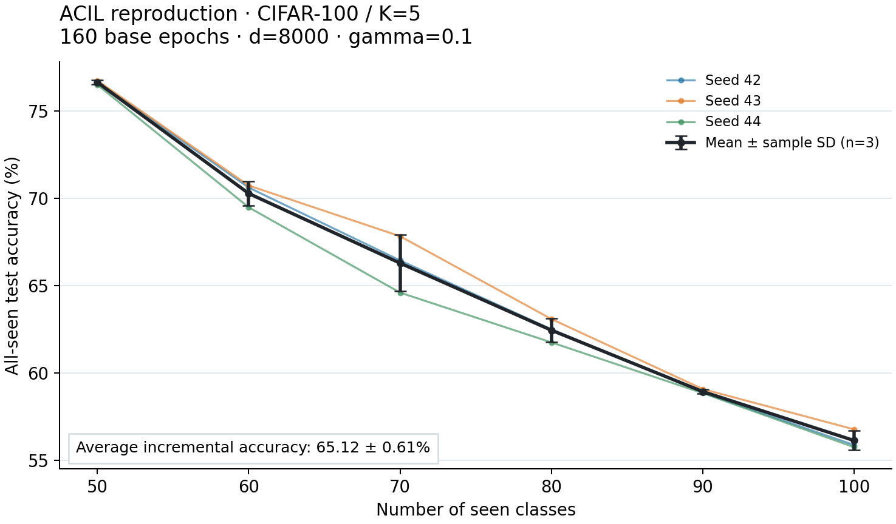
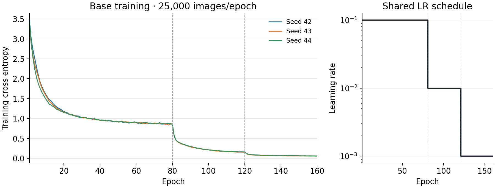

# R1 ACIL CIFAR-100/K5: đủ3 seeds — 06/11/2026

**Đã hoàn tất R1 với seeds42/43/44**, mỗi seed train base mới160 epochs, d8000/gamma0.1,50 base+5×10 lớp. Từng lượt có6 mốc đánh giá, checkpoint/state đã tải/kiểm và W&B Finished/công khai. Chưa tính R2/R3 hoặc sản phẩm thuyết trình/poster là đã hoàn thành.

## Kết quả chính

| Metric | Mean ± sample SD, n=3 |
|---|---:|
| Ā (%) | 65.1196 ± 0.6104 |
| A_final (%) | 56.1300 ± 0.5575 |
| F_base (pp) | 8.3067 ± 0.6201 |

Nguồn tính: [summary JSON](r1_cifar100_k5_summary.json), [manifest tổng hợp](R1-C100-K5-3SEEDS-provenance.json). Mỗi seed tính Ā trên A0..A5 trước; sau đó lấy mean và sample SD với **ddof=1** qua3 seed. Một phase không phải một seed. SD trong bảng dùng cùng thang đo với metric, không phải khoảng tin cậy.

## Các lượt được đưa vào tổng hợp

| Seed | Ā (%) | Final (%) | F_base (pp) | Numeric (phút) | Kaggle / W&B |
|---|---:|---:|---:|---:|---|
| 42 | 65.164550 | 55.87 | 8.32 | 53.78 | [Version1](https://www.kaggle.com/code/hsangg206/06-benchmark-seed42/output?scriptVersionId=365844618) / [zt1014ei](https://wandb.ai/hsangg-2006/acil-reproduction/runs/zt1014ei) |
| 43 | 65.706197 | 56.77 | 8.92 | 52.25 | [Version1](https://www.kaggle.com/code/hsangg206/07-benchmark-seed43/output?scriptVersionId=366266785) / [v51m2dan](https://wandb.ai/hsangg-2006/acil-reproduction/runs/v51m2dan) |
| 44 | 64.487963 | 55.75 | 7.68 | 54.13 | [Version1](https://www.kaggle.com/code/hsangg206/08-benchmark-seed44/output?scriptVersionId=366266800) / [vqcs1ql4](https://wandb.ai/hsangg-2006/acil-reproduction/runs/vqcs1ql4) |

Không loại một seed vì score thấp. Source core/bundle và recipe giữ nguyên; seed43/44 chỉ đổi seed, tag và thư mục output. Chúng chạy song song trên hai phiên Kaggle riêng, mỗi phiên timeout7200s. Mỗi seed có class order, backbone, normalization base-only và FE riêng; checkpoint seed42 không được dùng thay cho hai backbone mới. SD vì vậy phản ánh cả class order và khởi tạo/huấn luyện/FE theo [protocol](../docs/protocol_chot.md), không chỉ nhiễu của CNN.

## Đường cong theo phase

| Phase | Lớp seen | Ảnh test | A all-seen: mean ± SD (%) | B base: mean ± SD (%) |
|---|---:|---:|---:|---:|
| 0 | 50 | 5,000 | 76.6400 ± 0.1249 | 76.6400 ± 0.1249 |
| 1 | 60 | 6,000 | 70.2778 ± 0.6905 | 73.5067 ± 0.1553 |
| 2 | 70 | 7,000 | 66.2905 ± 1.6197 | 72.0200 ± 0.1587 |
| 3 | 80 | 8,000 | 62.4458 ± 0.6704 | 70.5867 ± 0.3690 |
| 4 | 90 | 9,000 | 58.9333 ± 0.1262 | 69.2200 ± 0.4359 |
| 5 | 100 | 10,000 | 56.1300 ± 0.5575 | 68.3333 ± 0.5005 |

Mọi dự đoán argmax trên tất cả lớp đã thấy. A_final là accuracy cuối trên100 lớp, khác Ā trung bình6 mốc. F_base dùng B0−B5 theo [metrics v1.0](../docs/metrics.md); signed delta được lưu riêng trong summary.

## Đối chiếu paper và kiểm chứng

Tham chiếu Table1 CIFAR100/K5 đã chốt: Ā66,30%, F9,00. Mean R1 lệch Ā **-1.180430pp** (-1.7804% tương đối), F_base lệch **-0.6933pp**. Không có paper_final tương ứng trong bảng, nên để null. Các khác biệt permutation/normalization/FE/recipe đã ghi trong protocol vẫn phải được trình bày; không quy chênh lệch cho một nguyên nhân chưa kiểm bằng ablation.

Mỗi lượt GPU chạy54 tests:53 passed/1 historical-snapshot skip, CUDA resume test passed. Đã kiểm độc lập160 hàng history, LR80/120,25.000 ảnh/epoch,6 shape/test counts; cùng attempt ID giữa results/progress/readiness. Checkpoint v2 hoàn tất160/160, context/source/model fingerprint/optimizer/scheduler/RNG/loader đã đối chiếu trên CPU. R8000×8000/W8000×100/FE64×8000 hữu hạn float64, R đối xứng trong tolerance và class order/FE hash đúng. Không train lại trong bước nghiệm thu, không chạy joint oracle d8000 hoặc cache lịch sử train features. Resume unit test CUDA dùng TinyCNN, không gọi đây là phép bitwise ResNet32 restart GPU.

JSON numeric/progress và readiness gốc được giữ nguyên; bản tổng hợp chỉ thêm tracking metadata sau sync. W&B được kiểm SDK và API công khai với source/config/summary,6 history rows. Field null bị W&B bỏ không được đổi thành SD=0. [Manifest seed42](R1-SEED42-KAGGLE-01-provenance.json), [seed43](R1-SEED43-KAGGLE-01-provenance.json), [seed44](R1-SEED44-KAGGLE-01-provenance.json) giữ version/source/checksum/checkpoint riêng. Trọng số/NPZ nằm tại Output Kaggle và reports/local, không đưa lên GitHub.

## Tái tạo bảng và hình

Chạy `python scripts/aggregate_r1.py` từ repository sau khi có đủ các JSON/manifests. Dùng môi trường vẽ riêng với `requirements-plots.txt`, rồi `python scripts/plot_r1.py`. Aggregate kiểm đủ3 seed, provenance/hash và độc lập checkpoint/FE; kiểm chéo mean/SD NumPy bằng statistics của Python. Thiếu seed hoặc input lỗi phải ghi failed, không giữ success cũ.

**Tiếp theo: R2 và R3.** Reuse checkpoint160 đúng cùng seed cho R2 no-FE/các gamma; R3 dùng checkpoint seed42/d1024 và các batch đã chốt. Không cần train lại R1 chỉ để lấy log. Bản [nghiệm thu seed42 ban đầu](R1_SEED42_KAGGLE_20261106.md) là snapshot n=1 trước khi bổ sung43/44; kết quả R1 cuối cùng nằm trong báo cáo này.
