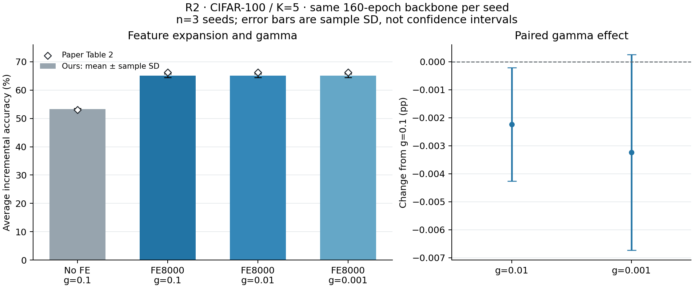

# R2 ablation ACIL CIFAR-100/K5 — 07/11/2026

**Đã hoàn tất 9 lượt analytic mới trên 3 seeds 42/43/44**, tái dùng 3 baseline R1 FE8000/gamma 0.1. Có4 hàng/3 seeds, mean±sample_SD(ddof=1), không train thêm backbone. Đây là 4/5 hàng Table 2 theo [protocol](../docs/protocol_chot.md); gamma 0 nằm ngoài scope đã chốt, không thay bằng epsilon/pinv.

## Kết quả chính: average incremental accuracy

| Cấu hình | Ours: mean ± SD (%) | Paper (%) | Ours−paper (pp) | Paired Δ so với R1: mean ± SD (pp) |
|---|---:|---:|---:|---:|
| No-FE / γ0.1 | 53.2547 ± 0.2768 | 52.99 | +0.2647 | -11.8649 ± 0.3710 |
| FE8000 / γ0.1 (R1) | 65.1196 ± 0.6104 | 66.30 | -1.1804 | 0.0000 ± 0.0000 |
| FE8000 / γ0.01 | 65.1173 ± 0.6089 | 66.25 | -1.1327 | -0.0022 ± 0.0020 |
| FE8000 / γ0.001 | 65.1163 ± 0.6088 | 66.23 | -1.1137 | -0.0032 ± 0.0035 |

Nguồn: [summary JSON](r2_cifar100_k5_summary.json), [manifest tổng hợp](R2-C100-K5-provenance.json). Ā tính trên 6 mốc trong từng seed trước khi tổng hợp3 seeds. Paired Δ dùng đúng baseline của cùng seed, không lấy một mean baseline trừ từng seed. SD là độ lệch chuẩn mẫu, không phải khoảng tin cậy.

## Giá trị theo seed

| Cấu hình | Seed42 Ā (%) | Seed43 Ā (%) | Seed44 Ā (%) |
|---|---:|---:|---:|
| No-FE / γ0.1 | 53.396958 | 53.431336 | 52.935688 |
| FE8000 / γ0.1 (R1) | 65.164550 | 65.706197 | 64.487963 |
| FE8000 / γ0.01 | 65.160615 | 65.703419 | 64.487963 |
| FE8000 / γ0.001 | 65.157606 | 65.703419 | 64.487963 |

| Cấu hình | Final accuracy: mean ± SD (%) | F_base: mean ± SD (pp) |
|---|---:|---:|
| No-FE / γ0.1 | 38.3267 ± 0.3743 | 1.5600 ± 0.6353 |
| FE8000 / γ0.1 (R1) | 56.1300 ± 0.5575 | 8.3067 ± 0.6201 |
| FE8000 / γ0.01 | 56.1300 ± 0.5575 | 8.3067 ± 0.6201 |
| FE8000 / γ0.001 | 56.1300 ± 0.5575 | 8.3067 ± 0.6201 |

Số tham chiếu lấy từ [ACIL, mục4.4/Table2, trang9](https://proceedings.neurips.cc/paper_files/paper/2022/file/4b74a42fc81fc7ee252f6bcb6e26c8be-Paper-Conference.pdf). Table 2 chỉ cung cấp Ā cho các hàng đối chiếu này; paper_final/paper_F giữ null. F_base và signed delta tuân [metrics](../docs/metrics.md), không suy ra bằng0 từ tương đương joint.

## Diễn giải trong phạm vi đã thử

Chênh lệch mean Ā giữa FE8000/gamma 0.1 và no-FE/gamma 0.1 là **+11.8649 pp**. Ba hàng có FE trong miền gamma 0.1/0.01/0.001 có dải mean Ā **0.0032 pp**. Đọc thêm paired Δ và SD trong bảng; không chọn gamma tốt nhất theo test hoặc suy kết luận cho mọi gamma/dataset từ3 seeds này. Khác biệt với paper vẫn cần gắn với các quyết định permutation/base-only normalization/FE N(0,1)/recipe đã ghi trong protocol, không quy cho một nguyên nhân chưa được kiểm riêng.

Phép bỏ FE thay cả phép chiếu và ReLU bằng F64 trực tiếp; kết quả đo tác động của toàn bộ thành phần FE, chưa tách riêng đóng góp của chiều rộng và tính phi tuyến. F_base phải đọc cùng Ā/final: chênh lệch accuracy trên lớp base nhỏ hơn không tự chứng minh mô hình tốt hơn nếu accuracy tổng thể thấp hơn. Các lượt này không kiểm gamma 0 nên không dùng chúng để kết luận thực nghiệm về việc bỏ hoàn toàn regularization.

## Vì sao thực hiện như vậy?

- Reuse checkpoint 160 của đúng seed để giữ representation cố định và tránh train lại cho mỗi gamma. Core training bị chặn bằng mock gây lỗi nếu được gọi; các báo cáo đều reused=true và training_executed_this_run=false. 160 hàng training_history trong JSON là lịch sử checkpoint R1, không phải training mới của R2.
- No-FE dùng F64 trực tiếp, không thêm random projection/ReLU để giả lập bỏ FE. Hàng có FE giữ cùng W_fe64×8000 theo seed+1000; hash FE phải khớp R1 ở cả hai gamma mới.
- Giữ class order, normalization chỉ từ base train, HF revision, dtype64, thứ tự ảnh, batch 128, argmax toàn bộ seen classes. Chỉ đổi thành phần FE/gamma theo case đã đăng ký.
- Mỗi case chạy đủ 50→60→70→80→90→100 lớp với 5.000→10.000 ảnh test, không chỉ chấm lớp mới. Không cache lịch sử train features hoặc chạy oracle joint d8000 trong benchmark.
- Mỗi case có attempt/output/W&B riêng. Suite lỗi phải ghi failed và không được đưa vào aggregate đầy đủ. Seed44 được gửi sau khi trống slot vì Kaggle giới hạn 2 phiên batch GPU; không loại seed theo score.

## Kiểm chứng và truy nguyên

Mỗi suite chạy core GPU tests 54,53 passed / 1 snapshot skip, CUDA resume test passed. Source bundle/core giống R1; checkpoint hash/model fingerprint/context/class order/normalization và FE được đối chiếu từng case. Các NPZ mới được load/kiểm **trên Kaggle CPU sau numeric timer**: R/W float64 hữu hạn, R đối xứng trong rtol1e-6/atol1e-8, shape đúng, FE/context đúng và file SHA. Ma trận lớn giữ tại Output đúng version; không tuyên bố đã tải/kiểm NPZ mới tại máy local. Local kiểm JSON/proof/source/metrics/hashes và checkpoint R1 đã tải trước đó.

JSON suite numeric giữ nguyên bytes lúc capture, gồm trạng thái offline/not_logged. Các ready/manifest nhỏ bổ sung actual tracking sau khi sync xong, kiểm SDK và API công khai không Authorization/Cookie. Native key không nằm trong code/notebook/repo. Mỗi hàng mới có 6 history rows khớp kết quả; baseline R1 giữ run cũ và có origin=reused_R1.

| Seed | Cấu hình | Nguồn | Kaggle | W&B Finished/public |
|---|---|---|---|---|
| 42 | No-FE / γ0.1 | new_R2 | [Kaggle](https://www.kaggle.com/code/hsangg206/09-r2-ablation-seed42/output?scriptVersionId=366341660) | [xdrm0d27](https://wandb.ai/hsangg-2006/acil-reproduction/runs/xdrm0d27) |
| 43 | No-FE / γ0.1 | new_R2 | [Kaggle](https://www.kaggle.com/code/hsangg206/10-r2-ablation-seed43/output?scriptVersionId=366341726) | [7wgme4so](https://wandb.ai/hsangg-2006/acil-reproduction/runs/7wgme4so) |
| 44 | No-FE / γ0.1 | new_R2 | [Kaggle](https://www.kaggle.com/code/hsangg206/11-r2-ablation-seed44/output?scriptVersionId=366348428) | [81aci8h1](https://wandb.ai/hsangg-2006/acil-reproduction/runs/81aci8h1) |
| 42 | FE8000 / γ0.1 (R1) | reused_R1 | [Kaggle](https://www.kaggle.com/code/hsangg206/06-benchmark-seed42/output?scriptVersionId=365844618) | [zt1014ei](https://wandb.ai/hsangg-2006/acil-reproduction/runs/zt1014ei) |
| 43 | FE8000 / γ0.1 (R1) | reused_R1 | [Kaggle](https://www.kaggle.com/code/hsangg206/07-benchmark-seed43/output?scriptVersionId=366266785) | [v51m2dan](https://wandb.ai/hsangg-2006/acil-reproduction/runs/v51m2dan) |
| 44 | FE8000 / γ0.1 (R1) | reused_R1 | [Kaggle](https://www.kaggle.com/code/hsangg206/08-benchmark-seed44/output?scriptVersionId=366266800) | [vqcs1ql4](https://wandb.ai/hsangg-2006/acil-reproduction/runs/vqcs1ql4) |
| 42 | FE8000 / γ0.01 | new_R2 | [Kaggle](https://www.kaggle.com/code/hsangg206/09-r2-ablation-seed42/output?scriptVersionId=366341660) | [qcgdklxh](https://wandb.ai/hsangg-2006/acil-reproduction/runs/qcgdklxh) |
| 43 | FE8000 / γ0.01 | new_R2 | [Kaggle](https://www.kaggle.com/code/hsangg206/10-r2-ablation-seed43/output?scriptVersionId=366341726) | [xfleip26](https://wandb.ai/hsangg-2006/acil-reproduction/runs/xfleip26) |
| 44 | FE8000 / γ0.01 | new_R2 | [Kaggle](https://www.kaggle.com/code/hsangg206/11-r2-ablation-seed44/output?scriptVersionId=366348428) | [dub202jk](https://wandb.ai/hsangg-2006/acil-reproduction/runs/dub202jk) |
| 42 | FE8000 / γ0.001 | new_R2 | [Kaggle](https://www.kaggle.com/code/hsangg206/09-r2-ablation-seed42/output?scriptVersionId=366341660) | [3yp99ewh](https://wandb.ai/hsangg-2006/acil-reproduction/runs/3yp99ewh) |
| 43 | FE8000 / γ0.001 | new_R2 | [Kaggle](https://www.kaggle.com/code/hsangg206/10-r2-ablation-seed43/output?scriptVersionId=366341726) | [aler6nj2](https://wandb.ai/hsangg-2006/acil-reproduction/runs/aler6nj2) |
| 44 | FE8000 / γ0.001 | new_R2 | [Kaggle](https://www.kaggle.com/code/hsangg206/11-r2-ablation-seed44/output?scriptVersionId=366348428) | [l9c50ezb](https://wandb.ai/hsangg-2006/acil-reproduction/runs/l9c50ezb) |

Manifest từng seed: [42](R2-SEED42-KAGGLE-01-provenance.json), [43](R2-SEED43-KAGGLE-01-provenance.json), [44](R2-SEED44-KAGGLE-01-provenance.json). Tái tạo bằng `python scripts/aggregate_r2.py` rồi `python scripts/plot_r2.py` trong môi trường vẽ riêng với requirements-plots.txt. Mean/SD được kiểm chéo NumPy và statistics; thiếu seed/case ghi failed, không giữ success cũ.

**R2 đã xong trong core scope. Tiếp theo R3**, dùng checkpoint seed 42/d1024 và batch 32/128/512 theo protocol; chưa chạy R3 hoặc hoàn thiện PPTX trong lượt R2 này.
