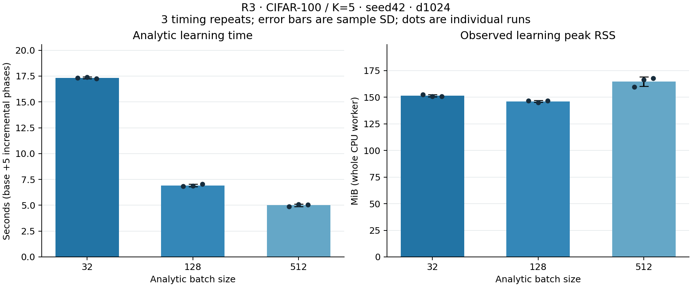

# R3 — batch size trong ACIL, CIFAR-100/K5 — 07/11/2026

**Hoàn tất 9 phép đo: batch 32/128/512 × 3 timing repeats trên cùng seed 42.** Cả 54 so sánh theo phase đạt joint oracle theo ngưỡng đã chốt, không có argmax khác nhau. Không train thêm backbone; dùng checkpoint R1 epoch cuối 160, d1024/gamma0.1. Đây là phân tích riêng theo [kế hoạch chốt trước khi chạy](../docs/R3_KE_HOACH_DO.md), không phải benchmark d8000 hoặc 3 seed độc lập.

## Thời gian và bộ nhớ đo được

| Batch | Base (s) | Tổng 5 phase incremental (s) | Tổng analytic (s) | Thời gian / batch128 | Peak RSS (MiB) | RSS tăng từ đầu worker (MiB) |
|---:|---:|---:|---:|---:|---:|---:|
| 32 | 10.7104 ± 0.0672 | 6.6230 ± 0.0968 | **17.3334 ± 0.0784** | 2.503× | 151.3503 ± 0.9749 | 61.8073 ± 0.2019 |
| 128 | 3.1937 ± 0.0679 | 3.7310 ± 0.0420 | **6.9247 ± 0.1098** | 1.000× | 146.1029 ± 0.9158 | 56.0742 ± 0.1255 |
| 512 | 1.2843 ± 0.0664 | 3.7132 ± 0.0540 | **4.9975 ± 0.1123** | 0.722× | 164.5521 ± 4.3843 | 75.0026 ± 3.7651 |

Các giá trị là **mean ± sample SD**, n=3 lần đo, ddof=1. Mỗi lần chạy trong tiến trình CPU mới, tuần tự, BLAS 4 threads. Môi trường worker: Python 3.13.16, NumPy 2.1.3, cpu_count=4; thông tin thư viện/kiến trúc BLAS lưu trong raw JSON. T4 dùng trích đặc trưng ngoài vùng đo; không gắn thời gian trên cho GPU analytic.

Tổng analytic là tổng 6 cửa sổ học, gồm FE transform + base Gram/solve + RLS incremental. **Không tính** tải/checksum cache, checkpoint/CNN, warm-up, evaluation, oracle, so sánh, ghi state hoặc W&B. Vì vậy số trên không phải tổng thời gian chạy notebook.

Peak RSS được lấy mẫu 5ms trong các cửa sổ học, có đo ở biên; đây là peak quan sát được, có thể bỏ lỡ đỉnh rất ngắn. RSS gồm runtime, input fixture, state và bộ nhớ allocator giữ lại; không đồng nhất với RAM riêng của learner. R/W/FE cuối luôn có **9.28125 MiB = 9.732.096 bytes**, cùng shape giữa mọi batch. Cả peak tuyệt đối và mức tăng baseline đều được báo để đọc cùng nhau.

Trong phiên này, batch **512** có mean tổng thời gian nhỏ nhất, nhanh hơn batch128 khoảng **1.386 lần**. Đây là kết quả về tốc độ trên máy/phần mềm đã đo. Batch lớn giảm số lần gọi cập nhật/kiểm tra dữ liệu nhưng hệ tuyến tính ở không gian batch lớn hơn và có workspace khác; các yếu tố này là cách giải thích phù hợp với code, chưa phải một phép tách riêng nguyên nhân bằng profiler. Không suy batch lớn luôn nhanh nhất hoặc dùng accuracy test để chọn cấu hình mới.

Ở bước batch128→512, thời gian base giảm **1.9094s**, còn tổng incremental chỉ giảm **0.0177s**, nhỏ so với độ dao động giữa các lần đo incremental. Phần tăng tốc tổng ở cặp này chủ yếu nằm trong bước base; dữ liệu không cho thấy lợi ích RLS incremental rõ như chênh lệch tổng. Peak RSS của512 cao hơn128 trung bình **18.4492MiB**, dù bytes state không đổi. Trong phiên đo,512 ưu tiên tốc độ tổng, còn128 có peak RSS thấp hơn; cần đọc cả hai chỉ số.

## Nghiệm có thay đổi khi đổi batch không?

| Batch | Số so sánh phase | Max relative W error | Max relative R error | Max abs score error | Tổng argmax khác joint |
|---:|---:|---:|---:|---:|---:|
| 32 | 18 | 1.159e-11 | 3.823e-15 | 2.475e-12 | 0 |
| 128 | 18 | 9.679e-12 | 3.399e-15 | 2.302e-12 | 0 |
| 512 | 18 | 9.782e-12 | 3.272e-15 | 2.178e-12 | 0 |

Mỗi batch có 3 repeats × 6 phase. R/W/score đều đạt `allclose(rtol=1e-6, atol=1e-8)`, ngoài ra lưu relative Frobenius errors, max absolute errors và kiểm shape/float64/hữu hạn. Ba repeats cùng batch bitwise equal sau giải nén R/W: **True**. Các batch có thể khác bitwise do thứ tự cộng/giải trong số thực hữu hạn; kết luận được kiểm ở đây là khớp nghiệm trong ngưỡng và cùng dự đoán trên test.

Joint oracle chạy ở tiến trình riêng **sau khi toàn bộ 9 worker đo xong**. Tại mỗi mốc, ghép toàn bộ H/nhãn đã thấy, giải `joint_ridge` độc lập cho W và hệ Gram đầy đủ cho R. Oracle có giữ lịch sử để kiểm chứng; learner chỉ nhận batch hiện tại, giữ R/W/FE và không lưu mẫu train cũ.

## Accuracy của cấu hình phân tích d1024

| Phase | Lớp đã thấy | Accuracy toàn bộ lớp (%) | Accuracy base (%) |
|---:|---:|---:|---:|
| 0 | 50 | 76.820000 | 76.820000 |
| 1 | 60 | 69.550000 | 74.240000 |
| 2 | 70 | 64.871429 | 73.300000 |
| 3 | 80 | 59.975000 | 72.300000 |
| 4 | 90 | 55.677778 | 71.760000 |
| 5 | 100 | 51.730000 | 70.860000 |

Cả 9 case và oracle có cùng các accuracy trên. Ā = **63.104034%**, final = **51.7300%**, F_base = **5.9600 pp** theo [metrics](../docs/metrics.md). Đây là **một seed**, không báo SD giữa seed từ ba lần đo lặp. Không dùng Ā d1024 này thay bảng R1 d8000.

## Vì sao tổ chức thí nghiệm như vậy?

- Trích F64 của đủ 50.000 train/10.000 test một lần từ cùng backbone đã freeze/eval; cache và FE có SHA cố định. R3 FE là N(0,1), shape64×1024, seed1042; không dùng nhầm hash FE8000 của R1. Mapping, normalization base-train-only và HF revision giữ đúng checkpoint seed42.
- Giữ nguyên thứ tự index gốc trong mỗi phase, chỉ đổi lát cắt batch; đổi cả base accumulation và RLS, báo riêng hai phần. Base có 782/196/49 batch; mỗi phase incremental có 157/40/10 batch ứng với batch32/128/512. Gamma chỉ cộng một lần khi khởi tạo.
- Thứ tự xoay 32→128→512;128→512→32;512→32→128 giảm việc một batch luôn chạy đầu/cuối. Giữ đủ 9 lượt, không chọn lần nhanh nhất. Fresh process hạn chế allocator/high-water RSS của case trước ảnh hưởng case sau.
- Cache toàn bộ F64 là **fixture của nghiên cứu và oracle**, không phải replay storage do learner tạo. Không dùng việc cache này để tuyên bố hạ tầng nghiên cứu không giữ dữ liệu lịch sử. Phép đo analytic có FE và kiểm tra đầu vào của implementation hiện tại; dữ liệu/cache/CNN không thuộc timing.

## Bằng chứng và kiểm tra

Kaggle [version1 /366444048](https://www.kaggle.com/code/hsangg206/12-r3-batch-analysis/output?scriptVersionId=366444048); source notebook12 tại commit `eaf256660fa896ca16ebe3a908868244f07f07d6`. [Raw suite](r3_cifar100_k5_results.json), [fixture manifest](r3_cifar100_k5_fixture.json), [joint report](r3_cifar100_k5_joint.json), [actual tracking](r3_cifar100_k5_ready.json), [execution provenance](R3-KAGGLE-01-provenance.json), [summary](r3_cifar100_k5_summary.json), [analysis provenance](R3-C100-K5-provenance.json).

Kaggle chạy 54 core tests (53 passed,1 historical-snapshot skip; CUDA resume test passed) và 5 driver tests R3 đều đạt. Các test driver kiểm joint/remainders, oracle/evaluation/IO ở ngoài timer, sửa trạng thái lỗi cũ và phát hiện fixture/state bị đổi. Kiểm tại local tải đủ fixture và **60 NPZ** (54 state +6 joint), đối chiếu hashes, source, checkpoint/context; giải lại joint từ full fixed features, so cả 54 state/score/prediction. Không dùng thời gian kiểm local làm số liệu hiệu năng.

| Batch | Timing repeat | Analytic (s) | Peak RSS (MiB) | W&B Finished/public |
|---:|---:|---:|---:|---|
| 32 | 1 | 17.340477 | 152.4727 | [luf7uv40](https://wandb.ai/hsangg-2006/acil-reproduction/runs/luf7uv40) |
| 32 | 2 | 17.408012 | 150.8633 | [yqxph1bb](https://wandb.ai/hsangg-2006/acil-reproduction/runs/yqxph1bb) |
| 32 | 3 | 17.251722 | 150.7148 | [59vlfxzv](https://wandb.ai/hsangg-2006/acil-reproduction/runs/59vlfxzv) |
| 128 | 1 | 6.838241 | 146.6797 | [o54hbdfp](https://wandb.ai/hsangg-2006/acil-reproduction/runs/o54hbdfp) |
| 128 | 2 | 6.887604 | 145.0469 | [4481bnn1](https://wandb.ai/hsangg-2006/acil-reproduction/runs/4481bnn1) |
| 128 | 3 | 7.048216 | 146.5820 | [3gv0moj7](https://wandb.ai/hsangg-2006/acil-reproduction/runs/3gv0moj7) |
| 512 | 1 | 4.868797 | 159.5742 | [lnk0grbq](https://wandb.ai/hsangg-2006/acil-reproduction/runs/lnk0grbq) |
| 512 | 2 | 5.075246 | 166.2422 | [5ehmjvh3](https://wandb.ai/hsangg-2006/acil-reproduction/runs/5ehmjvh3) |
| 512 | 3 | 5.048493 | 167.8398 | [xesh2kjl](https://wandb.ai/hsangg-2006/acil-reproduction/runs/xesh2kjl) |

Mỗi W&B có 6 history rows đúng JSON và source/config/fixture/checkpoint khớp. Run ID/URL lấy từ SDK sau sync; kiểm lại API công khai không Authorization/Cookie. Raw JSON giữ nguyên bytes và trạng thái capture offline, metadata actual tracking nằm riêng sau khi xác minh. Credential và ma trận lớn không commit Git.

Khi sync đã phát hiện va tên history/summary: `learning_seconds` và `max_abs_score_error` trên summary ban đầu nhận giá trị phase cuối, trong khi report định nghĩa tổng thời gian và max trên6 phase. [Helper đối chiếu summary](../scripts/reconcile_r3_tracking.py) chạy sau khi run Finished, tính lại từ raw JSON đã kiểm, cập nhật đúng summary và thêm alias riêng `r3/learning_seconds_total`, `r3/max_abs_score_error_all_phases` cùng hash raw suite. History/JSON numeric và phép đo giữ nguyên; trước/sau reconciliation được lưu trong tracking provenance. Có4 test hồi quy local riêng cho lỗi này và round-trip JSON;5 driver tests chạy trên Kaggle là bộ trước khi thêm helper tracking. Khi tái chạy, sync payload trước rồi gọi helper với `--suite` trỏ vào raw suite của chính lượt đó. So số thực qua API cho phép sai khác round-trip tương đối1e-14, atol0; int/bool/hash phải đúng tuyệt đối. Ngưỡng này chỉ cho transport JSON, không thay ngưỡng R/W/score của thực nghiệm.

Tái tạo bảng bằng `python scripts/aggregate_r3.py`; vẽ bằng môi trường riêng có `requirements-plots.txt` rồi `python scripts/plot_r3.py`. Thiếu input/case hợp lệ phải ghi failed, không giữ complete cũ.

**R1, R2 và R3 trong kế hoạch thực nghiệm đã hoàn tất.** Công việc còn lại của sản phẩm giữa kỳ gồm đối chiếu code tác giả theo protocol, hoàn thiện nội dung phân tích/nguồn và ghép PPTX; poster là sản phẩm tiếp theo. Chưa coi toàn bộ yêu cầu môn đã xong chỉ vì ba bộ thí nghiệm này đã có kết quả.
